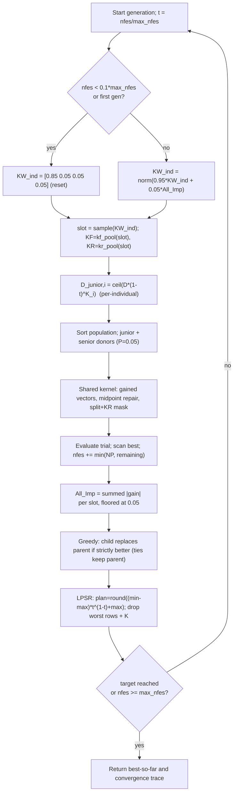

# AGSK — Adaptive Gaining-Sharing Knowledge

> **What this is:** the first self-tuning member of the family — it keeps GSK's
> junior/senior update but learns *which* `KF`/`KR` settings work and shrinks the
> population as the budget burns. **For:** readers who already know [GSK](gsk.md)
> and want to see what "adaptive" buys. **Prerequisites:** the gaining-sharing
> core (junior/senior gained vectors, midpoint repair, per-coordinate KR mask)
> from [GSK](gsk.md). **After reading** you can trace one generation by hand,
> including a selection-probability update and a population shrink, and map every
> line of `src/optimizers/agsk/agsk_optimize.m` to its math.

## Intuition

Baseline [GSK](gsk.md) uses a single fixed `(KF, KR)` for the whole run. AGSK
(**A**daptive **GSK**) reuses GSK's two-phase trial construction unchanged — the
same junior and senior gained vectors, the same midpoint bound repair, and the
same split-then-KR per-coordinate mask. See [GSK](gsk.md) for that shared core.

What AGSK changes is *how the knobs are set and how big the population is*:

- **Four parameter settings (pools).** Instead of one fixed `(KF, KR)` pair, AGSK
  keeps a small discrete menu of four `(KF, KR)` "slots". Every generation, each
  individual draws a slot from a probability vector `KW_ind`. After evaluation,
  AGSK measures how much fitness each slot bought and nudges `KW_ind` toward the
  settings that paid off. Good settings are sampled more often; bad ones are
  floored, not killed, so they can recover.
- **Per-individual junior schedule via `K`.** Each individual carries its own
  schedule exponent `K` (drawn once at start), and the junior count is driven by
  the **evaluation** ratio (not the generation ratio as in GSK), so the
  junior->senior handover happens at a different pace for each row.
- **Nonlinear population reduction (LPSR).** The population starts at `np_init`
  and shrinks toward `min_pop_size = 12` as `nfes` grows, by removing the worst
  individuals. Early breadth gives way to late-stage budget concentrated on
  fewer, better candidates.

## Mathematical formulation

The junior/senior gained vectors, midpoint repair, and the split/KR mask are
identical to [GSK](gsk.md) — only the *inputs* differ (`KF`, `KR`, and the junior
probability are now per-individual, and `P = 0.05`). This section documents only
the four AGSK-specific mechanisms.

**Parameter pools** (`agsk_optimize.m:31-32`). Four slots, indexed `1..4`. Slot
`s` supplies one `(KF, KR)` pair:

```text
kf_pool = [0.1 1.0 0.5 1.0]      % knowledge factor per slot
kr_pool = [0.2 0.1 0.9 0.9]      % knowledge ratio per slot
slot s ->  KF = kf_pool(s),  KR = kr_pool(s)
```

**Slot selection** (`agsk_optimize.m:121-127`). One `rand(NP,1)` draw per
generation; each individual's slot index `1..4` is relabeled by cumulative
`KW_ind` thresholds:

```text
0          < u <= KW(1)            -> slot 1
KW(1)      < u <= KW(1:2)          -> slot 2
KW(1:2)    < u <= KW(1:3)          -> slot 3
KW(1:3)    < u <= KW(1:4) (= 1)    -> slot 4
KF = kf_pool(slot)';  KR = kr_pool(slot)'
```

**Adaptive setting probabilities `KW_ind`** (`agsk_optimize.m:112-117`). A
two-phase scheme decides how often each slot is chosen. During the exploration
phase (`nfes < 0.1*max_nfes`) `KW_ind` is **reset every generation** to the prior
`[0.85 0.05 0.05 0.05]`; after that it is an exponential moving average toward the
latest improvement credit, then renormalized:

```text
exploration (nfes < 0.1*max_nfes):  KW_ind = [0.85 0.05 0.05 0.05]   % reset each gen
adaptive    (otherwise):            KW_ind = 0.95*KW_ind + 0.05*All_Imp
                                    KW_ind = KW_ind ./ sum(KW_ind)
```

**Improvement credit `All_Imp`** (`agsk_optimize.m:212-231`). The per-slot metric
is the *summed absolute fitness gain* of the children that strictly improved,
bucketed by the slot that produced them. Let `dif = |parent - child|` and
`child_better = parent > child`. For each slot `s in 1..4`:

```text
All_Imp(s) = sum( dif(i) for i where child_better(i) and slot(i) == s )
total      = sum(All_Imp)
if total == 0:           All_Imp = [0.25 0.25 0.25 0.25]      % no gains this gen
else:
    All_Imp = All_Imp ./ total                               % normalize to 1
    sort ascending; floor every slot but the largest at 0.05
    largest slot = 1 - sum(the other three)                  % keep sum = 1
```

The floor-the-losers / cap-the-winner step (`agsk_optimize.m:224-228`) guarantees
every slot keeps at least `0.05` weight (so no setting is permanently starved)
while the sum stays exactly `1`. The credit uses the **full** generation —
including any children beyond the budget — exactly as the reference.

**Per-individual junior schedule** (`agsk_optimize.m:132`). Unlike GSK
(generation ratio), AGSK drives the junior-coordinate count by the **evaluation**
ratio, with a per-individual exponent `K`:

```text
D_Gained_Shared_Junior = ceil( D * (1 - nfes/max_nfes) ^ K )
junior_prob            = D_Gained_Shared_Junior / D
```

`K` is sampled **once at initialization** and only trimmed (never redrawn) during
reduction (`agsk_optimize.m:80-83`): for each row, `Kind = rand`; where
`Kind < 0.5`, `K = rand` in (0,1); else `K = ceil(20*rand)` in {1..20}. A small
`K` keeps an individual junior longer; a large `K` flips it to senior almost
immediately.

**Nonlinear population reduction (LPSR)** (`agsk_optimize.m:239-256`). With
`max_pop_size = np_init`, the planned size at budget ratio `t = nfes/max_nfes`
follows:

```text
plan_pop_size = round( (min_pop_size - max_pop_size) * t^(1 - t) + max_pop_size )
```

Note the exponent is `1 - t` (not `1`), so the curve is not strictly linear in
`t`; it is steepest near the middle of the run. When `pop_size > plan_pop_size`,
the worst individuals are removed:

```text
reduction = pop_size - plan_pop_size
if pop_size - reduction < min_pop_size:   reduction = pop_size - min_pop_size
survivors = keep the (pop_size - reduction) best by fitness
trim popold, pop, fitness, and the per-row K vector to survivors (original row order)
```

Index selection uses the shared `gsk_reduction_survivors` helper, which is
provably identical to the reference's one-at-a-time worst-removal loop. All
per-individual arrays the reference trims (`popold`, `pop`, `fitness`, `K`) are
trimmed here, in original row order.

**Selection** is the same strict-greedy replacement as GSK
(`agsk_optimize.m:234-236`): `fitness = min(parent, child)` element-wise, and rows
where the child won copy the child into `popold`; ties keep the parent.

## Pseudocode

```text
pop_size = np_init;  max_pop_size = np_init                  # agsk_optimize.m:44-45
initialize / accept fair-start population, evaluate, scan best
K = draw_initial_K(NP)            # mixed unif(0,1) / int 1..20  # agsk_optimize.m:80-83
KW_ind = [];  All_Imp = zeros(1,4)
for g = 1, 2, ... until nfes >= max_nfes:                    # agsk_optimize.m:102
    if isempty(KW_ind) or nfes < 0.1*max_nfes:  KW_ind = [0.85 0.05 0.05 0.05]   # reset
    else:                                       KW_ind = norm(0.95*KW_ind + 0.05*All_Imp)
    slot = select_slots(KW_ind)              # one rand(NP,1); agsk_optimize.m:121
    KF = kf_pool(slot);  KR = kr_pool(slot)              # per-individual
    D_junior = ceil(D * (1 - nfes/max_nfes)^K)           # per-individual; agsk_optimize.m:132
    order    = sort(fitness, 'ascend')                   # best -> worst
    [Rg1,Rg2,Rg3] = junior_donors(order)                 # shared with GSK
    [R1,R2,R3]    = senior_donors(order, P=0.05)         # agsk_optimize.m:138
    trial = junior/senior gained vectors + midpoint repair + split/KR mask   # shared kernel
    evaluate trial; nfes += min(NP, max_nfes - nfes); scan best
    All_Imp = improvement_credit(fitness, children_fitness, slot)   # agsk_optimize.m:212
    greedy replace: parent <- child where f(child) < f(parent)      # ties keep parent
    LPSR: plan=round((min-max)*t^(1-t)+max); drop worst rows + K     # agsk_optimize.m:239
    append (nfes, best_so_far) to the convergence trace
    if best - optimum < target_error: zero error and stop           # agsk_optimize.m:266-272
```

## Parameters

Defaults are reference/interface values, overridable through `options` (source:
`agsk_optimize.m:27-28` and `src/optimizers/agsk/README.md`).

| Option | Symbol | Default | Valid range | Meaning | Code |
|---|---|---|---|---|---|
| `seed` | — | required | integer | RNG seed; applied through `gsk_set_rng(options)`. | `agsk_optimize.m:18-21` |
| `rand_generator` | — | `twister` | `threefry`, `twister`, `seed`, `state` | RNG family. Direct calls default to `twister`; unified runner resolves to `threefry` when supported, else `twister`. | `agsk_optimize.m:21` |
| `np_init` | NP_init | `100` | integer >= `min_pop_size` | Initial population size; also `max_pop_size` for LPSR. | `agsk_optimize.m:27` |
| `min_pop_size` | NP_min | `12` | integer >= 1 | Floor for population reduction. | `agsk_optimize.m:28` |
| `kf_pool` | kf-pool | `[0.1 1.0 0.5 1.0]` | fixed constant | Per-slot knowledge factors (step scale). | `agsk_optimize.m:31` |
| `kr_pool` | kr-pool | `[0.2 0.1 0.9 0.9]` | fixed constant | Per-slot knowledge ratios (per-coord update prob.). | `agsk_optimize.m:32` |
| `KW_ind` (init) | kw0 | `[0.85 0.05 0.05 0.05]` | fixed constant | Exploration-phase reset prior over the four slots. | `agsk_optimize.m:113` |
| `P` | p | `0.05` | fixed constant | Senior partition fraction (best/worst block = round(NP*P)). | `agsk_optimize.m:35` |

The pools, the reset prior, and `P` are fixed in code, not runner-exposed options
(the reference local senior helper hard-codes `round(NP*0.05)` / `round(NP*0.95)`).
The EMA constants `0.95 / 0.05`, the exploration cutoff `0.1*max_nfes`, and the
`0.05` slot floor are hard-coded.

> **Reproducing the reference dimension rule.** The published CEC2020 driver sets
> `pop_size = 40*D` for `D > 5` (else 100). The port defaults to the interface
> value `100`, so to reproduce the paper's setup pass `options.np_init = 40*D`
> explicitly.

## Worked example

AGSK's main new decision is: which of the four `(KF, KR)` slots should be used
more often in the next generation? The junior/senior/mask arithmetic itself is
identical to the [GSK worked example](gsk.md#worked-example), so it is not
repeated here. Suppose six individuals produced the following generation:

| Individual | Slot | Parent fitness | Child fitness | Strict improvement |
|---:|---:|---:|---:|---:|
| 1 | 1 | 40 | 35 | 5 |
| 2 | 1 | 20 | 18 | 2 |
| 3 | 2 | 50 | 51 | 0 |
| 4 | 3 | 25 | 20 | 5 |
| 5 | 3 | 10 | 10 | 0 |
| 6 | 4 | 30 | 27 | 3 |

Raw slot credit (summed `|parent - child|` over strictly-improving rows) is:

```text
slot 1 = 7, slot 2 = 0, slot 3 = 5, slot 4 = 3
sum = 15
```

After normalization:

```text
All_Imp = [7/15, 0, 5/15, 3/15]
        = [0.4667, 0, 0.3333, 0.2000]
```

The reference floor makes every non-largest entry at least `0.05`; the largest
entry then takes the remainder so the vector sums to one:

```text
All_Imp = [0.4167, 0.0500, 0.3333, 0.2000]
```

If the old probability vector was

```text
KW_ind_old = [0.85, 0.05, 0.05, 0.05]
```

then the next adaptive probability vector is (`agsk_optimize.m:115-116`):

```text
KW_ind_new = 0.95*KW_ind_old + 0.05*All_Imp
           = [0.8283, 0.0500, 0.0642, 0.0575]
```

This update is intentionally conservative: slot 1 still dominates, but slots 3 and
4 gain probability because they recently generated improvements.

**LPSR target size.** Take `np_init = max_pop_size = 100`, `min_pop_size = 12`,
`max_nfes = 10000`. Halfway through the run, `nfes = 5000`, so `t = 0.5` and
`t^(1-t) = 0.5^0.5 = 0.70710678`:

```text
plan        = (12 - 100) * 0.70710678 = -88 * 0.70710678 = -62.225397
plan_pop    = round(-62.225397 + 100) = round(37.774603) = 38
```

If the population is still `100`, `reduction = 100 - 38 = 62`; since
`100 - 62 = 38 >= 12`, the floor clause does not fire. The worst `62` rows (and
their `K` entries) are dropped, keeping the best `38` in original row order.

## Update cycle



## Bounds, budget, and determinism

- **Shared bound repair.** AGSK uses GSK's midpoint repair verbatim: a violating
  coordinate is pulled to the midpoint of the *parent* and the breached bound,
  never reflected past the parent. See
  [GSK](gsk.md#bounds-budget-and-determinism).
- **Budget.** The loop runs whole generations; the last one is partially counted
  via `n_count = min(NP, max_nfes - nfes)` (`agsk_optimize.m:196`), and `nfes`
  advances by `n_count`. As the population shrinks, later generations cost fewer
  evaluations, so AGSK fits more generations into the same budget than fixed-NP
  GSK. The best-so-far is monotone non-increasing.
- **Exploration window.** While `nfes < 0.1*max_nfes` the pool is held at
  `[0.85 0.05 0.05 0.05]` every generation (`agsk_optimize.m:112-113`); adaptation
  only begins once 10% of the budget is spent, so early noise does not move
  `KW_ind`.
- **Target-error stop.** Unlike GSK, AGSK checks `best_fitness - optimum < 1e-8`
  each generation (after the resize) and, if met, zeroes the error and **stops**
  with `result.termination = 'target_error_reached'`. There is **no** end-of-run
  zeroing on a budget exit. The per-generation check is skipped when
  `target_error` or `optimum` is `NaN`.
- **Determinism.** All randomness comes from the caller's RNG in a fixed draw
  order per generation: the slot draw `rand(NP,1)` (`agsk_optimize.m:121`), the
  donor draws, then three `rand(NP,D)` mask blocks. `K` is drawn once before the
  loop (`agsk_optimize.m:80`). Reductions are deterministic (stable worst-removal
  survivors). See [Seed Policy](../reference/seed_policy.md).

## Complexity

Per generation: `O(NP log NP)` to sort (twice — donors and reduction), `O(NP*D)`
to build and repair trials and to compute `All_Imp`, and `O(NP)` evaluations.
Because LPSR drives `NP` down over the run, the *average* `NP` is well below
`np_init`, so the total is bounded by `O(max_nfes * D)` time and `O(np_init * D)`
memory (the initial population is the high-water mark).

## When to use

Reach for AGSK when fixed [GSK](gsk.md) plateaus and you suspect either the
`KF`/`KR` choice or the static population size is the bottleneck: the adaptive
pools self-tune the step/ratio without a sweep, and LPSR concentrates the late
budget on the best survivors. It is the standard adaptive baseline of the family.
If you need APGSK's negative-`KF` pool and stochastic junior rule, see
[APGSK](apgsk.md); for fitness-distance-balanced donor selection,
[FDB-AGSK](fdb-agsk.md); for local search and restarts on top of the adaptive
machinery, [ATMALS-GSK](atmals-gsk.md). All of them reuse the junior/senior core
documented in [GSK](gsk.md).

AGSK is the one variant whose **native** suite is **CEC2020** (the reference
release targets it). In this toolkit it forms the default reproduction matrix on
**CEC2017**, **CEC2011**, **and CEC2020** — the only optimizer that includes
CEC2020 by default. CEC2020 uses a specific optimum vector and large
dimension-specific budgets (D5 50k, D10 1M, D15 3M, D20 10M); see
[benchmark_protocol.md](../reference/benchmark_protocol.md).

## Preserved reference quirks

- **`K` drawn once, never redrawn** — only trimmed on reduction, in original row
  order (alongside `popold`, `pop`, `fitness`).
- **`KW_ind` reset every generation in the exploration phase**, so the first
  adaptive generation updates from the constant `[0.85 ...]` vector plus the
  previous generation's `All_Imp`.
- **Budget crossing** — full generation always evaluated; counter and best-so-far
  clipped at `max_nfes`; `All_Imp` and the resize plan still use the full
  generation (including children beyond the budget), exactly as the reference.
- **Dead reference code not ported** (`dif_val`, the no-improvement `Imp_Ind`
  path, the unused `D_Gained_Shared_Senior` and `valBest`) — documented in the
  README.

Sanctioned deviations: deterministic seeding through `gsk_set_rng(options)`;
`np_init` defaults to 100 (not `40*D`); convergence recorded once per generation.
`result.error` is `NaN` when the optimum is unknown. Runner-level seed formulas are
documented in [seed_policy.md](../reference/seed_policy.md); under unified mode the
runner may also provide `options.initial_population` and the matching
post-initialization RNG state for fair cross-family starts.

## Source and validation

- Kernel: `src/optimizers/agsk/agsk_optimize.m`; shared midpoint repair
  `src/common/gsk_bound_repair.m`; rank-aware donor helpers
  `Gained_Shared_Junior_R1R2R3.m` / `Gained_Shared_Senior_R1R2R3.m` (P = 0.05) in
  `src/common`; LPSR survivors `src/common/gsk_reduction_survivors.m`. Ported from
  the reference `Adaptive_GSK_ALI.m` (AGSK release) with identical pools,
  defaults, and draw order. Entry point and interface contract:
  [matlab_interface.md](../reference/matlab_interface.md); run instructions:
  [runbook.md](../getting-started/runbook.md).
- Tested for deterministic replay, fair-start reuse, pool-adaptation and
  population-reduction behaviour, budget crossing, and runner execution on smoke
  cells. See [validation_report.md](../research/validation_report.md) and
  [numerical_examples.md](../research/numerical_examples.md).
