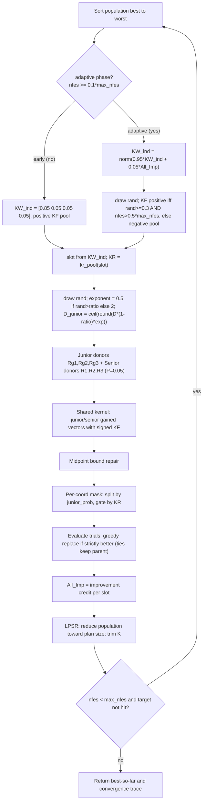

# APGSK — Adaptive-Parameters Gaining-Sharing Knowledge

> **What this is:** AGSK with extra adaptive twists — a *negative knowledge
> factor* pool that can be switched on probabilistically, a *stochastic* scalar
> junior-dimension schedule, and a larger reference population policy. **For:**
> readers who already know the gaining-sharing core and want to see what "APGSK"
> adds on top. **Prerequisites:** [GSK](gsk.md) (junior/senior core, midpoint
> repair, KR mask) and [AGSK](agsk.md) (adaptive KF/KR pools,
> improvement-credit weights, LPSR population reduction). **After reading** you
> can evaluate the positive/negative-KF gate and the stochastic junior schedule by
> hand and map every line of `src/optimizers/apgsk/apgsk_optimize.m` to its math.

## Intuition

APGSK shares [AGSK](agsk.md)'s adaptive-pool machinery but differs in three
deliberate ways that the reference keeps as a **separate algorithm** (not a flag
on AGSK):

- **Sign-switchable knowledge factor.** AGSK always draws its step scale from a
  *positive* pool `kf_pool`. APGSK keeps that pool but adds a *negative* secondary
  pool `kf_pool_negative`. Once the run is past its early phase, a gate decides,
  per generation, whether the whole population uses positive or negative `KF`. A
  **negative** knowledge factor flips the sign of the gained step: instead of
  moving *toward* the donor difference it moves *away* from it — a *contracting*
  step. Late in a run, when the population has clustered, that anti-step is a cheap
  diversification pulse that can escape a basin without a full restart.
- **Stochastic scalar junior schedule.** GSK and AGSK shrink the junior-dimension
  count with a *deterministic* power law. APGSK randomizes the **exponent** each
  generation — sometimes `0.5` (a slow, exploration-leaning decay), sometimes `2`
  (a fast, exploitation-leaning decay) — and applies it as a single **scalar** to
  the whole population, instead of the per-individual exponent AGSK uses.
- **Larger reference population policy.** The APGSK reference release uses a
  dimension-scaled population (`200*D` for `D > 5`, else `250`), opt-in here via
  `options.np_init`.

Everything else — the `KW_ind` credit update, `All_Imp`, greedy selection,
nonlinear reduction, budget/target semantics — is identical to AGSK. It is
implemented separately precisely so every APGSK-specific rule stays explicit.

## Mathematical formulation

The junior/senior gained vectors, midpoint repair, and the per-coordinate KR mask
are **identical to GSK** — see
[GSK § Mathematical formulation](gsk.md#mathematical-formulation). The adaptive
slot selection, improvement-credit weight update, and LPSR are **identical to
AGSK** — see [AGSK](agsk.md). Only the three APGSK-specific pieces are derived
here.

**Negative secondary KF pool** (`apgsk_optimize.m:36-37`). Both pools are indexed
by the AGSK slot `s in {1,2,3,4}` chosen for each individual:

```text
kf_pool          = [ 0.1   1.0   0.5   1.0 ]    % positive (same as AGSK)
kf_pool_negative = [-0.15 -0.05 -0.05 -0.15 ]   % negative secondary (reference name: KF_poool, sic)
```

`KR` always comes from `kr_pool = [0.2 0.1 0.9 0.9]`.

**Positive-vs-negative gate** (`apgsk_optimize.m:139-143`). The pool is chosen
*once per generation* for the whole population, **only in the adaptive phase**
(`nfes >= 0.1*max_nfes`). Because the short-circuit `&&` evaluates left-to-right,
one scalar `rand` is consumed every adaptive generation regardless of `nfes`:

```text
adaptive phase only:
if rand >= 0.3 && nfes > 0.5*max_nfes
    KF = kf_pool(slot)'             % positive primary pool
else
    KF = kf_pool_negative(slot)'    % negative secondary pool
```

Read the gate as two regimes:

- **First half of the adaptive phase** (`0.1*max_nfes <= nfes <= 0.5*max_nfes`):
  the right conjunct `nfes > 0.5*max_nfes` is false, so the negative pool fires
  **every generation** regardless of the scalar draw.
- **Second half** (`nfes > 0.5*max_nfes`): the gate reduces to "positive when
  `rand >= 0.3`", so the positive pool fires on roughly 70% of generations and the
  negative pool on the other ~30%. This is the late-stage anti-step pulse: most
  generations keep converging with positive `KF`, but ~30% inject a negative-`KF`
  diversification burst.

During the **initial** phase `KF` always comes from the positive pool and no extra
scalar is drawn (`apgsk_optimize.m:124`). Because the negative magnitudes are
small (`|KF| <= 0.15`), the anti-step is a gentle nudge away from the donor
difference, not a large jump; midpoint repair still pulls any out-of-bounds
coordinate back to the parent-bound midpoint, so a negative step can never leave
`[lb, ub]`.

**Stochastic scalar junior schedule** (`apgsk_optimize.m:153-157`). One scalar
`rand` per generation (drawn *after* the phase block) selects between two
exponents; `ratio = nfes/max_nfes`:

```text
if rand > ratio
    D_Gained_Shared_Junior = ceil( 1 * round( D * (1 - ratio)^0.5 ) )   % slow decay
else
    D_Gained_Shared_Junior = ceil( 1 * round( D * (1 - ratio)^2   ) )   % fast decay
junior_prob = D_Gained_Shared_Junior / D
```

The result is a single scalar that the reference expands with `(:, ones(1,D))`
against `rand(NP,D)` for the junior-probability mask. Contrast with the
**deterministic** schedules:

```text
GSK   (gsk_optimize.m:97):    D_junior = ceil( D * (1 - g/G_Max)^K ),   K = 10  (fixed)
AGSK  (agsk_optimize.m:132):  D_junior = ceil( D * (1 - ratio)^K_i )            (per-row K_i, fixed for the run)
APGSK (apgsk_optimize.m:153): exponent flips between 0.5 and 2 each generation by a coin vs. ratio
```

Two things follow. First, the exponent is a **scalar** for the whole population
each generation, so APGSK's junior count is the same for every individual in a
generation but *varies generation to generation*. Second, the gate `rand > ratio`
makes the slow exponent `0.5` more likely **early** (small `ratio`) and the fast
exponent `2` more likely **late** (large `ratio`) — a soft bias toward
exploration early and exploitation late, layered on top of the `(1 - ratio)`
decay.

> **RNG note.** APGSK still draws AGSK's initial per-individual `K` vector
> (`apgsk_optimize.m:87-90`) purely to keep the random stream bit-identical to
> AGSK, but the stochastic schedule above **never uses it** (the AGSK formula is
> commented out in the reference source). The draw order per adaptive generation
> is: slot draw -> negative-gate scalar `rand` -> junior-schedule scalar `rand`
> -> three `rand(NP,D)` mask blocks.

## Pseudocode

```text
np_init = 100 (200*D / 250 reference policy opt-in); min_pop_size = 12   # apgsk_optimize.m:30-32
max_pop_size = np_init
initialize / accept fair-start population, evaluate, scan best
K = draw_initial_K(NP)            # RNG-fidelity only, UNUSED            # apgsk_optimize.m:87-90
KW_ind = [];  All_Imp = zeros(1,4)
for g = 1, 2, ... until nfes >= max_nfes:                               # apgsk_optimize.m:108
    if isempty(KW_ind) or nfes < 0.1*max_nfes:        # initial phase
        KW_ind = [0.85 0.05 0.05 0.05]
        slot = select_slots(KW_ind);  KF = kf_pool(slot);  KR = kr_pool(slot)   # positive only
    else:                                             # adaptive phase
        KW_ind = norm(0.95*KW_ind + 0.05*All_Imp)
        slot = select_slots(KW_ind);  KR = kr_pool(slot)
        if rand >= 0.3 && nfes > 0.5*max_nfes: KF = kf_pool(slot)            # positive
        else:                                  KF = kf_pool_negative(slot)   # negative
    if rand > nfes/max_nfes: D_junior = ceil(round(D*(1-ratio)^0.5))    # scalar; apgsk_optimize.m:153
    else:                    D_junior = ceil(round(D*(1-ratio)^2))
    order   = sort(fitness, 'ascend')                                   # best -> worst
    [Rg1,Rg2,Rg3] = junior_donors(order)                               # shared with GSK
    [R1,R2,R3]    = senior_donors(order, P=0.05)                       # apgsk_optimize.m:163
    trial = junior/senior gained vectors (signed KF) + midpoint repair + split/KR mask
    evaluate trial; nfes += min(NP, max_nfes - nfes); scan best
    All_Imp = improvement_credit(fitness, children_fitness, slot)       # AGSK; apgsk_optimize.m:238
    greedy replace: parent <- child where f(child) < f(parent)          # ties keep parent
    LPSR: plan=round((min-max)*ratio^(1-ratio)+max); drop worst rows + K   # apgsk_optimize.m:265
    append (nfes, best_so_far) to the convergence trace
    if best - optimum < target_error: zero error and stop              # apgsk_optimize.m:286-292
```

## Parameters

APGSK exposes only the AGSK population options; the pools and gate constants are
fixed in code (source: `apgsk_optimize.m:30-41` and
`src/optimizers/apgsk/README.md`).

| Option | Symbol | Default | Valid range | Meaning | Code |
|---|---|---|---|---|---|
| `seed` | — | required | integer | RNG seed; applied through `gsk_set_rng(options)`. | `apgsk_optimize.m:21-24` |
| `rand_generator` | — | `twister` | `threefry`, `twister`, `seed`, `state` | RNG family. Direct calls default to `twister`; unified runner resolves to `threefry` when supported, else `twister`. | `apgsk_optimize.m:24` |
| `np_init` | NP_init | `100` | integer >= `min_pop_size` | Initial population size. The `200*D` (D>5) / `250` reference policy is opt-in. | `apgsk_optimize.m:30-31` |
| `min_pop_size` | NP_min | `12` | integer >= 1 | Floor for population reduction. | `apgsk_optimize.m:32` |

Fixed constants (not options):

| Constant | Value | Valid range | Meaning | Code |
|---|---|---|---|---|
| `kf_pool` | `[0.1 1.0 0.5 1.0]` | positive reals | Positive knowledge-factor pool (shared with AGSK). | `apgsk_optimize.m:36` |
| `kf_pool_negative` | `[-0.15 -0.05 -0.05 -0.15]` | negative reals | Negative secondary pool (APGSK only; reference `KF_poool`). | `apgsk_optimize.m:37` |
| `kr_pool` | `[0.2 0.1 0.9 0.9]` | each in [0,1] | Knowledge-ratio pool. | `apgsk_optimize.m:38` |
| `KW_ind` (init) | `[0.85 0.05 0.05 0.05]` | sums to 1 | Initial slot-selection weights. | `apgsk_optimize.m:118` |
| `P` | `0.05` | (0, 0.5) | Senior best/worst block fraction. | `apgsk_optimize.m:41` |
| negative-gate draw cutoff | `0.3` | (0,1) | `rand >= 0.3` keeps the positive pool in the second half. | `apgsk_optimize.m:139` |
| negative-gate stage cutoff | `0.5 * max_nfes` | — | Boundary between the always-negative and probabilistic halves. | `apgsk_optimize.m:139` |
| junior-schedule exponents | `0.5` / `2` | — | Slow vs. fast junior-decay exponents chosen by `rand > ratio`. | `apgsk_optimize.m:153-156` |

## Worked example

APGSK differs most visibly when the negative `KF` pool is active. The junior/
senior/mask arithmetic itself is identical to the
[GSK worked example](gsk.md#worked-example).

**Negative-KF step.** Suppose a candidate and donor expression produce this
ordinary search direction:

```text
x_i       = [1, 1]
direction = [4, -2]
```

With a positive `KF = 0.5`, the step would be:

```text
x_trial = [1, 1] + 0.5 * [4, -2]
        = [3, 0]
```

With the negative secondary pool, for example `KF = -0.15`, APGSK reverses and
shrinks that direction:

```text
x_trial = [1, 1] + (-0.15) * [4, -2]
        = [0.4, 1.3]
```

The negative factor is not random noise. It is a controlled contracting move: the
same donor information is used, but the algorithm steps away from the ordinary
direction. This can help when positive moves keep pushing the population into an
over-exploited region. It can also slow convergence if it is used too early, which
is why the reference guards the positive/negative choice with budget-progress
conditions.

**Stochastic junior schedule.** Suppose `D = 10` and `nfes/max_nfes = 0.64`. If
the scalar schedule draw selects exponent `0.5`, then:

```text
D_junior = ceil(round(10 * (1 - 0.64)^0.5))
         = ceil(round(10 * 0.6))
         = 6
```

If the exponent `2` branch is selected:

```text
D_junior = ceil(round(10 * (0.36)^2))
         = ceil(round(1.296))
         = 1
```

Thus the same budget point can produce a broad junior update (`junior_prob = 0.6`)
or a narrow one (`junior_prob = 0.1`), depending on the reference scalar draw.

## Update cycle



## Bounds, budget, and determinism

- **Bound repair** is the shared GSK midpoint rule: a violating coordinate is
  pulled to the midpoint of the parent and the breached bound. This holds for
  *negative*-`KF` steps too, so anti-steps never leave `[lb, ub]`.
- **Budget.** The loop runs whole generations until `nfes >= max_nfes`; the final
  generation is partially counted via `n_count = min(pop_size, max_nfes - nfes)`
  (`apgsk_optimize.m:224`). With LPSR active the population shrinks toward
  `min_pop_size`, so later generations spend fewer evaluations each. Best-so-far
  is monotone non-increasing.
- **Target-error stop.** Like AGSK and unlike GSK, APGSK checks
  `best_fitness - optimum < 1e-8` each generation (after the resize) and, if met,
  zeroes the error and **stops** with `result.termination =
  'target_error_reached'`. There is no end-of-run zeroing on a budget exit; the
  check is skipped when `target_error` or `optimum` is `NaN`.
- **Determinism.** The trial kernel is pure arithmetic; all randomness is drawn by
  the caller in a fixed order per adaptive generation — slot draw, then the
  negative-gate scalar `rand` (consumed every adaptive generation via short-circuit
  `&&`), then the junior-schedule scalar `rand`, then three `rand(NP,D)` mask
  blocks. The unused `k_vec` draw (`apgsk_optimize.m:87-90`) is kept to preserve
  byte-for-byte stream parity with AGSK. See
  [Seed Policy](../reference/seed_policy.md).

## Complexity

Same order as GSK/AGSK. Per generation: `O(NP log NP)` to sort, `O(NP*D)` to build
and repair trials, `O(NP)` evaluations; the gate and stochastic-exponent draws are
`O(1)` scalars. Over a run the total is `O(max_nfes * D)` time and `O(NP*D)`
memory; LPSR only lowers `NP` over time, so it never increases this bound. Mind
that the opt-in `200*D` policy makes APGSK runs substantially heavier per
generation than the default interface path.

## When to use

Reach for APGSK when an AGSK run stalls in late-stage exploitation and you want a
built-in escape mechanism cheaper than a full restart: the negative-`KF` pulse
periodically diversifies after the halfway mark, and the stochastic junior
schedule keeps the exploration/exploitation balance from locking onto a single
curve. If you do not need the sign-switch or the schedule jitter, prefer plain
[AGSK](agsk.md) (deterministic, one fewer source of variance) or baseline
[GSK](gsk.md). Other siblings: [FDB-AGSK](fdb-agsk.md),
[ATMALS-GSK](atmals-gsk.md), [eGSK](egsk.md).

Default reproduction matrix: **CEC2017** and **CEC2011** (the reference APGSK
release is CEC2020-era code in spirit, but in this toolkit CEC2020 is AGSK's
native default; APGSK runs CEC2020 only as an extension). See
[benchmark_protocol.md](../reference/benchmark_protocol.md).

## Preserved reference quirks

- **`K` is drawn but unused.** APGSK samples the per-individual `K` exactly as
  AGSK at init and trims it on reduction, but its junior schedule never uses it
  (the AGSK formula is commented out in the reference source). The draws and
  trimming are kept purely for **random-stream fidelity**.
- **The extra scalar `rand` is always consumed** in the adaptive phase (because of
  the short-circuit `&&`), before the schedule's own scalar draw — order
  preserved.
- **`KF_poool` (sic)** is renamed `kf_pool_negative` with the original spelling
  cited in a comment.
- **All_Imp update, greedy selection, nonlinear reduction, budget-crossing, and
  per-generation target stop** are identical to AGSK (zero-and-stop with
  `'target_error_reached'`, no end-of-run zeroing on a budget exit; NaN guards on
  `target_error` / `optimum`). Same dead-code omissions as AGSK.

Sanctioned deviations: deterministic seeding through `gsk_set_rng(options)`;
convergence recorded once per generation. `result.error` is `NaN` when the optimum
is unknown. Runner-level seed formulas are documented in
[seed_policy.md](../reference/seed_policy.md); under unified mode the runner may
also provide `options.initial_population` and the matching post-initialization RNG
state for fair cross-family starts.

## Source and validation

- Kernel: `src/optimizers/apgsk/apgsk_optimize.m`. It reuses the AGSK adaptive
  machinery (slot selection, `All_Imp` credit, LPSR) and the shared helpers:
  midpoint repair `src/common/gsk_bound_repair.m`; rank-aware donors
  `Gained_Shared_Junior_R1R2R3.m` / `Gained_Shared_Senior_R1R2R3.m` (P = 0.05) in
  `src/common`; LPSR survivors `src/common/gsk_reduction_survivors.m`. Ported from
  the reference APGSK release's `Adaptive_GSK_ALI.m` (a different file from the
  AGSK one) with identical pools, gate, schedule, and draw order. Entry point and
  interface contract: [matlab_interface.md](../reference/matlab_interface.md); run
  instructions: [runbook.md](../getting-started/runbook.md).
- Tests cover the positive/negative KF gate, the stochastic junior schedule,
  shared adaptive slot selection, improvement credit, population reduction, target
  stopping, fair starts, deterministic replay, and runner integration. See
  [validation_report.md](../research/validation_report.md) and
  [numerical_examples.md](../research/numerical_examples.md).
