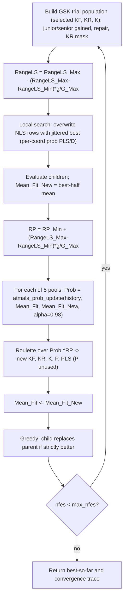

# ATMALS-GSK — Adaptive GSK with memory-based parameter selection and local search

> **What this is:** the most heavily self-tuning member of the family — it keeps
> the gaining-sharing core of [GSK](gsk.md) but drives **five** parameters
> (`KF`, `KR`, `K`, `P`, `PLS`) from a success-weighted **memory** by roulette
> over value pools, and bolts an **adaptive local search** onto the best-so-far
> vector each generation. **For:** readers who already know the junior/senior core
> and want the ATMALS additions. **Prerequisites:** [GSK](gsk.md) (core, midpoint
> repair, KR mask) and [AGSK](agsk.md) (the idea of parameter pools). **After
> reading** you can trace one memory-roulette selection and one local-search step
> by hand and map each to `atmals_gsk_optimize.m`. Two reference drivers exist
> (one tuned for CEC2017, one for CEC2011); this port reproduces either, selected
> by `options.protocol`.

## Intuition

ATMALS-GSK ("Adaptive Tuning + Memory + Adaptive Local Search") reuses the GSK
junior/senior gaining-sharing core — the gained-vector formulas, midpoint bound
repair, the split-by-junior-probability then gate-by-`KR` mask — using the
**currently selected** `KF`/`KR`/`K`. Three things are new:

- **Five adaptive pools, not four.** GSK's `KF`, `KR`, `K`, and the senior
  fraction `P` each become a *grid* of candidate values, and a fifth pool `PLS`
  is added to steer the local search. Every generation picks one value from each
  grid by roulette (`atmals_gsk_optimize.m:403-416`).
- **Memory-based roulette.** A per-pool history matrix accumulates over the whole
  run. Slots chosen on improving generations gain weight; slots chosen on
  worsening generations route weight to the *other* slots. The resulting
  probability vector is raised to a power `RP` before each spin, so as the run
  matures the wheel concentrates on slots that have paid off
  (`atmals_prob_update.m`, `atmals_gsk_optimize.m:386,403-416`).
- **Adaptive local search.** After the GSK trials are built, a few rows are
  overwritten with perturbations of the **current best** vector. The perturbation
  *probability per coordinate* is `PLS/D`, and the *amplitude* `RangeLS` anneals
  across the run, so the search starts coarse and ends fine
  (`atmals_gsk_optimize.m:245-263,314-332`).

The signal that drives the memory is the **mean of the best half** of the
population's error each generation — a smoother, less greedy progress measure than
the single best (`atmals_gsk_optimize.m:158-167,388-395`).

## Mathematical formulation

The gaining-sharing core is identical to [GSK](gsk.md); the senior donor blocks
are drawn by ATMALS-local helpers that match each reference driver exactly (a
CEC2017 split at `P_GSK = 0.1` in `atmals_senior_r1r2r3_cec2017`
(`atmals_gsk_optimize.m:494-517`), or a fixed 10% / 90% split for CEC2011 in
`atmals_senior_r1r2r3_cec2011` (`:519-540`)). Only the additions are derived here.

**Value pools (one per adapted parameter)** (`atmals_gsk_optimize.m:93-97`):

```matlab
KF_VAL  = 0.2:0.1:0.8;    KR_VAL = 0.85:0.01:1;   K_VAL = 8:1:30;
P_VAL   = 0.05:0.01:0.15; PLS_VAL = 1:0.1:2;
```

**Progress signal (best-half mean)** (`atmals_gsk_optimize.m:158-167`). With the
per-individual error `aa` (CEC2017: `abs(fitness - optimum)`; CEC2011 or unknown
optimum: raw fitness):

```text
bb = sort(aa) ascending
cc = bb(1 : floor(NP/2))
Mean_Fit = mean(cc)
```

`Mean_Fit` is the value before a generation; `Mean_Fit_New` is the same statistic
recomputed from the children.

**Per-pool probability update** (`atmals_prob_update.m`, the `ProbUpdate.m` port).
Let a pool hold values `VALs` (length `L`); let the slot chosen last generation be
at 1-based index `i` (located by `find(abs(VALs-val)<eps)`). A Gaussian membership
over the *pool values* is centred on the *index* `i`:

```text
sig = 0.05 * (max(VALs) - min(VALs))
yy  = exp( -(VALs - i).^2 / (2*sig.^2) )                  # atmals_gaussmf(VALs,[sig i])
denom = abs(Mean_Fit)
improved (Mean_Fit_New < Mean_Fit):  row =  yy        * exp(-(Mean_Fit_New - Mean_Fit)/denom)
worsened (Mean_Fit_New > Mean_Fit):  row = (1 - yy)*0.1 * exp(-(Mean_Fit_New - Mean_Fit)/denom)
tie:                                 row =  zeros(1,L)
```

The new `row` is appended to the pool's history `P_old`, then the whole history
is folded with a geometric factor `alpha = 0.98`:

```text
P_new = sum over rows j of  alpha^j * P_old(j, :)
```

(Quirk: because the membership is centred on the pool **index** `i` while it is
evaluated at the pool **values**, the bump location and the evaluation points live
on different scales — `yy` underflows toward 0 for most grids, so the worsened
branch's `(1 - yy)*0.1` term keeps weight alive. The weighting gives the
**oldest** row (the all-ones prior) the **largest** weight, `alpha^1`, and the
newest row the smallest, `alpha^rows`. Both are faithful quirks of the reference,
reproduced verbatim.)

**Memory roulette with sharpening** (`atmals_roulette_select.m`,
`atmals_gsk_optimize.m:386,403-416`). The selection weight is `Prob` raised to a
power `RP` that grows with the run:

```text
RP = RP_Min + (RangeLS_Max - RangeLS_Min) * (g / G_Max)     # 3.0 -> ~3.2
PR = Prob .^ RP;   PR = PR / sum(PR)
draw r ~ U(0,1);  slot = roulette over cumsum(PR)
value = pool(slot)
```

(`RP_Min = 3`; the update **reuses the local-search range constants** `0.2` and
`1e-10`, not `RP_Max - RP_Min`, so `RP` rises only from 3.0 to ~3.2 over the run.
`RP_Max = 5` is defined (`atmals_gsk_optimize.m:125`) but never used — a preserved
quirk.)

**Adaptive local search** (`atmals_gsk_optimize.m:245-263,314-332`). The amplitude
decays linearly each generation:

```text
RangeLS = RangeLS_Max - (RangeLS_Max - RangeLS_Min) * (g / G_Max)   # 0.2 -> ~0
NLS     = round(0.05 * NP)                                          # rows touched
```

`NLS` rows of the freshly built trial population are reset to the current best
vector `bsf_solution` and then jittered. For each touched row and each coordinate
`jjj`:

```text
with probability PLS/D:
    ui(iii,jjj) = bsf_solution(jjj) + (2*rand - 1) * RangeLS * (ub(jjj) - lb(jjj))
    clip to [lb, ub]      # CEC2017: exact-bound clip; CEC2011: clip to lb+eps / ub-eps
otherwise:
    ui(iii,jjj) = bsf_solution(jjj)      # coordinate copied from the best vector
```

So a touched row is "best vector, with a sparse coarse-to-fine jitter." The larger
`PLS` is, the more coordinates get jittered.

**Selection** is the same strictly-greedy replacement as GSK
(`atmals_gsk_optimize.m:430-433`): `fitness = min([fitness, children_fitness])`
and the population takes the winner row-by-row (ties keep the parent). ATMALS-GSK
does **not** reduce the population (unlike [AGSK](agsk.md)'s reduction); `NP` is
constant.

## Pseudocode

```text
G_Max = (cec2011 ? max_nfes/np : fix(max_nfes/np))         # atmals_gsk_optimize.m:130-134
KF,KR,K,P = 0.5, 0.9, 10, 0.1;  PLS = 1                     # initial picks :88-91,105
alpha = 0.98;  NLS = round(0.05*NP);  RP_Min = 3            # :104,122-124
RangeLS_Max,RangeLS_Min = 0.2, 1e-10                       # :127-128
Prob_*_OLDMAT = ones(1, len(pool))   for each of the 5 pools  # :141-145
initialize population, evaluate, Mean_Fit = best_half_mean  # :152-167
record best-so-far; nfes += NP                              # :168-190
for g = 1, 2, ... until nfes >= max_nfes:                   # :194
    junior/senior gained vectors (selected KF,KR,K), repair, split/KR mask  # :197-242 (cec2017)
    RangeLS = RangeLS_Max - (RangeLS_Max-RangeLS_Min)*g/G_Max               # :245
    randperm(NP) drawn (quirk: unused); overwrite rows 1..NLS with jittered best  # :247-263
    children_fitness = evaluate(ui)                          # :383
    RP = RP_Min + (RangeLS_Max-RangeLS_Min)*g/G_Max          # :386
    Mean_Fit_New = best_half_mean(children_fitness)          # :388-395
    for each pool (KF, KR, K, P, PLS):                       # :397-416
        Prob = atmals_prob_update(history, pool, chosen, Mean_Fit, Mean_Fit_New, alpha)
        chosen = pool( atmals_roulette_select(Prob.^RP) )    # P selected but never consumed
    Mean_Fit = Mean_Fit_New                                  # :418
    nfes += 1 per child, update bsf (strict-< scan; counter    # :421-428
      reads max_nfes+1 when a generation crosses the budget)
    greedy: fitness = min(parent, child); popold <- winners  # :430-433
    append (min(nfes, max_nfes), best_so_far) to the trace   # :435-437
result.nfes = min(nfes, max_nfes)   # recorded copies clipped  # :486
```

## Parameters

Reference defaults (source: `atmals_gsk_optimize.m`,
`src/optimizers/atmals-gsk/README.md`).

| Option | Symbol | Default | Valid range | Meaning | Code |
|---|---|---|---|---|---|
| `seed` | — | required | integer | RNG seed; applied through `gsk_set_rng(options)`. Replaces the historical wall-clock seed. | `atmals_gsk_optimize.m:64-67` |
| `rand_generator` | — | `twister` | `threefry` \| `twister` \| `seed` \| `state` | RNG family; unified runner resolves to `threefry` when supported, else `twister`. | `atmals_gsk_optimize.m:67` |
| `protocol` | — | `"cec2017"` | `"cec2017"` \| `"cec2011"` | Selects donor split, `G_Max` rounding, error metric, and bound-clip eps. | `atmals_gsk_optimize.m:69-77` |
| `np` | NP | `100` | integer ≥ 12 | Fixed population size (no reduction). | `atmals_gsk_optimize.m:85-86` |
| `kf_pool` | `KF_VAL` | `0.2:0.1:0.8` | non-empty float vector containing the initial pick `0.5`; otherwise `atmals_gsk:options` | Knowledge-factor candidates (step scale). | `atmals_gsk_optimize.m:93,98,107-120` |
| `kr_pool` | `KR_VAL` | `0.85:0.01:1` | non-empty float vector containing the initial pick `0.9`; otherwise `atmals_gsk:options` | Knowledge-ratio candidates (per-coord update prob). | `atmals_gsk_optimize.m:94,99,107-120` |
| `k_pool` | `K_VAL` | `8:1:30` | non-empty float vector containing the initial pick `10`; otherwise `atmals_gsk:options` | Junior-schedule exponent candidates (handover sharpness). | `atmals_gsk_optimize.m:95,100,107-120` |
| `p_pool` | `P_VAL` | `0.05:0.01:0.15` | non-empty float vector containing the initial pick `0.1`; otherwise `atmals_gsk:options` | Senior partition-fraction candidates (selected, never consumed). | `atmals_gsk_optimize.m:96,101,107-120` |
| `pls_pool` | `PLS_VAL` | `1:0.1:2` | non-empty float vector containing the initial pick `1`; otherwise `atmals_gsk:options` | Local-search density candidates; per-coord jitter prob is `PLS/D`. | `atmals_gsk_optimize.m:97,102,107-120` |

An overridden pool must contain its hard-coded initial pick, because the
first-generation `atmals_prob_update` looks that value up in the pool (same
`abs(pool - pick) < eps` match). The check runs before any RNG draw
(`atmals_gsk_optimize.m:107-120`) and names the offending option.

Internal constants (not options, fixed in the loop): initial picks
`KF=0.5, KR=0.9, K=10, P=0.1, PLS=1` (`atmals_gsk_optimize.m:88-91,105`);
`alpha = 0.98` (`:104`); `NLS = round(0.05*NP)` (`:122`); `RP_Min = 3`,
`RP_Max = 5` (`:124-125`); `RangeLS_Max = 0.2`, `RangeLS_Min = 1e-10`
(`:127-128`). There is **no** `use_local_search` flag — the local search always
runs (with `NLS = 0` it is a no-op). The memory lives in the per-pool
`Prob_*_OLDMAT` history arrays (`:141-145`), each seeded to all-ones so the first
spin is uniform.

If `problem.optimum` is `NaN` under `'cec2017'`, the optimum-based `Mean_Fit`
signal is undefined, so the port falls back to the CEC2011 raw-fitness signal
(`atmals_gsk_optimize.m:159`) — the reference never ran the CEC2017 driver with
unknown optima.

## Worked example

Three hand-checkable pieces: one memory-roulette selection, one local-search
coordinate, and one weight-update step.

**1) Memory roulette with sharpening** (`atmals_roulette_select.m`,
`atmals_gsk_optimize.m:386,403`). Take a 3-slot pool with accumulated weights
`Prob = [0.2, 0.5, 0.3]` and an early-run `RP = 3.0`. The selection weight is
`Prob.^RP`:

```text
Prob.^3  = [0.2^3, 0.5^3, 0.3^3] = [0.008, 0.125, 0.027]
sum      = 0.160
PR       = [0.0500, 0.78125, 0.16875]
cumsum   = [0.0500, 0.83125, 1.0]
```

The cubing has sharpened a 0.50 lead into a 0.78 share. Now spin (`r ~ U(0,1)`;
the slot is the first `cumsum` entry that `r` does not exceed):

```text
r = 0.10 -> slot 2   (0.0500 < 0.10 <= 0.83125)
r = 0.50 -> slot 2   (0.0500 < 0.50 <= 0.83125)
r = 0.90 -> slot 3   (0.83125 < 0.90 <= 1.0)
```

So the historically-best slot 2 (value index 2) is chosen for two of these three
draws — and the gap widens as `RP` grows later in the run.

**2) One local-search coordinate** (`atmals_gsk_optimize.m:250-263`). Suppose
`D = 30`, `PLS = 1.5` (so per-coord prob `PLS/D = 0.05`), bounds
`lb = -100, ub = 100`, current best `bsf_solution(jjj) = 12.0`, and this is a
mid-run generation with `RangeLS = 0.02` (`:245`). The row is first reset to
`bsf_solution`, then for one coordinate the RNG draws `0.03` (`< 0.05`, jitter
fires) and `2*rand - 1 = -0.4`:

```text
step = -0.4 * 0.02 * (100 - (-100)) = -1.6
ui(iii,jjj) = bsf_solution(jjj) + step = 12.0 - 1.6 = 10.4   (inside [-100,100])
```

A coordinate where the gate draw is `>= 0.05` keeps `bsf_solution(jjj) = 12.0`
unchanged. Early in the run `RangeLS = 0.2` would have made `step = -16.0`; late
in the run `RangeLS → 0` collapses the jitter to nearly zero, fine-tuning the best
vector.

**3) One weight-update step** (`atmals_prob_update.m:23-37`). Suppose the selected
`KF` value was `0.5`, the old best-half signal was `Mean_Fit = 100`, and the new
signal is `Mean_Fit_New = 90`. Because the new signal is better:

```text
gain = exp(-(Mean_Fit_New - Mean_Fit) / abs(Mean_Fit))
     = exp(-(-10) / 100) = exp(0.1) = 1.1052
```

The selected value's Gaussian membership row `yy` is multiplied by `1.1052` and
appended to the `KF` memory table. With two schematic history rows:

| Row | Meaning | Values |
|---:|---|---:|
| 1 | prior | `[1.00, 1.00, 1.00]` |
| 2 | new reward | `[0.10, 1.1052, 0.10]` |

and `alpha = 0.98`, the weighted accumulator is proportional to:

```text
P_new = 0.98^1 * row1 + 0.98^2 * row2
```

The reference weighting order is preserved even though it gives the oldest row a
large influence. This memory makes ATMALS-GSK slower to react than AGSK, but less
vulnerable to one lucky generation.

## Update cycle



## Protocols (`options.protocol`)

`'cec2017'` (default) and `'cec2011'` reproduce the two reference drivers, which
differ in exactly these transcribed points:

| Aspect | `cec2017` | `cec2011` |
|---|---|---|
| `G_Max` | `fix(max_nfes/np)` (`:133`) | `max_nfes/np`, no `fix` (`:131`) |
| `Mean_Fit` signal | best-half mean of `abs(fitness - optimum)` (`:162`) | best-half mean of **raw** fitness (no known optima) (`:160`) |
| Senior partition | `atmals_senior_r1r2r3_cec2017`: `PartSize = round(0.1*NP)`, middle ends at `NP - PartSize` (`:494-517`) | `atmals_senior_r1r2r3_cec2011`: blocks `round(NP*0.1)` / `round(NP*0.9)`, no `P` (`:519-540`) |
| Local-search clip | exactly to the bounds (`:255-260`) | to `bound + eps` / `bound - eps` (`:324-329`) |
| `D == 1` | n/a | dedicated **senior-only** branch (hard-coded factor 0.5, ratio 0.9) (`:334-380`) |

`run_experiment` and `gsk_run` auto-select the protocol for the two published
suites: `cec2017` on CEC2017 and `cec2011` on CEC2011. Direct optimizer calls can
pass `options.protocol` explicitly.

## Bounds, budget, and determinism

- **Bound repair** in the GSK core is the same midpoint pull toward the parent as
  [GSK](gsk.md) (`boundConstraint`, `atmals_gsk_optimize.m:542-558`). The **local
  search** clips independently: CEC2017 hard-clips to `[lb, ub]`; CEC2011 clips to
  `lb+eps` / `ub-eps`.
- **Budget.** `G_Max = fix(max_nfes/np)` for CEC2017 (CEC2011 keeps the exact
  ratio) (`atmals_gsk_optimize.m:130-134`). The whole final generation is
  evaluated, but the post-evaluation scan increments `nfes` per child and breaks
  once `nfes > max_nfes` (`:421-428`), so only children within budget can update
  the best-so-far. When a generation crosses the budget (`max_nfes` not a
  multiple of `NP`, or below `NP`) the reference per-child counter therefore
  reads `max_nfes + 1`; the reported `result.nfes` and `convergence.nfes` are
  clipped at `max_nfes` (`:181-189,436,486`), a bookkeeping-only change that
  leaves the loop counter, the crossing semantics, and the RNG stream untouched.
  Best-so-far is monotone non-increasing. ATMALS-GSK never stops early —
  `result.termination = 'max_evaluations'` (`:487`).
- **Error reporting.** On the published **CEC2017** protocol, ATMALS-GSK reports
  `result.error = abs(best_fitness - optimum)`, zeroed below `target_error`
  (`1e-8`) (`atmals_gsk_optimize.m:441-446`) — it is the **only** optimizer that
  reports absolute error. For other known-optimum suites it follows the interface
  `best_fitness − optimum` (`:447-452`); `NaN` when the optimum is unknown.
- **Determinism.** Every random draw goes through the caller's RNG in a fixed
  order: `gsk_set_rng(options)` seeds it (`:67`); per generation the junior `Rg3`
  and senior block samples, the split mask and two KR masks, the local search's
  `randperm` + per-cell `rand` draws (`:247,253-254`), then the five roulette
  spins (`:403-416`). Same seed → identical result, serial or parallel. See
  [Seed Policy](../reference/seed_policy.md). Under unified mode the runner may
  also provide `options.initial_population` and the matching post-initialization
  RNG state for fair cross-family starts.
- **CEC2011, D=1** takes a senior-only fallback generation
  (`atmals_gsk_optimize.m:334-380`) that skips the junior path; the rest of the
  loop is unchanged.

## Complexity

Per generation: `O(NP log NP)` to sort, `O(NP·D)` to build trials, plus
`O(NLS·D)` for the local search (`NLS = round(0.05·NP)`). Each of the five pool
updates appends one row to its history and then re-sums the whole alpha-weighted
history (`atmals_prob_update.m:26-37`), so at generation `g` it costs `O(g·L)` per
pool (`L ≤ 23`). Over `G_Max ≈ max_nfes/NP` generations a run therefore costs
`O(max_nfes·D + G_Max^2·L)` time. The quadratic bookkeeping term dominates for
large budgets: at roughly 1 µs per stored row per update it is about half an hour
per run at 3e6 evaluations (cec2013lsgo, cec2020 D15) and several hours at 1e7
evaluations (cec2020 D20), most of it outside function evaluation. Memory is
`O(NP·D)` for the population plus `O(G_Max·L)` for the five growing histories.
The unbounded history and its summation order are a preserved reference quirk.

## When to use

ATMALS-GSK is the choice when you want maximum self-tuning and a built-in
local-refinement stage, and you are willing to spend a little overhead on the
memory bookkeeping. It keeps `NP` fixed, so on budgets where population reduction
helps, compare against [AGSK](agsk.md) or [APGSK](apgsk.md)/[FDB-AGSK](fdb-agsk.md).
The other local-search variant uses an SQP polish instead of memory-based
perturbation — see [eGSK](egsk.md). For the un-tuned baseline that every variant
extends, see [GSK](gsk.md). See
**[../getting-started/runbook.md](../getting-started/runbook.md)** to run it;
interface contract: [matlab_interface.md](../reference/matlab_interface.md).

## Benchmark suites

Default reproduction matrix: **CEC2017** (use `protocol = 'cec2017'`) and
**CEC2011** (use `protocol = 'cec2011'`) — these protocols exist precisely to
match the two reference drivers. See
[benchmark_protocol.md](../reference/benchmark_protocol.md).

## Preserved reference quirks

Deliberate fidelity choices — do **not** "fix":

1. **`RP` uses the local-search range constants.**
   `RP = RP_Min + (RangeLS_Max - RangeLS_Min)*(g/G_Max)` is written with `0.2`
   and `1e-10`, not `RP_Max - RP_Min`, so `RP` grows from `3` to only **~3.2**
   over a run and `RP_Max = 5` is defined but **never used**
   (`atmals_gsk_optimize.m:125,386`).
2. **Local-search rows.** `randperm(pop_size)` is drawn into `iii_mat` (consuming
   RNG state) but the loop overwrites rows `1..NLS`, *not* the randomly chosen
   rows. The unused draw is kept for stream fidelity
   (`atmals_gsk_optimize.m:247-250`).
3. **Fixed senior `P`.** The adaptive `P` is selected by roulette every generation
   but **never consumed**; the senior phase always uses `P_GSK = 0.1` (cec2017,
   `:206,412-413`) or the hard-coded `round(0.1/0.9)` partition (cec2011).
4. **`atmals_prob_update` internals** (`atmals_prob_update.m`): the Gaussian
   membership **centre is the pool index** (not the value); the memory weights
   history row `j` by `alpha^j`, so the **oldest** row (the all-ones prior) gets
   the **largest** weight; the history matrices grow unbounded (one row per
   generation). `atmals_gaussmf.m` replaces the Fuzzy Logic Toolbox `gaussmf`
   with `exp(-(x-c).^2 ./ (2*sig.^2))` (mathematically identical, no toolbox
   dependency).
5. The CEC2017 senior partition is kept **variant-local** because the shared
   `src/common` senior helper uses `round(NP*(1-P))`, which differs from
   `NP - PartSize` whenever `NP*P` is an exact half-integer
   (`atmals_gsk_optimize.m:494-517`).

Sanctioned modernization (the only one): deterministic seeding through
`gsk_set_rng(options)` (the reference used `rand('seed', sum(100*clock))`).
Runner-level seed formulas are documented in
[seed_policy.md](../reference/seed_policy.md); `seed_policy='reference'` uses
deterministic legacy `seed` for ATMALS-GSK with `base_seed + 9973*func + run - 1`.

## Source and validation

- Kernel: `src/optimizers/atmals-gsk/atmals_gsk_optimize.m` (with its local
  `atmals_senior_r1r2r3_cec2017`, `atmals_senior_r1r2r3_cec2011`,
  `boundConstraint` subfunctions); helpers `atmals_prob_update.m`
  (the `ProbUpdate.m` port), `atmals_roulette_select.m`
  (the `RouletteWheelSelection.m` port), `atmals_gaussmf.m`; shared junior donors
  `src/common/Gained_Shared_Junior_R1R2R3.m`. Transcribed line-by-line from the
  two reference drivers `cec2017/ATMALS_GSK.m` and `cec2011/ATMALS_GSK.m`, with
  identical pool grids and draw order and the index-vs-value Gaussian quirk
  preserved.
- Baseline: [gsk.md](gsk.md); adaptive-pool relatives: [agsk.md](agsk.md),
  [apgsk.md](apgsk.md), [fdb-agsk.md](fdb-agsk.md); other local-search variant:
  [egsk.md](egsk.md). Concepts: [explainer.md](../getting-started/explainer.md);
  terms: [glossary.md](../reference/glossary.md).
- Smoke-tested by `src/tests/test_atmals_gsk_smoke.m` under both protocols: the
  result contract, deterministic replay, budget crossing (non-divisible and
  below-NP budgets, reported `nfes` clipped at `max_nfes`), fair-start `X0` reuse
  with the post-`X0` RNG restore, the cec2011 `D == 1` senior-only branch, and
  pool-override validation. Pool selection, the memory-weighted roulette, and the
  local search run inside these cells without dedicated assertions. See
  [Validation Report](../research/validation_report.md) and
  [Numerical Examples](../research/numerical_examples.md).
