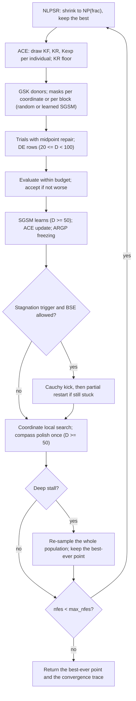

# DT-GSK — Dimension-Tiered Gaining-Sharing Knowledge

DT-GSK is GSK with extra control parts that switch on according to the problem
dimension `D`. Every run picks its parameters adaptively (ACE), shrinks its
population, escapes or restarts when the search stalls, and refines the best
points near the end; block crossover starts at `D = 10`. From `D = 20` it also
keeps separate parameter memories for the better and worse halves and adds a
DE/rand/1 option; from `D = 50` it learns which coordinates improve together
(SGSM) and ends with a compass polish; from `D = 100` it adds a local-search
budget rule, a population floor, novelty-based restarts and late-run
controllers, and drops the DE option. It has no tuning options: give it a
problem and a seed, and it always uses the full evaluation budget.

**How to run it.** New to the project? Follow the [Runbook](../../../RUNBOOK.md)
first (setup, build, first run). Then, in MATLAB:

```matlab
cd('<repo>/gsk_family/src/runners')
run_experiment('optimizer','dt-gsk', 'suite','cec2017', 'functions',[1 3], ...
    'dimensions',[10], 'runs',3, 'project_root','<repo>/gsk_family', ...
    'output_dir','<repo>/gsk_family/results/dt-gsk/cec2017')
```

or, from a terminal in `gsk_family`:
`build\gsk_run.exe --optimizer dt-gsk --suite cec2017 --dimension 10 --function 1 --runs 3`.
The full run guide (options, outputs, comparison) is in
[Command Reference 3.7](../getting-started/command_reference.md#37-dt-gsk).

> **What this is:** the seventh member of the family — GSK's junior/senior
> operators plus a control stack that the published `pub` profile switches on and
> tunes by problem dimension (adaptive configuration selection, nonlinear
> population reduction, linkage-aware crossover, budget-safe escapes and
> restarts, deterministic endgame refinement). **For:** readers who know
> [GSK](gsk.md). **Prerequisites:** the junior/senior gained vectors, midpoint
> repair, and KR mask of [GSK](gsk.md); population reduction as in
> [AGSK](agsk.md). **After reading** you can say what each tier (`D < 20`,
> `20 <= D < 50`, `D >= 50`, `D >= 100`) adds and map every mechanism to
> `src/optimizers/dt-gsk/*.m`.
>
> Reference: Masoud, Roshdy & Mohamed, "DT-GSK: Dimension-Tiered Adaptive
> Configuration Selection and Deterministic Refinement for Gaining-Sharing
> Knowledge-Based Optimization Algorithm", *Algorithms* (MDPI), 2026 (accepted;
> DOI pending); reference implementation DT-GSK v2.46 (MIT license),
> <https://github.com/MostafaMassoud/DT-GSK>.

## Intuition

DT-GSK starts from the same picture as [GSK](gsk.md): individuals gain knowledge
from their rank neighbours (junior phase) and from the best, middle, and worst
groups (senior phase), and a junior->senior schedule hands exploration over to
exploitation. It keeps those operators and changes how a fixed evaluation budget
is spent:

- **Adapt the operator, not one parameter.** ACE (adaptive configuration engine)
  draws a whole `(KF, KR, Kexp)` setting per individual from a small pool and
  favours the entries whose trials lowered the fitness most; ARGP freezes entries
  whose acceptance rate collapses.
- **Spend the budget where it counts.** The population shrinks nonlinearly from
  `5*D` (NLPSR). Escapes (BSE: Cauchy kicks, then partial restarts) and a
  deep-stall full restart move a stuck run while the best-ever point is kept
  aside; a coordinate local search and, from `D = 50`, a compass polish refine
  the best points near the end.
- **Recombine in blocks.** Linkage-aware crossover lets part of the population
  take whole blocks of coordinates from one phase. From `D = 50` an interaction
  graph (SGSM, success-graph structural memory) learns which coordinates improve
  together from moves already accepted (no extra evaluations) and supplies
  learned blocks and the polish directions.

Each mechanism is gated and tuned by dimension tier (`dt_gsk_config.m`). SGSM is
one component of the upper tiers, not the algorithm; the reference documentation
attributes DT-GSK's results to the complete tiered system.

## Mathematical formulation

Notation: `x_i` is individual `i`, `f_i` its fitness, `frac = nfes / max_nfes`
the budget fraction at the start of a generation (`:179`); `KF_i`, `KR_i`,
`Kexp_i` come from ACE. Bare line numbers refer to `dt_gsk_optimize.m`.

**Population size (NLPSR)** (`:181-195`). From `NP_init = 5*D` (`:93`), each
generation keeps the best `NP` individuals with

```text
NP = floor(NP_init + (n_min - NP_init) * frac^(1 - frac) + 0.5)   # round half up
NP = max(n_min, min(NP, NP_current))                              # never grows
```

`n_min = 12` below `D = 50` and `25` from `D = 50`. At `D >= 100`, SP-NLPSR raises
it to `max(12, ceil(2.5*sqrt(D) + log2(D + 1)))` until 64 generations have used
learned linkage or `frac >= 0.70` (`:182-186`, `dt_gsk_config.m:181-184`).

**GSK donors** (`junior_sources`, `senior_sources`, `gsk_donors`; `:764-813`).
`Rg1`/`Rg2` are the one-better/one-worse rank neighbours (the best uses ranks 2
and 3, the worst ranks `NP-2` and `NP-1`, as in GSK); `Rg3` is the first of 32
pre-drawn random indices that differs from `i`, `Rg1`, and `Rg2`. `R1`, `R2`,
`R3` are uniform picks from the best `n`, middle `NP - 2n`, and worst `n` ranks,
`n = max(1, floor(p_senior*NP + 0.5))`, `p_senior = 0.05` (`0.15` at
`20 <= D < 50`):

```text
junior:  v_j = x_i + KF_i * (x_Rg1 - x_Rg2 + x_Rg3 - x_i)   if f_i > f_Rg3
         v_j = x_i + KF_i * (x_Rg1 - x_Rg2 + x_i - x_Rg3)   otherwise
senior:  v_s = x_i + KF_i * (x_R1 - x_R3 + x_R2 - x_i)      if f_i > f_R2
         v_s = x_i + KF_i * (x_R1 - x_R3 + x_i - x_R2)      otherwise
```

Both are midpoint-repaired against the parent (`bound`, `:733-746`). From
`D = 50`, while the mean acceptance rate of the last 10 generations is `<= 0.10`,
the worse half takes its senior donors from wider 10% groups, with the same
random numbers (`:212-218`). The junior share is GSK's schedule driven by the
budget fraction (NLPSR leaves the generation count open) with a per-individual
exponent: `p_jun_i = ceil(D * (1 - frac)^Kexp_i) / D` (`:236`).

**ACE** (`:106-124`, `:220-234`, `:395-411`; helpers `:889-935`). Pool from
`dt_gsk_config.m:23-28`, with the DE entry appended at `:111-116`:

| Entry | KF | KR | Kexp | Initial probability | Config label |
|---|---|---|---|---|---|
| 1 | 0.1 | 0.2 | 2 | 0.05 | cautious explorer |
| 2 | 1.0 | 0.1 | 15 | 0.05 | dimension-selective bold |
| 3 | 0.5 | 0.9 | 10 | 0.45 | GSK-pure (baseline values) |
| 4 | 1.0 | 0.9 | 5 | 0.05 | aggressive wide |
| 5 | 0.5 | 0.9 | 3 | 0.40 | extended-exploration GSK |
| 6 (`20 <= D < 100`) | F = 0.5 | CR = 0.9 | — | 0.10 (`D < 50`), 0.20 | DE/rand/1 entry |

Each individual draws an entry by roulette wheel; from `D = 20` the better half
and the worse half keep separate probability vectors, each learning from its own
trials. Once 5% of the budget is used, every vector learns from the signed
fitness changes of the evaluated trials:

```text
omega_k = sum over trials i that drew k of (f(u_i) - f(x_i))   # < 0: improvement
T = sum_k omega_k
T < 0:  target = omega / T                        # share of the total decrease
T > 0:  target_k = omega_k / sum(omega_m < 0) for omega_k < 0, else 0
p <- Proj(0.9 * p + 0.1 * Proj(target))  # T = 0, not finite, no omega_k < 0: Proj(p)
```

`Proj` is the Euclidean projection onto `{p_k >= 0.05, sum_k p_k = 1}`. After the
draw `KR_i` is floored at `min(1, kr_min_dims / D)` (`kr_min_dims = 20` at
`20 <= D < 50`, `40` from `D = 50`; `:231`), and at `D >= 100` an open A2 window
multiplies it by 1.5, capped at 1 (`:232-234`).

**ARGP** (`:413-442`). After 15% of the budget, entries whose acceptance rate
over a rolling 30-generation window is below the threshold (`0.02`; `0.01` from
`D = 50`) are frozen in pool order while more than two remain free; entries back
above it are released. The (blended) probability vector is then redistributed so
frozen entries hold `0.05` and the free ones share the rest in proportion, and
both half vectors restart from it.

**Crossover** (`crossover_masks`, `:815-869`; trial assembly `:277-312`). Without
linkage (`D < 10`), each coordinate is junior when a uniform draw is
`<= p_jun_i`, senior otherwise, and changes only when a second draw is `<= KR_i`.
With linkage, a share of the rows (0.70; 0.40 at `20 <= D < 50`) makes one
junior/senior draw and one KR draw per block instead; blocks are a random
partition into groups of 5 (10 from `D = 50`), redrawn every 20 (10) generations
(`:242-246`). The trial takes `v_j` on junior cells, `v_s` on senior cells, and
the parent elsewhere; a trial with no cell set gets one random coordinate. Rows
that drew the DE entry then put `x_a + 0.5*(x_b - x_c)` (three distinct random
rows other than `i`) on binomial-crossover coordinates of their trial
(`CR = 0.9`, one forced), followed by midpoint repair.

**Selection** (`:314-346`). `u_i` replaces `x_i` when `f(u_i) <= f(x_i)`: ties are
accepted, unlike GSK's strict `<`. At `D >= 100`, A1 tightens this to
`f(u_i) < f(x_i) - 1e-3*|f(x_i)|` after 85% of the budget, once the EMA of the
`log10` best-fitness drop has been below -2 with a mean acceptance rate
`>= 0.30` for 5 consecutive generations (`:323-327`, `:370-393`).

**SGSM interaction graph** (`D >= 50`; `:348-365`, `dt_gsk_graph.m`). From 10% of
the budget, each accepted move `d = u_i - x_i` with gain `g = f(x_i) - f(u_i) > 0`
updates three symmetric `D x D` accumulators that decay by 0.95 per generation
(`update`, `dt_gsk_graph.m:44-80`):

```text
a = |d| / sum|d|,   s = d / sum|d|            # over the touched coordinates
M += g*w * a a'     S += g*w * s s'     N += w    # diagonals kept at zero
```

with `w = 1` for GSK moves, 0 for DE rows, and 0.25 for local-search moves
(`:609-615`). Every 5 generations (20 at `D >= 100`), and after escapes and
local-search moves, the normalised `M` is cut into blocks of 2 to 10 coordinates
with a confidence score (`extract_blocks`, `dt_gsk_graph.m:82-168`). Once the
graph is ready (10 absorbed moves, 2 refreshes, 4 covered coordinates, overall
confidence at the gate: 0.35 until 5 refreshes exist, then `max(0.12, median of
the last 30)`; `dt_gsk_graph.m:179-196`), about half of the blockwise rows use the
learned blocks (plus singletons) instead of random ones. At `D >= 100` FC4 lowers
that share to a quarter or to zero after half the budget when the EMA of the
learned-minus-random acceptance lift is `<= -0.05` or `<= -0.20` (`:257-264`).

**BSE escape** (`:444-535`). Trigger: the best fitness improved by less than a
relative `1e-8` over the last 50 generations; from `D = 20` ("triple") the mean
acceptance rate must also be `<= 0.10` and the mean population radius `<= 0.35`
times the initial one over the last 10 generations. BSE fires only while ACE
keeps at least 0.30 probability on entries 1, 2, 4, and 5, before 95% of the
budget, below the restart cap, and not within 5% of the budget after a restart.
The worst `round(0.10*NP)` rows (never the best 5%) get a Cauchy kick of scale
`0.05*span/sqrt(D)` (0.04 from `D = 20`), kept when not worse. If the best did
not improve, the worst `bse_restart_frac` of the rows are re-seeded from a
jittered archive member (probability 0.5) or uniformly (at `D >= 100`, the most
novel of four times as many candidates relative to the basin memory). With SGSM,
every escape halves the graph weights and pauses learned linkage for 5 generations.

**Deep-stall restart** (every tier; `:618-639`). When `max_nfes >= 20000`, the
best-ever fitness has not improved for 25% of the budget, 15% has passed since
the previous one, and `frac < 0.90`, the whole population is re-sampled
uniformly; the best-ever point is kept aside and returned if better (`:652-655`).

**Local search and polish** (`:537-607`; `compass`, `:1024-1054`). From 80% of
the budget (70% from `D = 50`), within a tier-specific evaluation cap, the best 2
to 5 individuals are probed at `+/- ls_step * std_c` along one coordinate each
(largest population spread first, rotating; the step shrinks linearly to a
quarter by the end), and each takes its best probe that is not worse. From
`D = 50`, once at 96% of the budget, a compass search from the incumbent (at most
2% of the budget) probes along the eigenvectors of `S` by descending
`|eigenvalue|`, or the coordinate axes when `S` is zero (`polish_basis`,
`dt_gsk_graph.m:205-222`); a success grows the step by 1.3, a failed sweep over
all directions halves it.

## Pseudocode

```text
cfg = dt_gsk_config(D)                                     # dt_gsk_optimize.m:71
named Threefry substreams from options.seed                # :77-90
pop = lb + U(5D x D) * span; evaluate; best-ever = best    # :93-104
while nfes < max_nfes:                                     # :177
    frac = nfes / max_nfes
    NLPSR: shrink to NP(frac), keep the best               # :181-196
    junior/senior donors (+ wider bottom-half groups)      # :198-218
    ACE: draw (KF, KR, Kexp) per row; KR floor; A2         # :220-236
    blocks: random, or learned SGSM (+ FC4 mix)            # :238-267
    trials: GSK donors, masks, >= 1 changed cell, DE rows  # :277-312
    evaluate (budget-capped); accept f(u) <= f(x) (A1)     # :314-346
    SGSM: learn from accepted moves, refresh blocks        # :348-365
    A1/A2 state; ACE probability update; ARGP              # :370-442
    BSE: Cauchy kick, then partial restart if still stuck  # :444-535
    coordinate local search on the elites                  # :537-593
    compass polish (once, D >= 50)                         # :595-607
    local-search moves teach the graph                     # :609-615
    deep-stall full restart (best-ever kept aside)         # :618-639
    record (nfes, best)                                    # :647-648
return best-ever; termination = 'max_evaluations'          # :652-685
```

## Parameters

DT-GSK has no tuning options (`np`, `kf`, `kr`, and a runner `X0` are not read);
the `pub` profile is built from `problem.dim` by `dt_gsk_config(D)`:

| Option | Default | Valid values | Meaning | Code |
|---|---|---|---|---|
| `seed` | required | integer `>= 0` | Run seed; every substream is derived from it. Missing: `dt_gsk_optimize:options`; negative: `dt_gsk:valueError`. | `dt_gsk_optimize.m:53-55,77-80` |
| `rand_generator` | `threefry` | `threefry`, or empty/`auto`/`default` | Anything else errors `dt_gsk_optimize:options`. | `dt_gsk_optimize.m:56-60` |

Settings that change by tier (`dt_gsk_config.m:96-209`; shared values at
`dt_gsk_config.m:11-94`):

| Setting | `D < 20` | `20 <= D < 50` | `50 <= D < 100` | `D >= 100` |
|---|---|---|---|---|
| NLPSR floor `n_min` | 12 | 12 | 25 | 25, SP-NLPSR floor |
| `p_senior` | 0.05 | 0.15 | 0.05; worse half 0.10 at low acceptance | as `D >= 50` |
| ACE memories / DE entry | one / no | top-bottom / yes (0.10) | top-bottom / yes (0.20) | top-bottom / no |
| KR floor | none | `20/D` | `40/D` | `40/D` |
| ARGP threshold | 0.02 | 0.02 | 0.01 | 0.01 |
| Linkage block / mix / refresh | 5 / 0.70 / 20 (`D >= 10`) | 5 / 0.40 / 20 | 10 / 0.70 / 10 | 10 / 0.70 / 10 |
| BSE trigger / Cauchy scale | stagnation / 0.05 | triple / 0.04 | triple / 0.04 | triple / 0.04 |
| BSE restarts / restart fraction | 4 / 0.30 | 2 / 0.30 | 4 / 0.10 | 2 / 0.10 |
| Local search start / budget / elites / step | 0.80 / 0.02 / 2 / 0.20 | 0.80 / 0.01 / 3 / 0.20 | 0.70 / 0.05 / 5 / 0.10 | 0.70 / 0.02 / 2 / 0.10 (every 2nd generation) |
| SGSM graph / compass polish | off / off | off / off | on / on | on (update every 10 generations, top 24 moves) / on |
| TERRA, basin memory, A1, A2, FC4 | off | off | off | on |

TERRA (`D >= 100`) lets the local search run only once the pre-escape budget
fraction reaches 0.70 (`:543`). `result.params` records `profile = 'pub'`,
`np_init_mult`, `n_min`, the base `KF`/`KR`/`Kexp` (reported only), `restarts_done`
(BSE partial restarts), and `max_nfes` (`:682-683`).

## Worked example

**NLPSR at `D = 50`.** `NP_init = 5*50 = 250` and `n_min = 25`, so
`NP(x) = floor(250 - 225*x^(1-x) + 0.5)` with `x = frac`:

| `x` | `x^(1-x)` | `250 - 225*x^(1-x)` | `NP` |
|---:|---:|---:|---:|
| 0.00 | 0.0000 | 250.000 | 250 |
| 0.10 | 0.1259 | 221.674 | 222 |
| 0.25 | 0.3536 | 170.450 | 170 |
| 0.50 | 0.7071 | 90.901 | 91 |
| 0.75 | 0.9306 | 40.614 | 41 |
| 1.00 | 1.0000 | 25.000 | 25 |

At `x = 0.5` the population is already at 91, below the 137.5 of a linear
reduction between the same endpoints. With 250 rows the senior groups hold
`floor(0.05*250 + 0.5) = 13` (best), 224 (middle), and 13 (worst) individuals.
At `D = 100` the SP-NLPSR floor `max(12, ceil(25 + log2(101))) = 32` holds `NP`
at 32 or more until learned linkage has run 64 generations or `frac >= 0.70`.

**ACE start probabilities at `D = 30`.** The DE entry joins with 0.10 and the
five pool entries are scaled by 0.9: `[0.045 0.045 0.405 0.045 0.360 0.100]`.
`project_probs` subtracts the 0.05 floor, finds the threshold 0.005 from the
three largest entries, clips at zero, and adds the floor back, giving
`p = [0.050 0.050 0.400 0.050 0.355 0.095]` (sum 1). The mass on entries 1, 2,
4, and 5 is `0.505 >= 0.30`, so the BSE gate is open from the start. The KR floor
`20/30 = 0.667` makes entries 1 and 2 (KR 0.2 and 0.1) change about two thirds
of the coordinates instead of a fifth or a tenth.

## Update cycle



## Bounds, budget, and determinism

- **Bounds.** Trials, kicks, restart seeds, and local-search probes are
  midpoint-repaired against the row they replace (`bound`, `:733-746`); the
  compass polish clips to `[lb, ub]` (`:1036`).
- **Budget.** A local `evaluate` evaluates only the leading rows that still fit
  (`:688-697`), so `nfes` ends exactly at `max_nfes`; trials left unevaluated in
  the last generation keep their parents. DT-GSK never stops early
  (`result.termination = 'max_evaluations'`, `:679`); the trace has one
  `(nfes, best)` point per generation, made best-so-far with `cummin` (`:680`).
  `result.error = best_fitness - optimum`, zeroed below `target_error`, `NaN`
  without a known optimum (`:661-668`).
- **Determinism.** All draws come from named Threefry substreams of
  `options.seed`: stream `k` of the reference list `init(0) core(1) ace(2)
  kexp(3) div(4) bse(5) arch(6) link(7) de(8) control(9) flow(10) basin(11)
  trust(12)` is seeded with `mod(seed + 1000003*(k + 1), 2147483646) + 1`, `init`
  with the seed itself; only the nine streams used are created (`:73-90`), so one
  mechanism never shifts another's draws. The global RNG is never touched.
- **Runner seeding (unified-only).** `run_experiment` (`is_unified_only`)
  schedules DT-GSK with `get_cec_seed(base_seed, dim, func, run)` and `threefry`
  under every `seed_policy` (`reference`, `unified`, `native`, `derived`), as the
  reference's `UNIFIED_ONLY_OPTIMIZERS` does. **Fair-start exception:** DT-GSK
  samples its own `5*D` population from the `init` stream and ignores a runner
  `X0`; the runner draws none and records this as `initial_population_policy` in
  the run metadata. See [Seed Policy](../reference/seed_policy.md).

## Complexity

Per generation: `O(NP log NP)` to rank, `O(NP*D)` for the trials, `O(NP)`
evaluations. From `D = 50` the graph adds `O(D^2)` per generation and per
absorbed move, `O(D^2 log D)` per block refresh, and one `D x D`
eigendecomposition for the polish. Memory: `O(NP_init*D + D^2)`, plus an archive
(at most 200 points) and a basin memory (at most 64).

## When to use

Use DT-GSK for a configuration that follows the problem dimension without hand
tuning: it has no tuning options and needs no MATLAB toolbox, but carries more
state and per-generation bookkeeping than the other six, especially from
`D = 50`. Alternatives: [GSK](gsk.md) (low-parameter baseline), [AGSK](agsk.md),
[APGSK](apgsk.md), [FDB-AGSK](fdb-agsk.md) (adaptive pools), [eGSK](egsk.md) (SQP
endgame), [ATMALS-GSK](atmals-gsk.md) (memory-based local search). In
cross-family studies DT-GSK shares each `(dim, func, run)` seed but not the
runner's 100-point `X0`. How this port compares with the reference results is
recorded in the [DT-GSK README](../../src/optimizers/dt-gsk/README.md).

## Benchmark suites

Reference results imported from the reference implementation cover all five suites:
CEC2017 (D 10/30/50/100, 51 runs), CEC2013 (D 10/30/50, 51 runs), CEC2020
(D 5/10/15/20, 30 runs), CEC2011 (native dimensions, 25 runs), and CEC2013LSGO
(D 1000/905, 25 runs), all with the `pub` profile, unified seeds, and full
budgets (`benchmarks/cec_reference_results/<suite>/dt-gsk/`; `PROVENANCE.md` and
per-run `evidence/` under `cec2017/dt-gsk/`). DT-GSK is in the default matrix on
CEC2017 and CEC2011, and `gsk_run` verifies its runs against these tables as for
every optimizer. See [benchmark_protocol.md](../reference/benchmark_protocol.md).

## Preserved reference behaviors

- **Draw order.** Substream seeds keep the reference's 13 positions although only
  nine streams are created (`:73-90`); `Rg3` is the first valid entry of an
  `NP x 32` candidate draw with a smallest-valid-index fallback (`:764-786`);
  scalar masks come from one fused `3*n*D` draw (`:849-856`).
- **Arithmetic.** As in the reference (`:30-32`): left-to-right (`seqsum`) and
  pairwise sums (`pairwise_rowsum`; `pairwise_sum` in `dt_gsk_graph.m`), stable sorts, the
  reference's `argmin` rule (a `NaN` wins), round-half-up `floor(x + 0.5)` sizes (`:187`, `:792`),
  and different zero-span guards for archive and basin distances (`:134-139`).
- **Acceptance.** Not-worse children replace parents (`<=`) in selection, Cauchy
  kick, and local search (`:321`, `:470`, `:569`); every trial changes at least
  one coordinate (`:284-294`).
- **Scope.** Only the `pub` profile is ported; options no `pub` tier selects,
  research hooks, and telemetry are left out (`:41-45`).

MATLAB's Threefry generator produces the same 64-bit words as the reference
implementation's generator but converts them to doubles slightly differently, so
uniform draws differ by at most `2^-53`; integer, permutation, and mask draws
coincide.

## Source and validation

- Kernel: `src/optimizers/dt-gsk/dt_gsk_optimize.m` (the whole optimizer, with
  local helpers), `dt_gsk_config.m` (the `pub` profile by tier), and
  `dt_gsk_graph.m` (the SGSM graph). Port of the DT-GSK reference implementation
  v2.46 (MIT license), <https://github.com/MostafaMassoud/DT-GSK>; MIT is
  compatible with this project's GPL-3.0-or-later, and the MATLAB port is part of
  this project ([LICENSES.md](../../LICENSES.md)). Interface:
  [matlab_interface.md](../reference/matlab_interface.md); running:
  [command_reference.md](../getting-started/command_reference.md); validation
  overview: [Validation Report](../research/validation_report.md).
- Validation: a line-by-line port was checked against the unmodified reference
  implementation on identical random numbers in all four tiers and reproduces
  the reference's golden values to `1e-13`; these three files reproduce that
  port bit for bit on 25 full-budget runs and 42 rare-branch problems. On
  CEC2017 (D10, D30 and D50 done, D100 still to run) all 87 functions agree
  with the imported reference runs. Details and the campaign results are in the
  [DT-GSK README](../../src/optimizers/dt-gsk/README.md).
- Tests: `src/tests/test_dt_gsk_smoke.m` checks the result contract, the exact
  full budget, the best-so-far trace, same-seed replay, that a supplied `X0` is
  ignored and the global RNG untouched, rejection of non-Threefry generators, the
  reference's sphere golden values (`D = 10`, `30`), and a run in every tier.
  Campaigns are compared per cell with `scripts/compare_reference_runs.m`
  (Statistics and Machine Learning Toolbox), e.g.
  `compare_reference_runs('results/_run_all/dt-gsk/cec2017',
  'benchmarks/cec_reference_results/cec2017/dt-gsk/evidence/per_run.csv')`.
