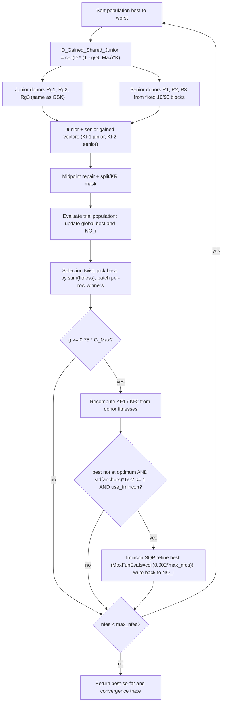

# eGSK — Enhanced Gaining-Sharing Knowledge

> **What this is:** the "enhanced" variant that keeps GSK's junior/senior core but
> swaps four pieces — a fixed 10/90 senior partition, fitness-driven **knowledge
> factors** `KF1`/`KF2`, a population-level **selection twist**, and a late-stage
> **fmincon (SQP) local refinement**. **For:** readers who already know
> [GSK](gsk.md) and want exactly what eGSK changes and why. **Prerequisites:** the
> junior/senior gaining-sharing update, midpoint repair, and the per-coordinate KR
> mask — all unchanged from [GSK](gsk.md). **After reading** you can trace one
> late-stage generation by hand and map every line of `egsk_optimize.m` to its
> math. Early generations behave like plain GSK with `KF1 = KF2 = 0.5` and
> `KR = 1`.
>
> Reference: Jawad, Roshdy & Mohamed, *Results in Control and Optimization* (2025),
> <https://doi.org/10.1016/j.rico.2025.100542>.

## Intuition

eGSK reuses GSK's two-phase backbone unchanged: the same junior gained vector
(rank neighbours + a random peer), the same senior gained vector, the same
midpoint bound repair, and the same per-coordinate split/KR mask. Read
[GSK](gsk.md) for that shared core — it is **not** re-derived here.

What eGSK adds on top:

- **Fitness-shaped knowledge factors.** GSK uses one scalar step `KF`. eGSK keeps
  a *per-individual* junior factor `KF1` and senior factor `KF2`, and in the late
  stage **recomputes them from donor fitnesses** with a triangular membership
  curve. An individual whose fitness sits near a donor "shoulder" gets a small
  step; one sitting mid-way between donors gets a larger step. Anything outside
  the band collapses to `0` (a no-move for that phase).
- **Fixed elite/worst partition.** The senior donors are drawn from a hard-coded
  top-10% / middle / bottom-10% split (GSK's senior `P` knob is gone).
- **A population-level selection twist.** Instead of GSK's row-by-row greedy
  replace, eGSK first compares the *total* fitness of parents vs children and
  picks whichever set is the "base", then patches in the per-row winners. The
  result is still elitist per row, but the base array flips with population state.
- **Late-stage local search.** Once the run is ≥ 75% through its generations, and
  the elite donor fitnesses have converged, eGSK polishes the single best point
  with a bounded `fmincon` SQP solver.

## Mathematical formulation

The junior/senior gained vectors, midpoint repair, and the split/KR mask are
**identical to [GSK](gsk.md)** (`egsk_optimize.m:169-203`). eGSK multiplies the
junior phase by a *per-individual* `KF1` and the senior phase by `KF2`
(`egsk_optimize.m:173,177,183,187`) instead of a single scalar `KF`. Only the
eGSK-specific pieces are formulated below.

**Initial factors, `KR = 1`, scalar `K`** (`egsk_optimize.m:138-141`):

```matlab
KF1 = 0.5 * ones(pop_size, 1);   % junior factor (per individual)
KF2 = 0.5 * ones(pop_size, 1);   % senior factor (per individual)
KR  = 1;   K = 10;               % K scalar -> D_Gained_Shared_Junior is a scalar broadcast
G_Max = fix(max_nfes / pop_size);
```

**Senior donors — fixed 10/90 blocks** (`egsk_gained_shared_senior.m`,
`egsk_optimize.m:167`). The sorted order is split at `round(NP*0.1)` and
`round(NP*0.9)`; one donor is sampled uniformly from each block:

```text
best   block = indBest(1 : round(NP*0.1))
middle block = indBest(round(NP*0.1)+1 : round(NP*0.9))
worst  block = indBest(round(NP*0.9)+1 : NP)
R1 = best  [ ceil(rand(NP) * |best |) ]
R2 = middle[ ceil(rand(NP) * |middle|) ]
R3 = worst [ ceil(rand(NP) * |worst |) ]
```

Compared to GSK this fixes the partition at `P = 0.1` on both ends and removes the
`P` option entirely. (This eGSK-local helper differs from the shared
`Senior(indBest, 0.1)` whenever `round(NP*0.9) ≠ NP - round(NP*0.1)`, so it is
kept as a separate copy.)

**Knowledge factor `KF1` — junior, per individual** (`egsk_optimize.m:230-246`).
The anchors are the *fitnesses* of this individual's three junior donors, and `x1`
is the individual's own fitness:

```text
a1 = fitness(Rg1)          # better rank-neighbour
b1 = fitness(Rg3)          # the random peer  (note: Rg3, not Rg2)
c1 = fitness(Rg2)          # worse rank-neighbour
x1 = fitness

if a1 <= x1 <= b1:  KF1 = (x1 - a1) / (b1 - a1)     # rising shoulder
if b1 <= x1 <= c1:  KF1 = (c1 - x1) / (c1 - b1)     # falling shoulder
otherwise:          KF1 = 0
then clamp inclusive:  KF1(KF1 >= 1) = 0;  KF1(KF1 <= 0) = 0
```

This is a triangular membership peaking where `x1 = b1`: an individual whose
fitness equals the random peer's gets `KF1 = 1` (then clamped to 0); one sitting
on either donor anchor gets `KF1 = 0`.

**Knowledge factor `KF2` — senior, scalar anchors** (`egsk_optimize.m:247-263`).
Same triangular shape, but the anchors are three *scalars* taken from the
**lowest-indexed** senior donor in each block (`min` over the index vector — a
reference quirk), and the same `x2 = fitness` feeds every individual:

```text
a2 = fitness(min(R1))      # min over the R1 INDEX vector
b2 = fitness(min(R2))
c2 = fitness(min(R3))
x2 = fitness

if a2 <= x2 <= b2:  KF2 = (x2 - a2) / (b2 - a2)
if b2 <= x2 <= c2:  KF2 = (c2 - x2) / (c2 - b2)
otherwise:          KF2 = 0
then clamp inclusive:  KF2(KF2 >= 1) = 0;  KF2(KF2 <= 0) = 0
```

Before the late stage fires, both factors are simply the constants
`KF1 = kf1 (=0.5)` and `KF2 = kf2 (=0.5)` for every individual
(`egsk_optimize.m:138-139`).

**Selection twist — population level** (`egsk_optimize.m:217-226`). Let `Fp`, `Fc`
be the parent and child fitness vectors. The *base* array is chosen by total
fitness, then per-row winners overwrite it:

```text
if sum(Fp) < sum(Fc):                 # parents collectively better
    base   = parent_pop
    base[ child strictly wins ] = trial[...]
    new_fitness = min(Fp, Fc) elementwise
else:                                 # children collectively >= parents
    base   = trial
    base[ parent strictly wins ] = parent_pop[...]
    new_fitness = min(Fp, Fc) elementwise
```

Per row the survivor is always the better of parent/child (so it never *loses*
fitness), but which array is copied first flips with the population's total — a
detail that matters only for ties (`Fp == Fc` rows keep the base array's row).

**Late-stage trigger** (`egsk_optimize.m:229-284`). For generations from
`0.75*G_Max` onward, eGSK (1) recomputes `KF1`/`KF2` for the *next* generation
from the donor fitnesses just used, and (2) — gated by two extra conditions — runs
one local search on the global best:

```text
if g >= 0.75 * G_Max:
    recompute KF1, KF2, anchors (a2,b2,c2)               # used next generation
    target_not_reached = ~has_optimum OR best_fitness > optimum + val_2_reach
    elites_converged   = std([a2, b2, c2]) * 1e-2 <= 1.0
    if target_not_reached and elites_converged and use_fmincon:
        refine best_solution with fmincon SQP            # egsk_ip_refine.m
        nfes += details.funcCount
        popold(NO_i,:) = refined best;  fitness(NO_i) = refined best fitness
```

**Local-search budget** (`egsk_ip_refine.m:24-26,30,41`). The `fmincon` call is
capped at `IP_FE = ceil(0.002 * max_nfes)` function evaluations over the box
`[lb, ub]`, starting from `bestx'`, with options
`optimset('Display','off','algorithm','sqp','UseParallel','never','MaxFunEvals',IP_FE)`.
Each objective call adds to `details.funcCount`; the result is accepted only if
`f < best_fitness`. Because `details.funcCount` is added to `nfes`,
`result.nfes` can **slightly exceed** `max_nfes`, exactly like the reference
counter.

## Pseudocode

```text
G_Max = fix(max_nfes / NP)                            # egsk_optimize.m:109
KF1[i] = kf1 (=0.5);  KF2[i] = kf2 (=0.5);  KR = 1;  K = 10   # :138-141
initialize / accept fair-start population, evaluate, record best + NO_i   # :116-135
for g = 1, 2, ... until nfes >= max_nfes:             # :157
    D_Gained_Shared_Junior = ceil(D * (1 - g/G_Max).^K)   # scalar (K scalar)  :159
    indBest      = sort(fitness, 'ascend')            # best -> worst
    [Rg1,Rg2,Rg3] = Gained_Shared_Junior_R1R2R3(indBest)  # SAME as GSK  :165
    [R1,R2,R3]    = egsk_gained_shared_senior(indBest)     # fixed 10/90 blocks  :167
    junior/senior gained (KF1 junior, KF2 senior), repair, split/KR mask  # :169-203
    children_fitness = evaluate(ui);  nfes += n_count; update bsf, NO_i   # :204-214
    selection twist: pick base by sum(fitness), patch per-row winners     # :217-226
    if g >= 0.75 * G_Max:                             # :229
        [KF1, KF2, anchors] = late_stage_factors(fitness, Rg*, R*)        # :230-263
        if (best not at optimum) and std(anchors)*1e-2 <= 1 and use_fmincon:  # :266-275
            [best, best_fit, nfes] = egsk_ip_refine(best, best_fit, nfes, ...)   # :277
            popold(NO_i,:) = best;  fitness(NO_i) = best_fit              # :278-279
    append (nfes, best_so_far) to the convergence trace                  # :286-288
```

## Parameters

Reference defaults (source: `egsk_optimize.m`, `src/optimizers/egsk/README.md`).

| Option | Symbol | Default | Valid range | Meaning | Code |
|---|---|---|---|---|---|
| `seed` | — | required | integer | RNG seed; applied through `gsk_set_rng(options)`. Replaces `rand('seed', sum(100*clock))`. | `egsk_optimize.m:63-66` |
| `rand_generator` | — | `twister` | `threefry` \| `twister` \| `seed` \| `state` | RNG family; unified runner resolves to `threefry` when supported, else `twister`. | `egsk_optimize.m:66` |
| `np` | NP | `100` | integer ≥ 12 | Population size; the fixed 10/90 senior blocks must be non-empty and distinct. | `egsk_optimize.m:106-107` |
| `kf1` | KF1₀ | `0.5` | > 0 (typ. (0,1]) | Initial junior knowledge factor before the late stage recomputes it (broadcast to `NP×1`). | `egsk_optimize.m:142` |
| `kf2` | KF2₀ | `0.5` | > 0 (typ. (0,1]) | Initial senior knowledge factor before the late stage recomputes it. | `egsk_optimize.m:143` |
| `kr` | KR | `1` | [0, 1] | Knowledge ratio — per-coordinate update probability (note: default 1, vs GSK's 0.9). | `egsk_optimize.m:144` |
| `k` | K | `10` | > 0 | Junior-schedule exponent (scalar) — sharpness of the junior→senior handover. | `egsk_optimize.m:145` |
| `use_fmincon` | — | `true` | bool | Enable the late-stage `fmincon` SQP refinement (required for reference mode). | `egsk_optimize.m:86-104` |

The senior partition fraction `P` of GSK has **no eGSK option** — it is fixed at
10/90 inside the donor helper (`egsk_gained_shared_senior.m:16,20,24`). The
late-stage trigger fraction `0.75` and the local-search cap factor `0.002` are
likewise hard-coded (`egsk_optimize.m:229`, `egsk_ip_refine.m:24`). Derived
constants: late-stage trigger `0.75*G_Max`, IP budget `ceil(0.002*max_nfes)`, IP
options `optimset('Display','off','algorithm','sqp','UseParallel','never','MaxFunEvals',IP_FE)`.

## Worked example

Two hand-checkable pieces specific to eGSK: a `KF1`/`KF2` computation, and one
late-stage trigger check. (The trial-vector build itself is GSK's — see the
[GSK worked example](gsk.md#worked-example).)

Setup: `NP = 6`, population already sorted best→worst, with these fitnesses and
the donor indices the helpers produced this generation
(`indBest = [1,2,3,4,5,6]`, 1-based):

```text
index i:   1     2     3     4     5     6
fitness:  5.0   8.0  10.0  14.0  20.0  25.0

junior donors for i = 3:   Rg1 = 2,  Rg2 = 4,  Rg3 = 6
senior donor vectors (one per row); the relevant min-indices are
   min(R1) = 1,  min(R2) = 3,  min(R3) = 6
```

**`KF1` for individual i = 3** (`egsk_optimize.m:230-246`). Anchors from
junior-donor fitnesses: `a1 = fitness(Rg1) = fitness(2) = 8`,
`b1 = fitness(Rg3) = fitness(6) = 25`, `c1 = fitness(Rg2) = fitness(4) = 14`. Own
fitness `x1 = 10`.

```text
first band needs a1 <= x1 <= b1 :  8 <= 10 <= 25   TRUE
KF1 = (x1 - a1) / (b1 - a1) = (10 - 8) / (25 - 8) = 2/17 ~ 0.1176
0 < 0.1176 < 1  ->  kept
KF1[3] ~ 0.1176
```

(For contrast, individual `i = 1` has `x1 = 5`, below `a1 = 8`, so neither band
matches and `KF1[1] = 0` — a junior no-move that generation.)

**`KF2` for individual i = 3** (`egsk_optimize.m:247-263`). Scalar anchors from
the lowest-indexed senior donors: `a2 = fitness(min R1) = fitness(1) = 5`,
`b2 = fitness(min R2) = fitness(3) = 10`, `c2 = fitness(min R3) = fitness(6) = 25`.
Same `x2 = 10`.

```text
first band a2 <= x2 <= b2 :  5 <= 10 <= 10   TRUE
KF2 = (x2 - a2) / (b2 - a2) = (10 - 5) / (10 - 5) = 1.0
but the inclusive clamp rejects KF2 >= 1.0  ->  KF2 = 0
KF2[3] = 0            (sits exactly on the b2 peak shoulder, clamped to 0)
```

These `KF1[3] ~ 0.1176` and `KF2[3] = 0` are what the kernel uses as the
junior/senior step scales for row 3 in the *next* generation.

**Late-stage trigger check** (`egsk_optimize.m:229,266-275`). Suppose
`max_nfes = 6000`, `NP = 6`, so `G_Max = fix(6000/6) = 1000`; the threshold is
`0.75 * 1000 = 750`. Take the elite anchors above, `a2 = 5, b2 = 10, c2 = 25`,
and assume the optimum is unknown so `target_not_reached = True`:

```text
g = 800 >= 750                     -> late stage active
std([5, 10, 25]) = 10.4083...
10.4083 * 1e-2 = 0.1041 <= 1.0     -> elites_converged = True
target_not_reached AND elites_converged AND use_fmincon
   -> run fmincon SQP on best with MaxFunEvals = ceil(0.002 * 6000) = 12
```

So at generation 800 eGSK spends up to 12 evaluations polishing the single best
point and writes any improvement back into `popold(NO_i,:)`. At generation 700
(< 750) none of this runs and eGSK behaves like plain GSK with `KF1 = KF2 = 0.5`.

## Update cycle



## Bounds, budget, and determinism

- **Bound repair** is GSK's midpoint rule, unchanged: a violating coordinate is
  pulled to the midpoint between the parent value and the breached bound
  (`boundConstraint`, `egsk_optimize.m:332-347`). `fmincon` refinement is
  additionally box-constrained to `[lb, ub]` (`egsk_ip_refine.m:30`), so every
  point stays feasible.
- **Budget.** `G_Max = fix(max_nfes / NP)` (`egsk_optimize.m:109`); each generation
  spends one evaluation per child in the strict-`<` scan (`:206-214`). A
  late-stage refinement adds its own `details.funcCount` evaluations to `nfes`
  (`egsk_optimize.m:277`, `egsk_ip_refine.m:41`), so `result.nfes` can include —
  and slightly exceed `max_nfes` by — local-search calls. Best-so-far is monotone
  non-increasing. eGSK never stops early —
  `result.termination = 'max_evaluations'` (`:325`).
- **Determinism.** The per-generation draw order is fixed: `gsk_set_rng(options)`
  seeds the stream (`:66`); then junior `Rg3`, then the fixed-block senior donors
  (`egsk_gained_shared_senior.m` draws `rand(NP)` per block), then the split mask
  and two KR masks (`egsk_optimize.m:192-199`). The `KF1`/`KF2` recomputation and
  the selection twist are pure arithmetic on fitnesses — no extra RNG draws. The
  one non-reproducible-vs-reference piece is the `fmincon` SQP solver, whose
  numerics vary with the MATLAB/Optimization Toolbox version, just as in the
  published code. See [Seed Policy](../reference/seed_policy.md). Under unified
  mode the runner may also provide `options.initial_population` and the matching
  post-initialization RNG state for fair cross-family starts. Convergence is
  recorded once per generation (fmincon's internal evaluations are not appended,
  matching the reference).

## Complexity

Per generation the GSK core is unchanged: `O(NP log NP)` to sort, `O(NP·D)` to
build/repair trials, `O(NP)` evaluations. The eGSK additions are cheap —
`KF1`/`KF2` and the selection twist are `O(NP)` vector ops. The only super-linear
cost is the late-stage `fmincon`, bounded at `ceil(0.002·max_nfes)` evaluations
per call and gated by the convergence test, so it fires rarely. Overall a run is
still `O(max_nfes · D)` time and `O(NP·D)` memory.

## Toolbox policy (fmincon)

The IP stage needs the **Optimization Toolbox**. Reference-mode eGSK requires
`license('test','Optimization_Toolbox') && exist('fmincon','file')`; if `fmincon`
is unavailable, the default call errors before the search starts instead of
silently dropping the IP stage (`egsk_optimize.m:84-104`).

- Toolbox **present** -> refinement runs.
- Toolbox **absent** -> reference-mode run fails with `egsk:fminconUnavailable`.
- `options.use_fmincon = false` -> refinement is skipped only for an explicit
  non-reference diagnostic run, recorded as `'IP refinement disabled via
  options.use_fmincon (non-reference diagnostic mode)'` (`egsk_optimize.m:93-94`).

The port calls MATLAB's real `fmincon` solver (`egsk_ip_refine.m:30`). Numerical
details can therefore vary with MATLAB/Optimization Toolbox version, just as in
the published code. The legacy `optimset` settings (including
`'UseParallel','never'`) are kept exactly as the reference and verified to work on
R2025b.

## When to use

Reach for eGSK when a problem benefits from a **local-polish endgame** and from
**fitness-adaptive step sizes** rather than GSK's single fixed `KF`. The
late-stage SQP refinement helps on smooth, near-unimodal landscapes where the
population has already localized a basin; on rugged multimodal problems the fixed
10/90 elite pressure and the `KF→0` no-moves can stall, and a pool-based adaptive
variant — [AGSK](agsk.md), [APGSK](apgsk.md), [FDB-AGSK](fdb-agsk.md), or
[ATMALS-GSK](atmals-gsk.md) — may explore better. The other local-search variant
uses memory-based perturbation instead of SQP — see [ATMALS-GSK](atmals-gsk.md).
All of these share the junior/senior core documented in [GSK](gsk.md). See
**[../getting-started/runbook.md](../getting-started/runbook.md)** to run it
(install/enable the Optimization Toolbox for reference-mode runs); interface
contract: [matlab_interface.md](../reference/matlab_interface.md).

## Benchmark suites

eGSK's reference targets **CEC2017** (with the SQP late-stage refinement); in this
toolkit it forms the default reproduction matrix on **CEC2017** and **CEC2011**.
See [benchmark_protocol.md](../reference/benchmark_protocol.md).

## Preserved reference quirks

- **`min` over index vectors** for the `KF2` anchors (`fitness(min(R1))`, …) — a
  quirk, kept as written (`egsk_optimize.m:247-249`).
- **Whole-vector re-assignment inside the per-individual loop** (`KF1 = y1;`
  inside the `for k` loop) — preserved (`egsk_optimize.m:243,260`).
- **Clamp boundaries inclusive** (`KF >= 1` and `KF <= 0` both set to 0)
  (`egsk_optimize.m:245-246,262-263`).
- **`NO_i` may be stale** when used as the IP replacement row — transcribed as
  written (`egsk_optimize.m:278`).
- **Unknown optimum.** The escape trigger compares against `optimum + val_2_reach`
  (`1e-8`, or `problem.target_error` when set); with `optimum = NaN` the target
  can never be confirmed reached, so the trigger is treated as satisfied
  (`egsk_optimize.m:266`).

Sanctioned modernization (the only one): deterministic seeding through
`gsk_set_rng(options)` instead of the reference wall-clock seed.
`result.error = best_fitness − optimum`, zeroed below `target_error`, `NaN` when
the optimum is unknown (`egsk_optimize.m:294-301`). Runner-level seed formulas are
in [seed_policy.md](../reference/seed_policy.md).

## Source and validation

- Kernel: `src/optimizers/egsk/egsk_optimize.m` (with its local `boundConstraint`
  subfunction); local search `egsk_ip_refine.m` (the `IP.m` port); fixed-block
  senior donors `egsk_gained_shared_senior.m`; shared junior donors
  `src/common/Gained_Shared_Junior_R1R2R3.m`. Transcribed line-by-line from the
  reference `eGSK.m` and `IP.m` (Jawad, Roshdy & Mohamed,
  <https://doi.org/10.1016/j.rico.2025.100542>).
- Baseline: [gsk.md](gsk.md); adaptive relatives: [agsk.md](agsk.md),
  [apgsk.md](apgsk.md), [fdb-agsk.md](fdb-agsk.md); other local-search variant:
  [atmals-gsk.md](atmals-gsk.md). Concepts:
  [explainer.md](../getting-started/explainer.md); terms:
  [glossary.md](../reference/glossary.md).
- Tested for the eGSK senior helper, late-stage `KF1`/`KF2` factors, the selection
  twist, deterministic replay, fair-start replay, budget crossing, and optional
  local search on/off. See [Validation Report](../research/validation_report.md)
  and [Numerical Examples](../research/numerical_examples.md).
