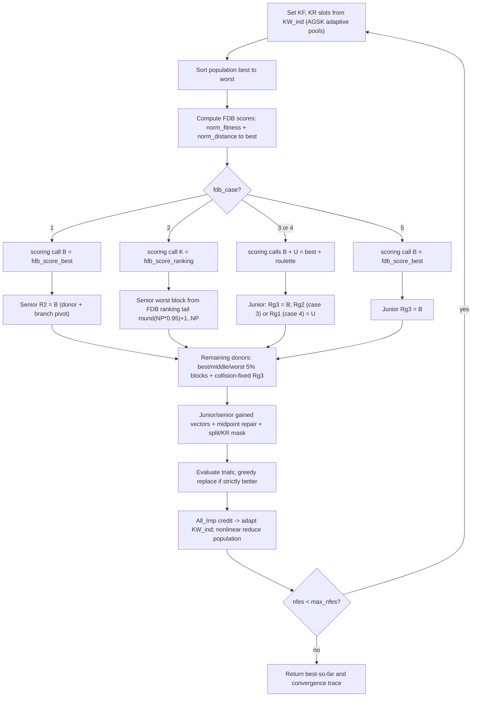

# FDB-AGSK — Fitness-Distance-Balance AGSK

> **What this is:** [AGSK](agsk.md) with one change — some random donor picks are
> replaced by a **Fitness-Distance-Balance (FDB)** selected individual. **For:**
> readers who already know the gaining-sharing core and want the FDB donor twist.
> **Prerequisites:** [GSK](gsk.md) (junior/senior core, midpoint repair, KR mask)
> and [AGSK](agsk.md) (adaptive `KF`/`KR` pools, `KW_ind`/`All_Imp` credit,
> nonlinear population reduction). **After reading** you can compute an FDB score
> by hand and say exactly which donor each of the five `fdb_case` values replaces.

## Intuition

FDB-AGSK keeps the entire AGSK machine intact: the same junior/senior gained
vectors, the same midpoint bound repair, the same per-coordinate split + KR mask,
the same adaptive `(KF, KR)` pools, the same `KW_ind`/`All_Imp` improvement
credit, and the same nonlinear population reduction. Only the **donor indices**
change.

Plain AGSK fills its donor slots from rank neighbours (junior) and from
best/middle/worst rank blocks (senior), choosing within each block **uniformly at
random**. FDB-AGSK argues that purely random donors waste guidance: a good donor
should be both **fit** (low objective value) and **diverse** (far from the
current best, so it pulls the search somewhere new). The **Fitness-Distance
Balance** score rewards exactly that combination — it is large for individuals
that are simultaneously near the top of the ranking and far from the best point
in space. FDB-AGSK computes that score each generation and splices the chosen
individual(s) into specific donor slots. The `options.fdb_case` option (1–5)
picks *which* slots get overwritten and *which* flavour of FDB pick goes there.
Five published cases come from the self-contained reference files
`FDB_AGSK_Case1.m … Case5.m`.

Everything else — the schedules, the credit accounting, the reduction — is
inherited unchanged, so this guide spends its budget on the FDB score and the
five injection cases. Case 1 is the default because it is the first/canonical
case of the reference set (`fdb_agsk_optimize.m:79`).

## Mathematical formulation

### The FDB score

Let the population be `x_1 … x_NP` with fitness `f_1 … f_NP`. Let `b = argmin f`
be the **best** individual and `x_b` its position. `fdb_score_best` (the
`FDB_Func1` port `fdb_score_best.m`) computes, per individual, the Manhattan
(L1) distance to the best, a normalised fitness and a normalised distance, then
sums them:

```text
d_i         = sum_j | x_b,j - x_i,j |                    # L1 distance to best
norm_fit_i  = 1 - (f_i - min_f) / (max_f - min_f)
norm_dist_i = (d_i - min_d) / (max_d - min_d)
FDB_i       = norm_fit_i + norm_dist_i
```

where `min_f, max_f` are the min/max fitness and `min_d, max_d` the min/max of
the distance vector `d`. Two consequences fall straight out of the algebra:

- **Fitness is inverted** (the `1 - …`), so the *best* individual gets
  `norm_fit = 1` and the *worst* gets `0`. Higher FDB = better.
- The best individual `x_b` has `d_b = min_d` (it is closest to itself), so its
  `norm_dist = 0`. Its score is therefore exactly `1.0`, and any individual that
  is reasonably fit **and** reasonably far from `x_b` can beat it. That tension
  is the whole point: FDB never just returns the fitness-best.

### The three scoring calls

The score feeds three reference selection routines:

```text
fdb_score_best(pop, fitness)      -> argmax_i FDB_i            # single index   (FDB_Func1)
fdb_score_ranking(pop, fitness)   -> indices sorted desc FDB   # full ranking   (FDB_Func2)
fdb_score_roulette(pop, fitness)  -> roulette pick, P_i prop FDB_i  # single index (RFDB_Func1)
```

`fdb_score_best` returns the single highest-FDB individual. `fdb_score_ranking`
returns *all* indices sorted best-FDB → worst (used to re-define the senior worst
block in case 2). `fdb_score_roulette` draws one index with probability
proportional to its FDB score.

**Degeneracy guards.** If the fitness is flat (`min_f == max_f`),
`fdb_score_best` returns `randi(NP)` (consuming one RNG draw);
`fdb_score_ranking` in its degenerate branch returns an **empty** ranking, so the
case-2 caller errors exactly like the reference.

### Which donor slots get the FDB pick

The shared kernel builds each gained vector from three donor indices. Junior
donors `(Rg1, Rg2, Rg3)`: `Rg1`/`Rg2` are the better/worse **rank neighbours**
(`fdb_agsk_optimize.m:362-374`), `Rg3` is the third term in the gained vector.
Senior donors `(R1, R2, R3)`: `R1` from the **best 5%** block, `R2` from the
**middle** block (and also the senior branch pivot `f_i > f(R2)`,
`fdb_agsk_optimize.m:217`), `R3` from the **worst 5%** block. The senior
partition uses `round(NP*0.05)` / `round(NP*0.95)`
(`fdb_agsk_optimize.m:421,430`).

Each `fdb_case` replaces a different subset of those six indices. The junior
overrides live in `fdb_junior_r1r2r3` (`fdb_agsk_optimize.m:345-404`), the senior
overrides in `fdb_senior_r1r2r3` (`fdb_agsk_optimize.m:406-452`). Writing
`B = fdb_score_best`, `K = fdb_score_ranking`, `U = fdb_score_roulette`:

```text
case  scoring call(s)        junior donors                     senior donors
                             (Rg1,   Rg2,   Rg3)               (R1,    R2,   R3)
----  ---------------------  -------------------------------   ---------------------------
 1    B (scalar)             neigh,  neigh, RANDOM             best5%, = B,  worst5%
 2    K (full ranking)       neigh,  neigh, RANDOM             best5%, mid,  K-tail (round(NP*0.95)+1..NP)
 3    B and U                neigh,  = U,   = B                best5%, mid,  worst5%
 4    B and U                = U,    neigh, = B                best5%, mid,  worst5%
 5    B (scalar)             neigh,  neigh, = B                best5%, mid,  worst5%
```

Reading the table case by case (each "RANDOM" is the usual collision-free uniform
junior `Rg3` draw `floor(rand*NP)+1`, `fdb_agsk_optimize.m:378`):

- **Case 1** (`fdb_agsk_optimize.m:426-432`). Junior is untouched (standard random
  `Rg3`). **Senior `R2` is forced to the FDB-best index `B`** — the same guide
  index for every row (`:428`). Because `R2` is also the senior branch pivot
  (`:217`), case 1 changes both the donor *and* the comparison `f_i > f(R2)`.
  `R1`/`R3` are still sampled from the best/worst 5% partitions.
- **Case 2** (`fdb_agsk_optimize.m:433-441`). Junior untouched. Senior `R1`/`R2`
  are normal best/middle picks, but **`R3` is sampled from the tail of the FDB
  descending ranking** (positions `round(NP*0.95)+1 … NP`, `:439`) — the worst
  block is re-defined by FDB score instead of by raw fitness.
- **Case 3** (`fdb_agsk_optimize.m:379-382`). **Junior `Rg2 = U` (RFDB roulette)
  and `Rg3 = B` (FDB best)**, both overwriting the ring-computed values before the
  collision loop; senior is fully standard (0.05 / middle / 0.95). Two of the
  three junior donors become FDB picks.
- **Case 4** (`fdb_agsk_optimize.m:383-386`). **Junior `Rg1 = U` (RFDB roulette)
  and `Rg3 = B` (FDB best)**; senior standard. Like case 3 but the roulette pick
  replaces the *better* neighbour `Rg1` instead of the worse neighbour `Rg2`.
- **Case 5** (`fdb_agsk_optimize.m:387-389`). **Junior `Rg3 = B` (FDB best)** only;
  senior standard. The lightest touch — a single FDB injection into the junior
  third term.

After any junior override, `Rg3` (a constant index column in cases 3–5) still
passes through the same collision-regeneration loop that re-randomises any
position where `Rg3 ∈ {Rg1, Rg2, i}` (`fdb_agsk_optimize.m:392-402`) — so the
constant-index injection is partially re-randomised wherever it collides, exactly
as the reference.

### Transcribed AGSK machinery

The pool, credit, schedule and reduction code is the AGSK reference verbatim:

```matlab
KF_pool = [0.1 1.0 0.5 1.0];   KR_pool = [0.2 0.1 0.9 0.9];   % fdb_agsk_optimize.m:95-96
% setting probabilities start at [0.85 0.05 0.05 0.05] while nfes < 0.1*max_nfes,
% then KW_ind = 0.95*KW_ind + 0.05*All_Imp (normalised), 0.05-floor / largest-remainder rule.
% per-individual K: rand in (0,1) w.p. 0.5, else ceil(20*rand) in {1..20}  (:131-134)
D_Gained_Shared_Junior = ceil(D * (1 - nfes/max_nfes) .^ K);   % nfes-ratio schedule  (:182)
% nonlinear reduction toward min_pop_size = 12, removing the current worst (K trimmed too)  (:287-302)
```

See [AGSK](agsk.md) for how the pools and `KW_ind`/`All_Imp` credit adapt.

## Pseudocode

```text
pop_size = np_init;   max_pop_size = pop_size;   min_pop_size = 12      # fdb_agsk_optimize.m:99-100
initialize / accept fair-start population, evaluate, record best (vector too)
draw per-individual K (rand(NP,1) split 0.5/0.5)                        # :131-134
while nfes < max_nfes:                                                  # :154
    if isempty(KW_ind) or nfes < 0.1*max_nfes: KW_ind = [0.85 0.05 0.05 0.05]   # :160
    else:  KW_ind = 0.95*KW_ind + 0.05*All_Imp;  renormalise                    # :170-171
    relabel rand(NP,1) into slot 1..4 via cumulative KW_ind; KF,KR = pool(slot) # :162-178
    D_Gained_Shared_Junior = ceil(D * (1 - nfes/max_nfes).^K)          # nfes-ratio  :182
    [fdbIndex, RfdbIndex] = scoring_call(fdb_case, pop, fitness)       # B / K / U   :188-198
    indBest = sort(fitness, 'ascend')                                  # best -> worst
    [Rg1,Rg2,Rg3] = fdb_junior_r1r2r3(indBest, fdb_case, fdbIndex, RfdbIndex)   # case overrides
    [R1,R2,R3]    = fdb_senior_r1r2r3(indBest, fdb_case, fdbIndex)              # case overrides
    junior/senior gained vectors (branch on f_i > f(Rg3) / f_i > f(R2))         # :204-225
    boundConstraint both (midpoint repair)                            # :226-227
    split mask (rand <= D_junior/D) + two KR masks; assemble trial ui # :229-240
    children_fitness = evaluate(ui);  nfes += n_count, update bsf      # :242-252
    All_Imp = per-slot improvement credit; floor 0.05 / largest-remainder       # :260-280
    greedy: fitness = min(parent, child); popold <- winners           # :281-284
    plan_pop_size = round((min-max)*(nfes/max_nfes)^(1-nfes/max_nfes)+max); drop worst, trim K   # :287-302
    append (nfes, best_so_far) to the convergence trace               # :304-306
```

The only lines that differ from [AGSK](agsk.md) are the scoring call and the two
`fdb_*_r1r2r3` donor builders; the gained-vector kernel, credit update, greedy
selection, and reduction are the AGSK code unchanged.

## Parameters

Current interface defaults (source: `fdb_agsk_optimize.m`,
`src/optimizers/fdb-agsk/README.md`). The sphere-harness `40*D` population is
opt-in through `options.np_init`.

| Option | Symbol | Default | Valid range | Meaning | Code |
|---|---|---|---|---|---|
| `seed` | — | required | integer | RNG seed; applied through `gsk_set_rng(options)`. Direct calls default to `twister`. | `fdb_agsk_optimize.m:74-77` |
| `rand_generator` | — | `twister` | `threefry` \| `twister` \| `seed` \| `state` | RNG family; unified runner resolves to `threefry` when supported, else `twister`. | `fdb_agsk_optimize.m:77` |
| `fdb_case` | — | `1` | integer in `{1,2,3,4,5}` | Donor-injection case (see table above). | `fdb_agsk_optimize.m:79-86` |
| `np_init` | NP₀ | `100` | integer ≥ `min_pop_size` | Initial population size before reduction (`40*D` reference harness opt-in). | `fdb_agsk_optimize.m:92-93` |
| `min_pop_size` | NP_min | `12` | integer ≥ 11 | Floor the population reduces to. | `fdb_agsk_optimize.m:100-101` |

Fixed (not exposed): `KF_pool = [0.1 1.0 0.5 1.0]`, `KR_pool = [0.2 0.1 0.9 0.9]`
(`fdb_agsk_optimize.m:95-96`). Invalid `fdb_case` raises `fdb_agsk:invalid_case`.

`fdb_case` value meanings (overrides applied each generation):

| `fdb_case` | Scoring call | What it overrides |
|---|---|---|
| `1` | `fdb_score_best` (scalar) | Senior `R2` ← FDB-best (also the senior branch pivot); `R1`/`R3` from best/worst 5%. |
| `2` | `fdb_score_ranking` (array) | Senior worst block re-sampled from the FDB-ranking tail `round(NP*0.95)+1..NP`; `R1`/`R2` standard. |
| `3` | `fdb_score_best` + `fdb_score_roulette` | Junior `Rg2` ← RFDB-roulette, `Rg3` ← FDB-best. |
| `4` | `fdb_score_best` + `fdb_score_roulette` | Junior `Rg1` ← RFDB-roulette, `Rg3` ← FDB-best. |
| `5` | `fdb_score_best` (scalar) | Junior `Rg3` ← FDB-best. |

## Worked example

FDB-AGSK chooses some donors using both fitness quality and distance from the
current best. Suppose three candidates have these values:

| Candidate | Fitness | Manhattan distance to best |
|---|---:|---:|
| A | 10 | 0 |
| B | 14 | 5 |
| C | 18 | 2 |

Normalize fitness so lower objective is better:

```text
norm_fit = 1 - (fitness - min_fitness) / (max_fitness - min_fitness)

A = 1 - (10-10)/(18-10) = 1.00
B = 1 - (14-10)/(18-10) = 0.50
C = 1 - (18-10)/(18-10) = 0.00
```

Normalize distance:

```text
norm_dist = (distance - min_distance) / (max_distance - min_distance)

A = (0-0)/(5-0) = 0.00
B = (5-0)/(5-0) = 1.00
C = (2-0)/(5-0) = 0.40
```

The FDB score is the sum:

| Candidate | `norm_fit` | `norm_dist` | FDB score |
|---|---:|---:|---:|
| A | 1.00 | 0.00 | 1.00 |
| B | 0.50 | 1.00 | 1.50 |
| C | 0.00 | 0.40 | 0.40 |

The FDB-best index is therefore **B**, not A. A is the current best by objective,
but B is fit enough and far enough away to be a better diversity donor. This is
the core idea behind the FDB case injections. With `fdb_case = 5`, every junior
gained vector that generation uses `Rg3 = B` as its third donor; with
`fdb_case = 1`, every senior gained vector uses `R2 = B` as both its middle donor
and its branch pivot `f_i > f(B)`.

## Update cycle



## Bounds, budget, and determinism

- **Bounds and repair** are unchanged from [GSK](gsk.md): each gained coordinate
  that violates a bound is pulled to the midpoint between the *parent* value and
  the breached bound (`boundConstraint`, `fdb_agsk_optimize.m:454-469`).
- **Budget.** The whole final generation is evaluated, but the post-evaluation
  scan increments `nfes` before it checks the budget and breaks once
  `nfes > max_nfes`, so only children within budget can update the best-so-far
  (`fdb_agsk_optimize.m:245-252`). When a generation crosses the budget
  mid-population, the internal per-child counter therefore reads `max_nfes + 1`
  (the reference counter semantics). The reported `result.nfes` and
  `convergence.nfes` are clipped at `max_nfes` (`:136-145,305,337`); that is
  bookkeeping only, since the internal counter that drives the KW phase, the
  junior schedule, and the reduction plan is unchanged. The population shrinks under nonlinear reduction toward `min_pop_size`
  (`:287-302`). FDB-AGSK has **no target-error early stop** — the loop always runs
  to `max_nfes` and reports `result.termination = 'max_evaluations'`
  (`fdb_agsk_optimize.m:338`). `result.error = best_fitness − optimum`, zeroed
  below `target_error`, `NaN` when the optimum is unknown (`:312-319`).
- **Determinism.** All randomness flows from the caller's RNG in a fixed order:
  `gsk_set_rng(options)` seeds it (`:77`); per generation the slot draw
  `K_rand_ind = rand(NP,1)` comes first (`:162,172`), then the scoring call
  (which draws only on its fallback path, or for roulette), then junior `Rg3`,
  then the senior block samples, then the split mask and two KR masks
  (`:229-236`). Serial
  and parallel runs match bit-for-bit. See
  [Seed Policy](../reference/seed_policy.md).

## Complexity

Per generation, on top of AGSK's `O(NP log NP)` sort and `O(NP·D)` trial build,
the FDB score adds `O(NP·D)` for the distance vector and `O(NP)` (or
`O(NP log NP)` for `fdb_score_ranking`) for selection — so the asymptotics are
unchanged: `O(max_nfes·D)` time, `O(NP·D)` memory over the run.

## When to use

Reach for FDB-AGSK when plain [AGSK](agsk.md) stalls because its random donors
keep re-using nearby points and you want donor *diversity* steered by a principled
fitness-distance trade-off. Start with `fdb_case = 1` (the default, lightest
senior injection); cases 3–4 are more aggressive (two junior donors replaced) and
worth trying when exploration is the bottleneck. If you do not need FDB donor
steering, the plain [AGSK](agsk.md), [APGSK](apgsk.md), or [GSK](gsk.md) baselines
are simpler. For comparison this optimizer sits alongside
[ATMALS-GSK](atmals-gsk.md), [eGSK](egsk.md) and [DT-GSK](dt-gsk.md) in the
family. See
**[../getting-started/command_reference.md](../getting-started/command_reference.md)** to run it (pass
`options.fdb_case` to pick a case); interface contract:
[matlab_interface.md](../reference/matlab_interface.md).

## Benchmark suites

The reference cases were run on a **sphere** problem (the reference
`problem.m` / `problem_terminate.m` harness: D = 100, `maxFEs = 1000*D`,
`pop_size = 40*D`), not a CEC suite. Running FDB-AGSK on the CEC suites through
the generic `problem` interface is a **framework-level extension** of this port
(not a reference-validated setup). In this toolkit it appears in the default
matrix on **CEC2017** and **CEC2011** as an extension; see
[benchmark_protocol.md](../reference/benchmark_protocol.md).

## Preserved reference quirks

- **Initial best-solution recording.** The reference Case files record only the
  *fitness* of the best-so-far during the initial population scan, not the vector;
  this port records the vector too (`fdb_agsk_optimize.m:123`), so
  `result.best_x` is always defined. Pure bookkeeping — no RNG draw or trajectory
  change (the reference would otherwise crash at its final `disp(bsf_solution)` if
  no child ever improved on the initial best).
- **Adaptive branch and tiny budgets.** The original reference flow assumes
  `np_init < 0.1*max_nfes`, true for `40*D` vs `1000*D`. This port adds an
  `isempty(KW_ind)` phase guard (`fdb_agsk_optimize.m:160`) so reduced-budget runs
  stay robust; the guard is inert on validated full-budget runs where the `nfes`
  condition fires first.
- **`fdb_score_best` flat-fitness branch** returns `randi(NP)` (consuming one RNG
  draw); **`fdb_score_ranking`** in its degenerate branch returns an **empty**
  ranking (so the case-2 caller errors, exactly like the reference).
- **`dif_val` is computed and never used**, as written (`fdb_agsk_optimize.m:258`).

Sanctioned modernization (the only one): deterministic seeding through
`gsk_set_rng(options)` (the reference relies on session RNG state). Under unified
mode the runner may also provide `options.initial_population` and the matching
post-initialization RNG state for fair cross-family starts; runner-level seed
formulas are in [seed_policy.md](../reference/seed_policy.md).

## Source and validation

- Kernel: `src/optimizers/fdb-agsk/fdb_agsk_optimize.m` (with its local
  case-parameterized junior/senior donor builders `fdb_junior_r1r2r3`,
  `fdb_senior_r1r2r3` and the `boundConstraint` subfunction; FDB-AGSK does not
  call the shared `src/common/Gained_Shared_Junior_R1R2R3.m`); FDB scores
  `fdb_score_best.m`, `fdb_score_ranking.m`, `fdb_score_roulette.m`. Transcribed
  from the reference `FDB_AGSK_Case1.m … Case5.m`, `FDB_Func1.m`, `FDB_Func2.m`,
  `RFDB_Func1.m`, with the reference draw order; the interface default
  `np_init = 100` differs from the reference harness's `40*D`, which is opt-in via
  `options.np_init` (see Parameters). Reuses the [AGSK](agsk.md) adaptive
  machinery.
- Parent algorithm whose machinery this reuses: [agsk.md](agsk.md); baseline:
  [gsk.md](gsk.md). Concepts: [explainer.md](../getting-started/explainer.md);
  terms: [glossary.md](../reference/glossary.md).
- Validated to reproduce the reference tables. `src/tests/test_fdb_agsk_smoke.m`
  covers the default configuration, all five injection cases (exercising the
  best/ranking/roulette FDB score modes), invalid-case rejection, same-seed
  deterministic replay, and budget handling (reported `nfes` equal to
  `max_nfes`). The unified fair-start path (runner `X0` plus the post-`X0` RNG
  state) is checked through `run_experiment` by
  `src/tests/test_runner_fair_start.m`. The flat-fitness degeneracy fallbacks
  (including the preserved Case-2 empty-ranking error) are not yet pinned by a
  test. See
  [Validation Report](../research/validation_report.md) and
  [Numerical Examples](../research/numerical_examples.md).
