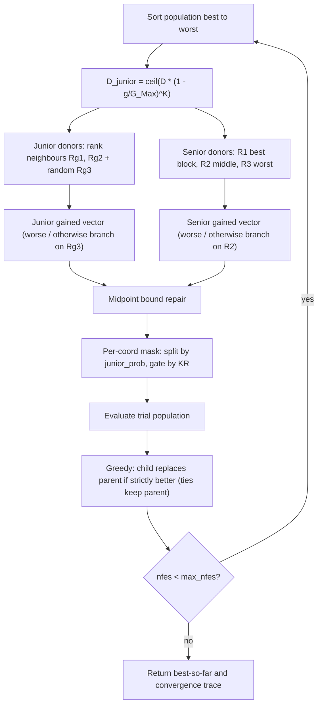

# GSK — Gaining-Sharing Knowledge (baseline)

> **What this is:** the reference algorithm of the family and the baseline every
> other optimizer in this toolkit extends. **For:** anyone who wants to
> understand the core gaining-sharing update before reading a variant.
> **Prerequisites:** basic population-based optimization. **After reading** you
> can trace one generation by hand and map every line of
> `src/optimizers/gsk/gsk_optimize.m` to its math.

## Intuition

GSK (**G**aining-**S**haring **K**nowledge) is the baseline population-based
optimizer this whole toolkit is built around; every other page here describes a
published variation on its skeleton. It improves a population of candidate
solutions across generations using two "knowledge" phases inspired by how people
learn:

- **Junior phase (exploration).** Early on, an individual learns from the two
  near-rank neighbours next to it in the fitness ranking and from one random
  peer. This spreads the search widely.
- **Senior phase (exploitation).** Later, an individual learns from the **best**
  and the **worst** of the population, mediated by a **middle** performer. This
  refines around good regions.

Each *coordinate* of an individual is assigned to one phase per generation. A
schedule moves coordinates from junior to senior as the run progresses, so the
search transitions smoothly from exploration to exploitation. All control
parameters are **fixed** for the whole run — what changes in the variants is
exactly which of those parameters become adaptive. For the plain-language idea,
see [explainer.md](../getting-started/explainer.md).

## Mathematical formulation

Let `x_i` be individual `i`, with the population sorted best->worst by ascending
fitness. `KF` is the knowledge factor (step scale), `KR` the knowledge ratio
(per-coordinate update probability), `P` the senior partition fraction.

**Junior gained vector** (`gsk_optimize.m:108-117`). Donors `Rg1`, `Rg2` are the
just-better and just-worse rank neighbours of `x_i`; `Rg3` is one random peer.
With `worse = f(x_i) > f(x_Rg3)`:

```text
worse:      g_j = x_i + KF * ( x_Rg1 - x_Rg2 + x_Rg3 - x_i )
otherwise:  g_j = x_i + KF * ( x_Rg1 - x_Rg2 + x_i - x_Rg3 )
```

**Senior gained vector** (`gsk_optimize.m:122-131`). The sorted population is
split into a best block (top `round(NP*P)`), a middle block, and a worst block
(bottom `round(NP*P)`); `R1`, `R2`, `R3` are random picks from those blocks. With
`worse = f(x_i) > f(x_R2)`:

```text
worse:      g_s = x_i + KF * ( x_R1 - x_i + x_R2 - x_R3 )
otherwise:  g_s = x_i + KF * ( x_R1 - x_R2 + x_i - x_R3 )
```

The senior-phase formula has a Differential-Evolution-style vector structure, but
donor selection is rank-aware rather than purely random.

**Midpoint bound repair** (`gsk_bound_repair.m:20-28`). Per coordinate `j`, using
the *parent* value `x_i,j`:

```text
g < lb_j:  g = (x_i,j + lb_j) / 2
g > ub_j:  g = (x_i,j + ub_j) / 2
```

Components inside the bounds are untouched, and the repair consumes no random
numbers.

**Junior coordinate schedule** (`gsk_optimize.m:97`). At generation `g` of
`G_Max`, with the per-individual exponent vector `k_vec = K*ones(NP,1)`:

```text
D_Gained_Shared_Junior = ceil( D * (1 - g / G_Max) ^ K )
junior_prob            = D_Gained_Shared_Junior / D
```

`(1 - g/G_Max)` shrinks from 1 to 0, and the exponent `K = 10` makes the
junior->senior handover sharp: early generations are almost all junior, late
generations almost all senior.

**Per-coordinate mask** (`gsk_optimize.m:141-156`). The junior-probability mask
(`rand <= junior_prob`) splits coordinates into junior vs senior; the senior mask
is its complement. Each side is then filtered by an independent `rand <= KR`
mask. Unselected coordinates keep the parent value:

```text
junior coord (rand_split <= junior_prob): take g_j only if rand_kr_junior <= KR
senior coord (otherwise):                 take g_s only if rand_kr_senior <= KR
```

**Selection** is pairwise greedy (`gsk_optimize.m:177-179`): the child replaces
the parent only where `f(child) < f(parent)` (`min([fitness, children_fitness],
[], 2)`), so the population never worsens. **Ties keep the parent.**

## Pseudocode

```text
G_Max = fix(max_nfes / NP)                          # gsk_optimize.m:43  (full budget)
initialize / accept fair-start population, evaluate, scan best
k_vec = K * ones(NP, 1)                              # gsk_optimize.m:77
for g = 1, 2, ... until nfes >= max_nfes:           # gsk_optimize.m:92
    D_junior   = ceil(D * (1 - g/G_Max)^K)          # gsk_optimize.m:97
    order      = sort(fitness, 'ascend')            # best -> worst
    [Rg1,Rg2,Rg3] = junior_donors(order)            # rank neighbours + random
    [R1,R2,R3]    = senior_donors(order, P)         # best / middle / worst blocks
    g_j = junior_update(...);  midpoint_repair(g_j) # better/worse branch on Rg3
    g_s = senior_update(...);  midpoint_repair(g_s) # better/worse branch on R2
    trial = masked choice of g_j / g_s / parent     # split mask + KR gates
    evaluate trial; nfes += min(NP, max_nfes - nfes); scan best
    greedy replace: parent <- child where f(child) < f(parent)   # ties keep parent
    append (nfes, best_so_far) to the convergence trace
# never stops early; runs the whole budget
```

## Parameters

All defaults are the reference values, overridable through `options` (read with a
local helper that falls back to the default when the field is absent or empty;
`gsk_optimize.m:221-228`). Source: `gsk_optimize.m:25-29` and
`src/optimizers/gsk/README.md`.

| Option | Symbol | Default | Valid range | Meaning | Code |
|---|---|---|---|---|---|
| `seed` | — | required | integer | RNG seed; applied through `gsk_set_rng(options)` at entry. | `gsk_optimize.m:20-23` |
| `rand_generator` | — | `twister` | `threefry`, `twister`, `seed`, `state` | RNG family. Direct calls default to `twister`; unified runner mode resolves to `threefry` when supported, else `twister`. | `gsk_optimize.m:23` |
| `np` | NP | `100` | integer >= 6 at default `P=0.1` (junior needs NP>=4; senior needs non-empty best/worst blocks) | Population size. | `gsk_optimize.m:25` |
| `kf` | KF | `0.5` | > 0 (typ. (0,1]) | Knowledge factor — step scale along the donor direction. | `gsk_optimize.m:26` |
| `kr` | KR | `0.9` | [0, 1] | Knowledge ratio — per-coordinate probability of adopting the proposed change. | `gsk_optimize.m:27` |
| `k` | K | `10` | > 0 | Knowledge rate — exponent of the junior->senior schedule (larger = sharper handover). | `gsk_optimize.m:28` |
| `p` | P | `0.1` | (0, 0.5) | Senior rank-partition fraction (best/worst block sizes = round(NP*P)). | `gsk_optimize.m:29` |

In `GSK_Enhanced.m` the senior partition is inlined as `round(NP*0.1)` /
`round(NP*0.9)`; here it is passed as `P = 0.1` to the shared senior helper, which
reproduces those boundaries bit-for-bit.

## Worked example

Consider a two-dimensional minimization problem with bounds `[-5, 5]` and one
candidate:

```text
x_i = [2, -1]
```

Suppose the junior donor helper returns:

```text
x_Rg1 = [1, -2]
x_Rg2 = [4,  0]
x_Rg3 = [0,  3]
KF    = 0.5
KR    = 0.9
```

If the branch `f(i) > f(Rg3)` is active, the junior proposal is:

```text
direction = x_Rg1 - x_Rg2 + x_Rg3 - x_i
          = [1-4+0-2, -2-0+3-(-1)]
          = [-5, 2]

g_j = x_i + KF * direction
    = [2, -1] + 0.5 * [-5, 2]
    = [-0.5, 0]
```

For `D = 2`, if the schedule gives `D_junior = 1`, each coordinate has
probability `1/2` of being assigned to junior learning before the independent
`KR` mask is applied:

| Coordinate | Schedule draw | `KR` draw | Source used |
|---:|---:|---:|---|
| 1 | `0.30 <= 0.50` | `0.20 <= 0.90` | junior value `-0.5` |
| 2 | `0.70 > 0.50` | senior mask decides | senior or parent |

This is why GSK is not just one vector equation. A trial vector is a
coordinate-wise mixture of junior information, senior information, and unchanged
parent coordinates. The child is evaluated and replaces `x_i` only if its fitness
is strictly better.

## Update cycle



## Bounds, budget, and determinism

- **Bound repair** never reflects past the parent; it pulls a violating
  coordinate to the midpoint between the *parent* and the breached bound, so
  trials stay inside `[lb, ub]` and near their parent (`gsk_bound_repair.m`).
- **Budget.** `G_Max = fix(max_nfes / NP)` and the loop runs whole generations,
  so the final generation may be partially counted (`n_count = min(NP, max_nfes -
  nfes)`, `gsk_optimize.m:166`). The best-so-far is monotone non-increasing.
- **Termination — never stops early.** GSK runs the whole budget; `result.error`
  is `best_fitness - optimum`, zeroed only when **strictly below** the target
  (`1e-8`). `result.termination` is therefore *always* `'max_evaluations'`. This
  differs from [AGSK](agsk.md)/[APGSK](apgsk.md), which stop early.
- **Determinism.** All randomness comes from the caller's RNG in a fixed
  per-generation draw order (junior `Rg3` -> senior donors -> junior probability
  mask -> junior KR mask -> senior KR mask), preserved so the stream matches the
  reference; convergence is recorded once per generation. See
  [Seed Policy](../reference/seed_policy.md).

## Complexity

Per generation: `O(NP log NP)` to sort, `O(NP*D)` to build and repair trials,
`O(NP)` evaluations. Over a run of `G_Max ~ max_nfes/NP` generations the total is
`O(max_nfes * D)` time and `O(NP*D)` memory.

## When to use

GSK is the baseline: a strong, low-parameter starting point and the control in
every comparison. If a run needs population reduction or self-tuned `KF`/`KR`,
reach for a variant — [AGSK](agsk.md) (adaptive pools + LPSR),
[APGSK](apgsk.md) (negative-KF pool + stochastic schedule),
[FDB-AGSK](fdb-agsk.md), [ATMALS-GSK](atmals-gsk.md), or [eGSK](egsk.md) — all of
which reuse the junior/senior core above.

Default reproduction matrix: **CEC2017** (functions 1-30; D in {10, 30, 50, 100};
budget `10000 * D`; target error `1e-8`) and **CEC2011** (22 real-world problems,
fixed native dimensions, no published optima, budget 150,000, no target). CEC2013,
CEC2013LSGO and CEC2020 are runnable extensions, not reference reproductions for
GSK. Exact rules: [benchmark_protocol.md](../reference/benchmark_protocol.md).

## Preserved reference quirks

These are deliberate fidelity choices (detailed in
`src/optimizers/gsk/README.md`):

- **`G_Max` from the full budget.** `G_Max = fix(max_nfes/NP)` counts the
  initialization evaluations, so the generation counter `g` never exceeds `G_Max`
  and the schedule base `(1 - g/G_Max)` never goes negative.
- **Budget-crossing semantics.** The final generation is **always fully
  evaluated** (one `problem.evaluate` call for all NP children), but only the
  first `max_nfes - nfes` children update the counter and best-so-far (sequential
  strict-`<` scan, first minimum wins); the greedy selection still uses every
  child. `result.nfes` is clipped at `max_nfes` exactly as in `GSK_Enhanced.m`.
- **Fixed per-generation random draw order** (junior `Rg3` -> senior donors ->
  junior probability mask -> junior KR mask -> senior KR mask), preserved so the
  RNG stream matches the reference.
- **Midpoint repair**, **greedy ties-to-parent**, and the junior/senior
  better-worse displacement branching are transcribed unchanged.

The only sanctioned deviation is deterministic seeding through
`gsk_set_rng(options)` instead of the reference driver's external per-run seeding.
`result.error` is `NaN` when the optimum is unknown. Runner-level seed formulas
are documented in [seed_policy.md](../reference/seed_policy.md); under unified mode
the runner may also provide `options.initial_population` and the matching
post-initialization RNG state for fair cross-family starts.

## Source and validation

- Kernel: `src/optimizers/gsk/gsk_optimize.m`; shared midpoint repair
  `src/common/gsk_bound_repair.m`; rank-aware donor helpers
  `Gained_Shared_Junior_R1R2R3.m` / `Gained_Shared_Senior_R1R2R3.m` (in
  `src/common`). Ported from the reference `GSK_Enhanced.m` (primary,
  cross-checked against the original `GSK.m` form) with identical defaults and
  draw order. Entry point and interface contract:
  [matlab_interface.md](../reference/matlab_interface.md); run instructions:
  [runbook.md](../getting-started/runbook.md).
- Tested for deterministic replay, fair-start reuse, convergence shape, budget
  crossing, and runner execution on smoke cells. See
  [validation_report.md](../research/validation_report.md) and
  [numerical_examples.md](../research/numerical_examples.md).
