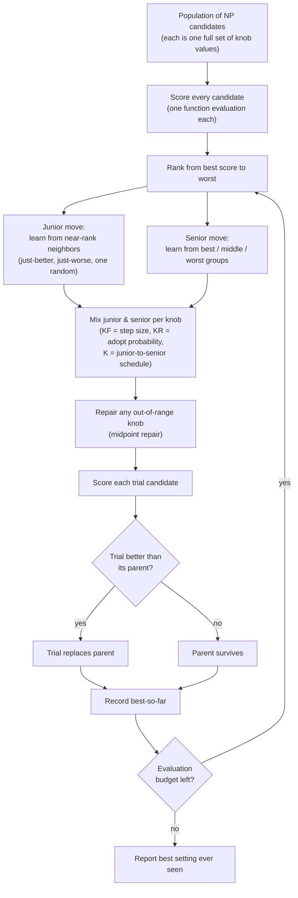
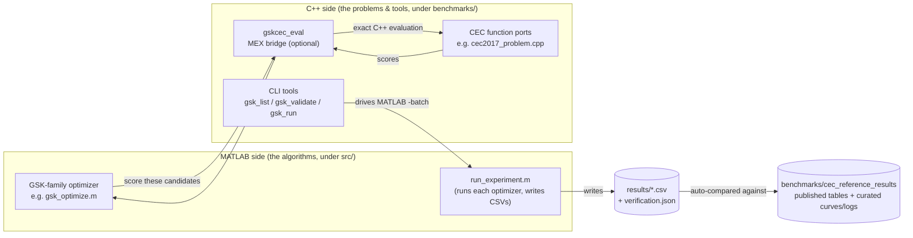
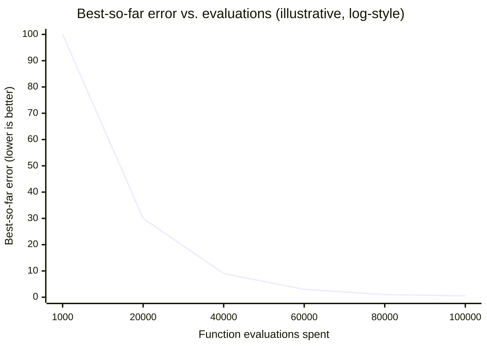

# What this is, and why it exists

> **What this is:** the plain-language introduction to the `gsk_family`
> project - black-box optimization, the GSK algorithm, the CEC benchmark suites,
> and what this toolkit uniquely provides. **For:** any reader, with no
> background in optimization, GSK, the CEC suites, C++, or MATLAB.
> **Prerequisites:** none. **After reading:** you will understand the problem
> GSK solves, how one GSK generation works, what the benchmark suites are, and
> how to read a convergence curve - ready for [tutorial.md](tutorial.md).

This page is the plain-language introduction. It assumes **no** background in
optimization, the GSK algorithm, the CEC benchmark suites, C++, or MATLAB. Read
it first. When you want the map of the *code*, go to
[code_reading_guide.md](../development/code_reading_guide.md); when you want to
actually build and run something, go to [tutorial.md](tutorial.md).

Every term in **bold** here is defined in the
[glossary](../reference/glossary.md).

---

## 1. The problem: black-box continuous optimization

Imagine you have a knob-covered machine. You turn the knobs (each can be set to
any real number, say between -100 and +100), press a button, and the machine
prints back a single number: a *score*. Lower is better. You do not get a
manual, a formula, or a hint about which direction to turn the knobs. You only
get to try settings and read scores.

Your job: find the knob settings that give the **lowest** score, using as few
button presses as possible.

That is **black-box continuous optimization**:

- **Continuous** — the knobs take real-number values, not just a few discrete
  choices.
- **Black-box** — you cannot look inside; you can only ask "what is the score
  at *this* setting?" Each such question is one **function evaluation**.
- **Optimization** — you are searching for the best (here, lowest-scoring)
  setting.

The number of knobs is the **dimension** (written `D`). A 10-knob machine is a
`D=10` problem; a 1000-knob machine is `D=1000`. More knobs is dramatically
harder: the number of settings to consider explodes.

This kind of problem is everywhere in engineering and science: tuning a power
plant's generators to meet demand at lowest cost, designing a spacecraft
trajectory that uses the least fuel, fitting a model to data. You usually cannot
write down a clean equation to solve; you can only *evaluate* candidate
solutions and compare them. The CEC2011 suite in this project is exactly such a
collection of real-world engineering problems (generator scheduling, spacecraft
flyby planning, and more).

Algorithms that solve black-box problems by repeatedly proposing settings and
learning from the scores are called **metaheuristics**. GSK is one of them.

---

## 2. The idea: Gaining-Sharing Knowledge (GSK)

**GSK** stands for **Gaining-Sharing Knowledge**. It is a **population-based**
metaheuristic: instead of tracking one candidate solution, it keeps a whole
*population* of them (by default 100) and improves them generation after
generation, like an evolving group.

The human metaphor it is named after: people improve their knowledge in two
ways across a lifetime.

### Junior knowledge — learning from your near-neighbors

Early in a career, a person learns mostly from people *close to them in
experience*: the slightly-better colleague they imitate, the slightly-worse one
they help and learn from in the process, and a random acquaintance who adds
something unexpected.

GSK models this by ranking the whole population from best score to worst. For
each individual it picks its **near-rank neighbors** — the candidate just better
than it and the one just worse — plus one random other candidate. It nudges the
individual along the direction suggested by those neighbors. This is the
**junior** gaining-sharing phase: small, local, exploratory moves informed by
who is nearby in the ranking.

### Senior knowledge — learning from the best, middle, and worst groups

Later, a person learns more from broad categories: the acknowledged experts
(the *best* group), the typical practitioners (the *middle* group), and even
cautionary examples (the *worst* group).

GSK models this by splitting the ranked population into three groups — **best**,
**middle**, **worst** — using a partition fraction. Each individual is nudged by
combining a representative drawn from these groups. This is the **senior**
gaining-sharing phase: larger, more structured moves that exploit what the whole
population has learned.

### How a single generation works

Every generation, GSK does the following for each of the 100 individuals:

1. Decide, dimension by dimension (knob by knob), how much of the move should
   come from **junior** behavior versus **senior** behavior. Early generations
   lean junior (explore widely); later generations lean senior (refine). The
   schedule is controlled by `K`.
2. Compute a proposed junior move and a proposed senior move.
3. Build a **trial** candidate by taking some knobs from the junior move, some
   from the senior move, and leaving the rest unchanged. A second knob is the
   probability of accepting a changed coordinate at all — that is `KR`.
4. If any proposed knob value falls outside the legal range, repair it back
   inside (this project uses the reference's *midpoint repair* rule).
5. Score the trial. If it beats the original, the trial replaces it; otherwise
   the original survives. (This is *greedy selection*: the population never gets
   worse.)

Repeat until the **evaluation budget** (the allowed number of button presses)
runs out. The best setting ever seen is the answer.

### The three knobs of GSK, one sentence each

- **KF (Knowledge Factor)** — the *step size*: how big a move to take along the
  direction the neighbors/groups suggest (reference default `0.5`).
- **KR (Knowledge Ratio)** — the *probability that any given knob actually
  adopts the proposed change* rather than keeping its old value (reference
  default `0.9`).
- **K (Knowledge Rate)** — the *exponent of the schedule* that shifts each
  individual from mostly-junior early on to mostly-senior later (reference
  default `10`).

A fourth control, **NP**, is simply the population size (default `100`).

That is baseline GSK. The other six optimizers in this toolkit are published
variations on the same skeleton — for example, they make `KF`/`KR` *adapt*
automatically as the run proceeds, or shrink the population over time, or add a
final polishing step. The [glossary](../reference/glossary.md) names each one;
the differences are recorded faithfully in
[porting_notes.md](../reference/porting_notes.md).

The newest member, **DT-GSK** (Dimension-Tiered GSK), changes its recipe with
the size of the problem. On small machines (fewer than 20 knobs) it runs a
light setup; from 20, 50 and 100 knobs upward it switches on more machinery —
for example learning which knobs tend to improve together, a careful final
polishing pass, and budget-aware restarts for the largest problems. It starts
from `5 × D` candidates and always spends the whole budget. Unlike the others,
it was ported from its authors' Python reference implementation rather than a
MATLAB release, and was checked against that code (details on the
[DT-GSK page](../algorithms/dt-gsk.md) and in
`src/optimizers/dt-gsk/README.md`).

### Figure 1 — one GSK generation (schematic)

---

## 3. The yardstick: the CEC benchmark suites

You cannot claim an optimizer is good without a fair, shared test. The
optimization research community uses standard problem sets published for the
**Congress on Evolutionary Computation (CEC)**. They are the field's common
yardstick: every serious new algorithm is reported on them, so results are
comparable across papers and groups.

Each suite is a fixed list of mathematical "machines" (functions) with known
properties, designed to be hard in different, deliberate ways — some have many
false bottoms (*local optima*) to trap a lazy search, some are stretched into
narrow valleys, some are rotated so you cannot cheat by tuning one knob at a
time. The five suites this toolkit ports:

| Suite | What it is | Functions | Typical dimensions |
|---|---|---|---|
| **CEC2011** | Real-world engineering problems (power systems, spacecraft trajectories, signal design). | 22 | fixed per problem (e.g. 6, 30, 240) |
| **CEC2013** | Standard synthetic single-objective test functions. | 28 | 2 … 100 |
| **CEC2013LSGO** | "Large-Scale Global Optimization" — same spirit, but huge (≈1000 knobs). | 15 | ≈1000 (native) |
| **CEC2017** | The widely-used 2017 single-objective suite. | 30 | 10, 30, 50, 100 |
| **CEC2020** | A compact 10-function 2020 suite. | 10 | 5, 10, 15, 20 |

Two technical points that matter when you read results:

- **Known optimum / bias.** For the synthetic suites (2013, 2017, 2020) the
  designers built each function so its true best score is a known constant (its
  **bias** or **optimum**). For example, CEC2017 function `N` has optimum
  `100 × N`. That lets us report **error** = (best score found) − (true
  optimum), where smaller is better and 0 is perfect. The real-world CEC2011
  problems have *no* published optimum, so results there are reported as **raw
  scores**, not errors. (See
  [benchmark_protocol.md](../reference/benchmark_protocol.md).)
- **Evaluation budget.** Each suite fixes how many button presses an optimizer
  is allowed, so everyone competes under the same allowance — for CEC2017 it is
  `10000 × D` evaluations.

---

## 4. What THIS toolkit uniquely provides

Plenty of GSK and CEC code exists in the wild. This project's value is not "yet
another implementation" — it is a **carefully verified, reproducible, and
self-contained** one. Concretely:

1. **Standalone C++ ports of the benchmarks, validated bit-for-bit against the
   originals.** The CEC functions were originally distributed as MATLAB **MEX**
   files (compiled C++ called from MATLAB) and R packages. Here they are
   re-implemented as plain **C++20** that needs no MATLAB, no R, and no Python
   to run. Each port is checked against the *original* reference implementation
   at fixed probe points: the largest disagreement observed across the CEC2017
   suite is about `4.8e-15` (i.e. identical to ~15 significant digits). The same
   functions, the same constants, even the same documented *quirks* — odd-looking
   reference behaviors are preserved on purpose, named at the spot, and never
   silently "fixed." (See [porting_notes.md](../reference/porting_notes.md).)
2. **Seven GSK-family optimizers in MATLAB**, each a faithful port of a
   published reference, each citing the exact source it came from:
   `gsk`, `agsk`, `apgsk`, `atmals-gsk`, `egsk`, `fdb-agsk` (MATLAB reference
   releases) and `dt-gsk` (the Python DT-GSK reference implementation).
3. **Automatic verification against published results.** Every experiment run is
   *automatically* compared to the same optimizer's published reference table,
   and a verdict — **CONSISTENT** or **DEVIATES** — is written next to the
   results as `verification.json`. A run literally carries proof that it
   reproduces known behavior. (See
   [result_schema.md](../reference/result_schema.md).)
4. **Explicit reproducibility contract.** Deterministic modes derive and record
   every run seed so results can be regenerated exactly. ATMALS-GSK reference
   mode uses the deterministic legacy `seed` generator as a controlled
   replacement for its historical wall-clock driver.
5. **No Python, anywhere.** Not in the benchmarks, not in the tooling, not even
   in the documentation build. The languages are C++, MATLAB, PowerShell, and
   CMake. This is a hard project rule, not an accident.

Two distinct meanings of "correct" are kept carefully apart, and you will see
this distinction throughout:

- The **benchmark ports** are checked *exactly* — bit-for-bit against fixed
  ground-truth values from the original implementations (the C++ unit tests).
- The **optimizers** are checked *statistically* — their score distributions are
  compared against published result tables (the CONSISTENT/DEVIATES verdict).

The first asks "did we re-implement the test machine perfectly?" The second asks
"does our search behave like the published algorithm?"

### Figure 2 — what runs on what (the optimizer × suite matrix)

`Y` = part of the default reproduction matrix; `(ref)` = run on request, and
the reference source ran it, so its table is imported; `(ext)` = available but
a framework-level extension the original papers did not run (every optimizer
can be pointed at every suite). The executable matrix is
`configs/all_cec2017.yml`,
`configs/all_cec2011.yml` and `configs/agsk_cec2020.yml` (run via `gsk_run` or
`scripts/run_all.ps1 -Full`); `src/experiments/default_experiment_matrix.m` is
only the reference statement of the same table (no runner calls it). See also
[benchmark_protocol.md](../reference/benchmark_protocol.md).

| Optimizer | CEC2011 | CEC2013 | CEC2013LSGO | CEC2017 | CEC2020 |
|---|:---:|:---:|:---:|:---:|:---:|
| **gsk** | Y | (ext) | (ext) | Y | (ext) |
| **agsk** | Y | (ext) | (ext) | Y | **Y** |
| **apgsk** | Y | (ext) | (ext) | Y | (ext) |
| **atmals-gsk** | Y | (ext) | (ext) | Y | (ext) |
| **egsk** | Y | (ext) | (ext) | Y | (ext) |
| **fdb-agsk** | Y | (ext) | (ext) | Y | (ext) |
| **dt-gsk** | Y | (ref) | (ref) | Y | (ref) |

Reading: all seven optimizers form the default matrix on **CEC2017** and
**CEC2011**; **AGSK** additionally runs the **CEC2020** reproduction. CEC2013
and CEC2013LSGO are validation/extension suites you can run on request.
**DT-GSK**'s reference campaigns covered all five suites, so each of its runs,
in or outside the default matrix, has an imported table to compare against.
Any pairing the reference sources never ran is labeled an extension, not a
reproduction.

### Figure 3 — how the two halves meet

The algorithms are MATLAB; the problems are C++. They meet at one thin bridge,
the optional `gskcec_eval` **MEX** component, so a MATLAB optimizer can score
candidates using the *exact* C++ benchmark port.

---

## 5. How to read a result: the convergence curve

The most informative single picture of an optimization run is its **convergence
curve**: the best score found so far (vertical axis) plotted against the number
of function evaluations spent (horizontal axis). This project records exactly
this — the median run's trace per (function, dimension), in
`curves/Figure_F<f>_D<d>_Run#<r>.csv`
(see [result_schema.md](../reference/result_schema.md)).

A healthy curve drops fast at first (easy gains, wide exploration) and then
flattens as the search refines a good region and improvements get small. Because
the gains span many orders of magnitude, the vertical axis is usually drawn on a
**logarithmic scale** for suites with a known optimum (where the quantity plotted
is the error, which approaches 0).

### Figure 4 — an illustrative convergence curve (shape only)

This sketch shows the *shape* you expect, not data from a specific run. Lower is
better; the curve never rises because selection is greedy.

To compare two optimizers, plot both curves: the one that is lower at the same
budget is doing better at that budget. To compare across many functions and
runs, the field summarizes the final errors with statistics (best / median /
mean / worst / standard deviation) and ranks algorithms with statistical tests
such as **Wilcoxon** (pairwise) and **Friedman** (multi-algorithm) — all defined
in the [glossary](../reference/glossary.md).

---

## 6. Where to go next

- **Run something end to end:** [tutorial.md](tutorial.md) — build, test,
  validate, run a tiny experiment, and read every output file it produces.
- **Understand the code layout:**
  [code_reading_guide.md](../development/code_reading_guide.md)
  and [project structure](../reference/project_structure.md).
- **Look up a term:** [glossary.md](../reference/glossary.md).
- **The exact rules each suite follows:**
  [benchmark_protocol.md](../reference/benchmark_protocol.md).
- **What every output column means:**
  [result_schema.md](../reference/result_schema.md).
- **What was preserved or differs from each reference:**
  [porting_notes.md](../reference/porting_notes.md).
- **Browse the C++ API:** generate it with Doxygen — see
  [api.md](../reference/api.md).

This document is intentionally non-promotional. Where the toolkit makes a
deliberate trade-off or preserves a known quirk, that is stated plainly here and
documented in detail in [porting_notes.md](../reference/porting_notes.md).
