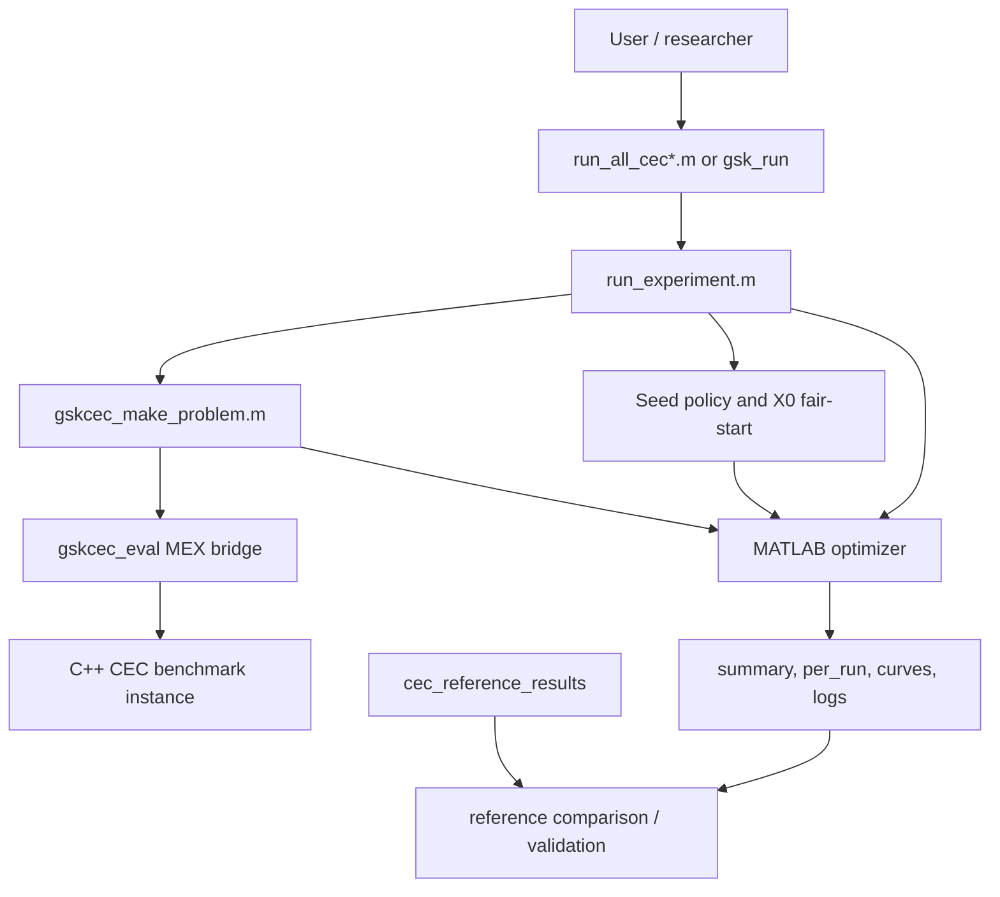

# Architecture

> **What this is:** the five-layer design of the hybrid MATLAB + C++ toolkit and
> how a run flows through them. **For:** anyone forming a mental model of the
> project before reading code or adding a feature. **Prerequisites:** none beyond
> knowing the project pairs MATLAB GSK optimizers with C++ CEC benchmarks.
> **After reading** you will know what each layer owns, the two hard boundaries,
> and how the MEX bridge joins the halves.

The project has five layers.

1. **C++ core utilities** (`benchmarks/cec_suite_cpp/cec_tools/include/gskcec/core`):
   numeric types, `Bounds` (with reference midpoint repair), deterministic
   `RandomEngine` (`std::mt19937_64`) and run-seed derivation, summary
   statistics, stopwatch, run-result records.
2. **C++ benchmark layer** (`benchmarks/cec_suite_cpp/*/src` +
   `benchmarks/cec_suite_cpp/cec_tools/include/gskcec/benchmark`): one immutable
   `BenchmarkProblem` per (suite, function, dimension), constructed through
   per-suite `make_problem` factories or the generic
   `gskcec::make_problem(suite, function, dimension, data_root)` in
   `factory.hpp`. All data loads from explicit `data_root` paths at
   construction; no current-directory dependence; failures are exceptions
   naming the offending file. Evaluation state is per-instance (mutable
   scratch buffers; instances are not thread-safe - use one instance per
   thread).
3. **MATLAB optimizer layer** (`src/optimizers`, `src/common`): the seven
   GSK-family algorithms - six faithful to the reference MATLAB sources, plus
   DT-GSK, ported from its reference implementation and self-contained
   in `src/optimizers/dt-gsk` (see `docs/reference/matlab_interface.md` and
   `docs/reference/porting_notes.md`).
4. **Experiment layer**: C++ config parsing
   (`gskcec/experiment/config.hpp`), the MATLAB runner
   (`src/runners/run_experiment.m`) which executes optimizers and writes
   the documented result artifacts, and the `gskcec_eval` MEX bridge
   (`benchmarks/cec_suite_cpp/cec_tools/src/mex_bridge`) through which MATLAB optimizers
   evaluate the EXACT ported C++ benchmarks. The bridge is an optional
   component built by `scripts/build_mex_bridge.ps1`; the benchmark
   library itself never requires MATLAB or MEX.
5. **Validation and reporting**: CLI tools `gsk_list`, `gsk_validate`,
   `gsk_run` (`benchmarks/cec_suite_cpp/cec_tools/src/cli`), the imported-reference
   loader and the results-vs-reference comparison
   (`gskcec/experiment/comparison.hpp`), plus C++ unit tests under
   `benchmarks/cec_suite_cpp/cec_tools/tests` and MATLAB tests under `src/tests`.

## Execution model

`gsk_run` validates a requested experiment against the benchmark factory,
then drives MATLAB in `-batch` mode (one invocation per optimizer) running
`src/runners/run_experiment.m`. MATLAB writes the CEC-competition layout
`results/<optimizer>/<suite>/{summary,curves,gen_logs}` per
`docs/reference/result_schema.md`. The C++ side never implements GSK optimizers
(project contract); the MATLAB side never parses configs (single strict
parser in C++).

MATLAB is located via `--matlab`, the `GSKCEC_MATLAB` environment
variable, or `matlab` on PATH - never a hard-coded install path.

## Reproducibility

Documented seed policies keep deterministic runs explicit and keep historical
wall-clock seeding as provenance only:

- C++ tooling: `gskcec::make_run_seed` (`gskcec/core/random.hpp`) feeding
  `std::mt19937_64`.
- MATLAB runs: `src/runners/run_experiment.m` defaults to the fair `unified`
  policy documented in `docs/reference/seed_policy.md` (`reference`/`native`/`derived`
  remain selectable); every optimizer except DT-GSK seeds through
  `src/common/gsk_set_rng.m`, so `threefry`, `twister`, and deterministic
  legacy `seed`/`state` checks are explicit (DT-GSK draws from its own named
  Threefry substreams). Every per-run seed is recorded in
  `summary/seed_schedule.csv`, `summary/per_run.csv`, and the `gen_logs/`
  `Seed` column;
  `summary/environment.json` records `base_seed`, the seed scheme, and the
  effective generator (not per-cell seeds).
- Unified MATLAB runs use
  `get_cec_seed(base_seed, dim, func, run) =
  mod(base_seed + 1000003*dim + 1000033*func + 1000037*run, 2147483646) + 1`.
  The formula intentionally excludes optimizer name, optimizer order,
  population size, suite name, worker identity, parfor schedule, current time,
  and budget. The runner resolves one generator (`threefry` when available,
  otherwise `twister`), then owns the first population draw and the
  post-initialization RNG state, while optimizers keep their reference update
  logic unchanged. DT-GSK is the documented fair-start exception: it samples
  its own `NP = 5*D` population.
- Reference MATLAB runs keep the published/recovered per-family seed split:
  GSK/ATMALS-GSK/eGSK use `base_seed + 9973*func + run-1`, while
  AGSK/APGSK/FDB-AGSK use `D*func*run`. Reference mode also selects the
  effective MATLAB RNG family per optimizer, as documented in
  `docs/reference/seed_policy.md`.
- DT-GSK is unified-only: under every policy it gets the unified seed and
  `threefry`, the schedule its imported reference campaign used.

## Boundaries

- All CEC artifacts live under `benchmarks/`: `cec_reference_results` is the
  imported read-only reference table tree; `cec_suite_cpp` owns CEC ports, input
  data, and the nested `cec_tools` support library, CLIs, MEX bridge, and tests.
- All GSK algorithm code lives under `src/` (MATLAB root, not C++).
- Standard CEC2013 (converted from the CEC2013 R package) and CEC2013LSGO
  are separate suites and are never merged.
- MATLAB and C++ code, plus PowerShell helper scripts: no scripts, wrappers,
  generated bindings, or package metadata in any other language anywhere in the
  project.

## Component interaction diagram

The diagram has two important boundaries:

- The MATLAB optimizer boundary keeps algorithm research readable and close to
  the historical MATLAB releases (for DT-GSK, to its reference implementation).
- The C++ benchmark boundary keeps CEC evaluation fast, testable, and independent
  of MATLAB scripts or current-directory state.

## Why the layers are separate

| Layer | Why it exists | Activated when |
|---|---|---|
| C++ core utilities | Shared types, bounds, random engines, summaries, and timers keep CLI behavior consistent. | Any C++ CLI, C++ test, or MEX benchmark call. |
| C++ benchmark layer | Encapsulates CEC data loading and function evaluation. | A suite/function/dimension problem is constructed. |
| MATLAB optimizer layer | Preserves GSK-family reference behavior in the language of the source algorithms. | An optimizer is called by `run_experiment` or directly by a test. |
| Experiment layer | Owns seeds, paths, budgets, result files, and resume behavior. | Any campaign run. |
| Validation/reporting | Compares generated outputs to imported references and summarizes results. | End of a run, `gsk_validate`, or `analyze_results`. |

This separation is also a performance choice. Benchmark evaluation is compiled,
while algorithm experimentation remains editable MATLAB code. It is a
reproducibility choice too: changing the seed schedule or output schema does not
require touching optimizer equations.
