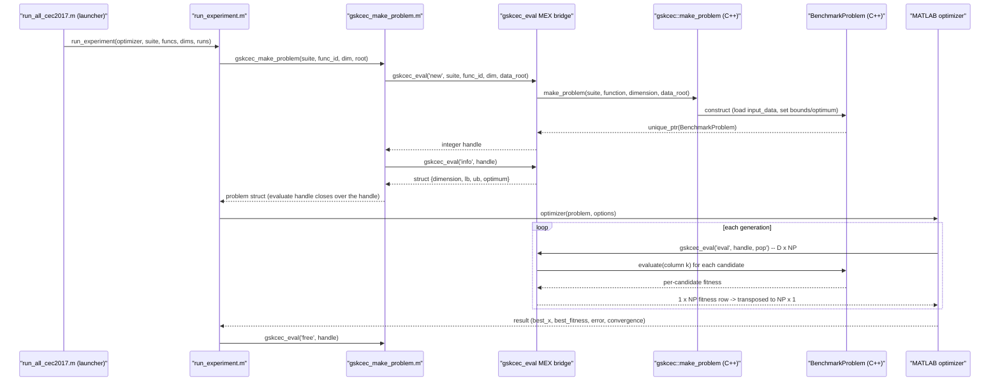

# Benchmark Mapping

> **What this is:** A walkthrough of how a MATLAB GSK-family optimizer reaches a
> CEC benchmark function, mapping each step from the root launcher down to the
> ported C++ evaluation. **For:** Readers tracing the runtime path through the
> `gskcec_eval` MEX bridge, and maintainers who need to know which file owns each
> link in the chain. **Prerequisites:** None beyond
> [architecture.md](architecture.md); RNG details are in
> [seed_policy.md](seed_policy.md). **After reading:** you can follow any objective
> call from `run_all_cec*.m` through `run_experiment` -> `gskcec_make_problem` ->
> the `gskcec_eval` MEX bridge -> `gskcec::make_problem`, and you know the exact
> matrix shape that crosses the bridge. For the rules each suite enforces (budgets,
> optima, target errors) see [benchmark_protocol.md](benchmark_protocol.md).

This project is two languages joined at one seam. The GSK-family optimizers are
MATLAB (`src/`); the CEC benchmark functions are standalone C++20 ports
(`benchmarks/`). They meet only at the `gskcec_eval` MEX bridge. There is no
Python anywhere in the project. This page documents the seam: how a row-wise
MATLAB population becomes a fitness vector computed by the exact same C++ code
the C++ tests validate.

## Source Evidence

The CEC artifacts live under `benchmarks/`, split into two trees by ownership:

```text
benchmarks/cec_reference_results/    imported reference tables, curves, logs (read-only)
benchmarks/cec_suite_cpp/                CEC C++ ports + input data, used at runtime
benchmarks/cec_suite_cpp/cec_tools/      C++ helper library, 4 CLIs, MEX bridge, ctest suites
```

The runtime evaluation code is the C++ port under `benchmarks/cec_suite_cpp/<suite>/src`,
reached through the bridge. The reference tables under
`benchmarks/cec_reference_results` are comparison evidence only; they are never an
input to evaluation (see [Reference Table Use](#reference-table-use)).

## Runtime Mapping

Each link in the chain is owned by one file. The left column is the runtime
stage; the right column is the file (and the function) that implements it.

| Runtime stage | MATLAB / C++ owner |
|---|---|
| Campaign launcher (per suite) | `run_all_cec2017.m` ... `run_all_cec2011.m` (repo root) |
| MEX prerequisite gate | `src/runners/gskcec_require_mex.m` |
| Experiment driver (one optimizer x suite) | `src/runners/run_experiment.m` |
| Problem-struct factory | `src/runners/gskcec_make_problem.m` |
| MEX bridge (`new` / `eval` / `info` / `free`) | `benchmarks/cec_suite_cpp/cec_tools/src/mex_bridge/gskcec_eval_mex.cpp` |
| Generic C++ problem factory | `gskcec::make_problem(suite, function, dimension, data_root)` in `.../include/gskcec/benchmark/factory.hpp` |
| Immutable C++ problem instance | `gskcec::BenchmarkProblem` (`evaluate` / `bounds` / `optimum` / `dimension`) |
| Objective call from the optimizer | `problem.evaluate(pop)` (the handle set in `gskcec_make_problem.m:62/64`) |
| Per-dimension summaries | `results/<optimizer>/<suite>/summary/*.csv` |
| Reference comparison / verdict | `gskcec/experiment/comparison.hpp`, written as `summary/verification.json` |

The two boundaries this table crosses are deliberate. The MATLAB optimizer
boundary keeps GSK algorithm code readable and close to the reference releases;
the C++ benchmark boundary keeps CEC evaluation fast, testable, and free of any
MATLAB or current-directory dependence (see [architecture.md](architecture.md)).

## The Eval Path



The `'new'` and `'info'` calls happen once per `(function, dimension)` cell, when
`gskcec_make_problem` builds the struct. The `'eval'` call happens once per
generation for the whole population. DT-GSK, whose population starts at
`NP = 5*D`, also makes smaller `'eval'` calls inside a generation (Cauchy-kicked
and restarted rows, local-search probes, the final polish), each clipped to the
remaining budget. `run_experiment` owns the matching `'free'` when the cell
finishes, so handles never leak.

Handle contract: `function_id`, `dimension` and the handle must be finite,
integer-valued double scalars; anything else raises `gskcec:badInput` and is
never truncated (`1.7` is not treated as `1`, nor `h + 0.5` as `h`). While any
handle is live the bridge is `mexLock`ed, so `clear mex` / `clear functions` do
not unload it and cannot recycle live handle ids underneath MATLAB variables
that still hold them. Freeing the last handle, or `gskcec_eval('clear')`, unlocks
it (for example before rebuilding the bridge).

## Suite Coverage

All five CEC suites plus the test-only `sphere` problem are reachable through the
same factory. `sphere` is pure MATLAB and needs no MEX, so optimizer and runner
smoke tests stay bridge-free.

| Suite | Reached through | Notes |
|---|---|---|
| `sphere` | `gskcec_make_problem.m` (inline MATLAB) | Test-only deterministic minimizer; no bridge, no data files. |
| `cec2017` | MEX bridge -> C++ port | 30 functions; dims 10/30/50/100; F2 excluded from default comparisons. |
| `cec2011` | MEX bridge -> C++ port | 22 problems; fixed native dimensions; raw-objective statistics, `optimum() = NaN`. |
| `cec2013` | MEX bridge -> C++ port | 28 functions (converted from the CEC2013 R package; runs without R). |
| `cec2013lsgo` | MEX bridge -> C++ port | 15 large-scale functions; native ~1000-D; separate suite, never merged with cec2013. |
| `cec2020` | MEX bridge -> C++ port | 10 public functions; dims 5/10/15/20; AGSK optimum vector and budgets. |

`gskcec_make_problem` rejects an unknown suite with `gskcec:badSuite`
(`gskcec_make_problem.m:86`) and a dimension with no reference budget with
`gskcec:badDimension`.

## Shape Contract

This is the single most important fact about the bridge. The MATLAB optimizers
and the C++ evaluator disagree on matrix orientation, and `gskcec_make_problem`
hides the transpose inside the `evaluate` handle so optimizer code never sees it.

- **Optimizer side (MATLAB):** populations are row-wise, `NP x D` (one candidate
  per row), the reference MATLAB convention.
- **Bridge / C++ side:** the `'eval'` command takes a column-major `D x NP`
  matrix (one candidate per column, the classic `cec17_func` orientation) and
  returns a `1 x NP` fitness row.

The handle reconciles the two with a transpose on each side:

```matlab
% gskcec_make_problem.m:64 -- the general case
problem.evaluate = @(pop) gskcec_eval('eval', handle, pop')';
%                                                    ^^^^      ^
%                                          NP x D -> D x NP   1 x NP -> NP x 1
```

On the C++ side the bridge reads `D` from the matrix row count and `NP` from the
column count, checks `D` against `problem.dimension()`, and walks one column at a
time:

```cpp
// gskcec_eval_mex.cpp:142-155
const auto dim = static_cast<int>(mxGetM(prhs[2]));   // rows = D
const auto np  = mxGetN(prhs[2]);                     // cols = NP
// ... dimension check ...
for (std::size_t k = 0; k < np; ++k) {
    out[k] = problem.evaluate(std::span<const double>(
        x + k * dim, dim));                           // column k = candidate k
}
```

Because MATLAB stores matrices column-major, candidate `k` already occupies a
contiguous `D`-length span at offset `k * D`, so the bridge slices it with no
copy. Before the `D` check the bridge requires `X` to be a real, full
(non-sparse) double matrix: sparse storage holds only the nonzeros, so a sparse,
complex, or non-double `X` raises `gskcec:badInput` instead of being read as a
dense block. A `D`-mismatch raises `gskcec:badInput` naming both the supplied
row count and the expected dimension. CEC2011 F8 is the one special case: its handle first
maps the discrete candidate index into `[eps, 15]` before the transpose
(`repair_cec2011_f8_population`, `gskcec_make_problem.m:62/102`).

## Worked Mapping -- One Objective Call

To evaluate a single CEC2017 F1 candidate at D=10:

1. The runner already holds the problem struct from
   `gskcec_make_problem('cec2017', 1, 10, project_root)`, which allocated a C++
   `BenchmarkProblem` and stored the integer handle.
2. The optimizer forms a `1 x 10` row vector `x` (one candidate) and calls
   `problem.evaluate(x)`.
3. The handle transposes `x` to `10 x 1` and calls
   `gskcec_eval('eval', handle, x')`.
4. The bridge reads `D = 10`, `NP = 1`, verifies `D` matches
   `problem.dimension()`, and calls `problem.evaluate(span)` on the single
   column.
5. The C++ port computes the shifted/rotated CEC2017 F1 value and returns it as a
   `1 x 1` row, which the handle transposes back to a `1 x 1` column.

Everything the reference CEC framework kept in separate structures -- bounds,
budget, optimum -- is a field on the single MATLAB `problem` struct, populated
from the bridge's `'info'` call:

| Quantity | Field | Source |
|---|---|---|
| Bounds | `problem.lb`, `problem.ub` (`1 x D`) | `info.lb` / `info.ub` from `BenchmarkProblem::bounds()` |
| Known optimum | `problem.optimum` | `info.optimum` from `BenchmarkProblem::optimum()` (`NaN` for cec2011; `0` for cec2013lsgo, whose statistics are nonetheless over raw objectives, so its per-run `error` equals `best_fitness`) |
| Evaluation budget | `problem.max_nfes` | suite policy in `gskcec_make_problem.m:68-87`, the same for every optimizer (DT-GSK included) |
| Target error | `problem.target_error` | `1e-8` for known-optimum suites, `NaN` otherwise |

## Reference Table Use

Reference tables are validation evidence, not runtime input. The evaluation path
above never reads `benchmarks/cec_reference_results`. After a run finishes,
`run_experiment` (and standalone `gsk_validate --verify`) compares the generated
`summary/*.csv` statistics against the same optimizer's imported reference table
through `gskcec/experiment/comparison.hpp` and writes a `CONSISTENT` or
`DEVIATES` verdict to `summary/verification.json`
(see [result_schema.md](result_schema.md)).

Two senses of "correct" stay distinct here:

- The benchmark **ports** are checked exactly against fixed-vector ground truth
  by the C++ ctest suites (CEC2017 at rel-tol `1e-10`, CEC2013 saved vectors at
  `1e-12`). This is the same C++ code the optimizers evaluate, so passing the
  bridge means evaluating a port that already matched its ground truth.
- The **optimizers** are checked statistically against the same optimizer's
  published reference table -- a quality comparison, not a bit-exact one.
  The DT-GSK tables (`<suite>/dt-gsk/`) were produced by its Python reference
  implementation, so agreement with them is cross-implementation evidence;
  `scripts/compare_reference_runs.m` compares a DT-GSK campaign's
  `per_run.csv` with the imported per-run CEC2017 evidence.
