# Flowcharts And Diagrams

> **What this is:** A visual gallery of the project -- the MATLAB optimizer side,
> the C++ benchmark side, and the `gskcec_eval` MEX bridge between them -- drawn
> as Mermaid flowcharts. **For:** anyone who wants the shape of the system at a
> glance before reading the prose. **Prerequisites:** none; the same flows are
> described in [architecture.md](architecture.md), [benchmark_mapping.md](benchmark_mapping.md),
> and [seed_policy.md](seed_policy.md). **After reading:** you can place any file
> or stage on these diagrams and follow it to its neighbours.

Every diagram depicts the MATLAB + C++ reality: GSK-family algorithms in MATLAB
(`src/`), CEC benchmarks as standalone C++20 ports (`benchmarks/`), and the
optional MEX bridge that joins them. There is no Python in the project. Each node
uses an `id["label"]` declaration, with special-character labels quoted, so the
charts parse cleanly under Mermaid.

## Full Project Architecture

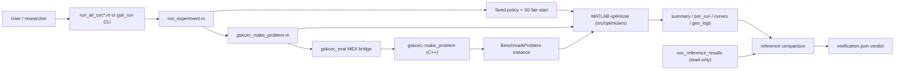

## Algorithm Execution Flow

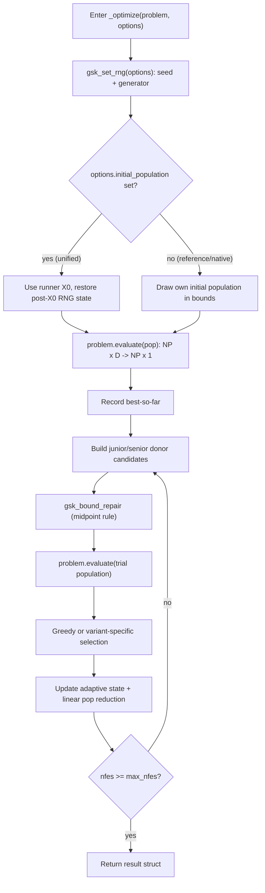

## Benchmark Evaluation Pipeline

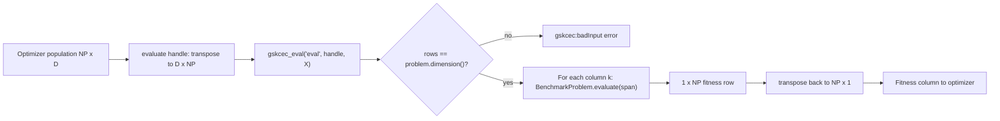

## Experiment Lifecycle

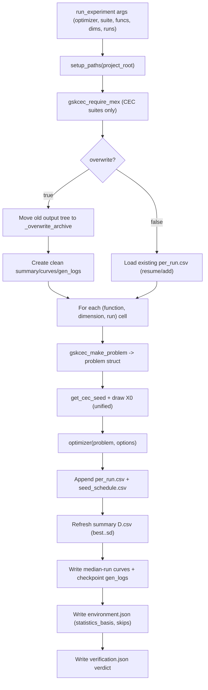

## Configuration Loading

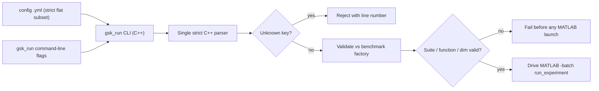

## Seed Generation And RNG Flow

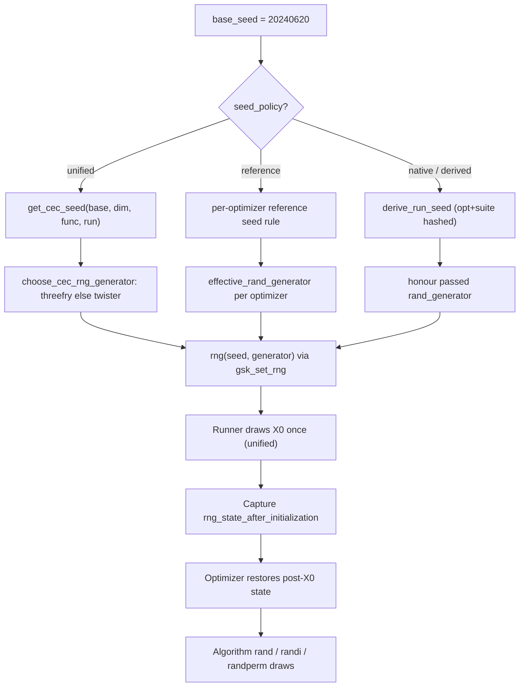

## Parallel parfor Execution Flow

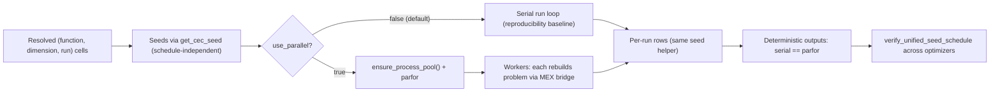

## Logging And Reporting Pipeline

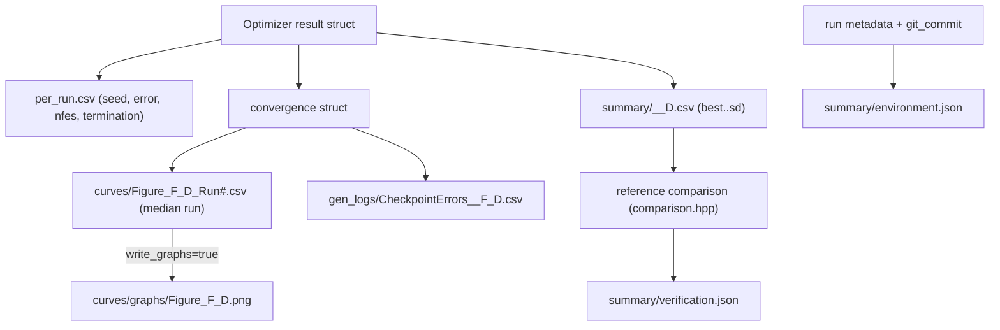

## Optimizer Update Cycle

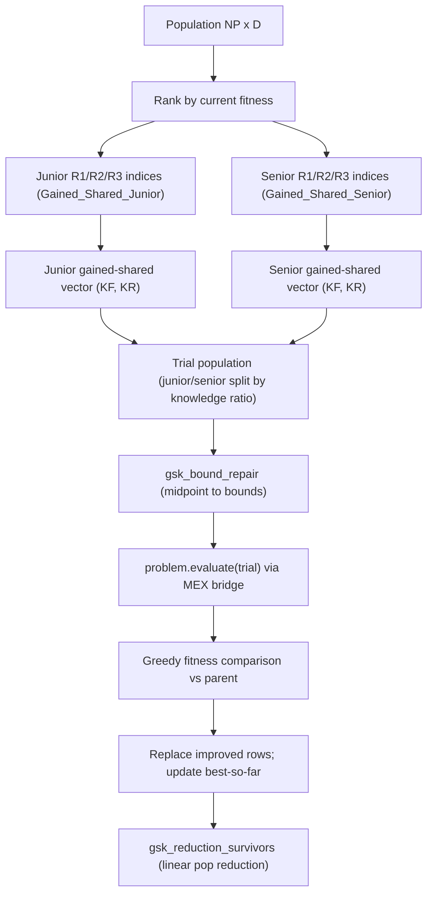

## Validation Workflow

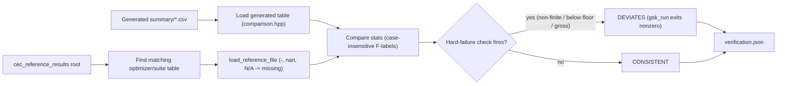

## Validation Workflow -- Port Ground Truth

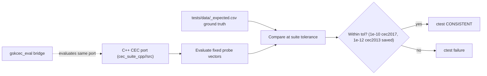

## Testing Workflow

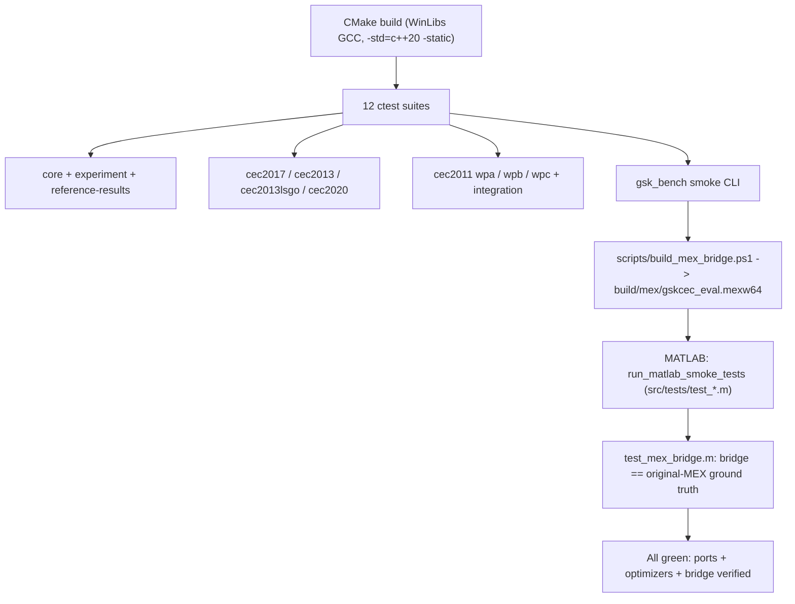
