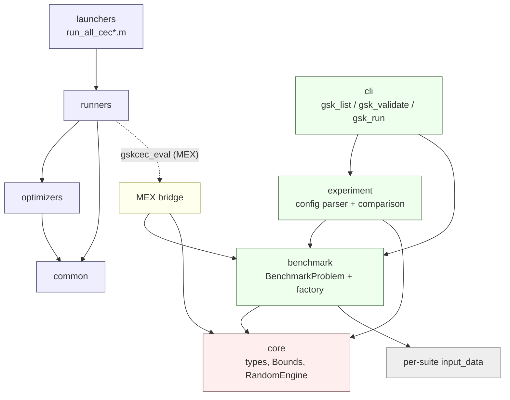

# Module Dependencies

> **What this is:** the allowed dependency directions between the project's
> layers - the MATLAB packages under `src/` and the C++ `gskcec` layers under
> `benchmarks/cec_suite_cpp/cec_tools/` - and why they are arranged this way.
> **For:** contributors deciding where new code belongs, and reviewers checking
> that a change does not create a backward dependency or cross a hard boundary.
> **Prerequisites:** a rough sense of the folder layout (see
> [project_structure.md](project_structure.md)) and the five-layer overview in
> [architecture.md](architecture.md). **After reading** you will know what each
> layer may call and what it must never call.

The project keeps dependencies pointed toward stable contracts. The volatile,
replaceable pieces (CLIs, output files, reference tables, launchers) depend on
the stable core (the C++ `core` utilities, the `BenchmarkProblem` interface, the
MATLAB optimizer contract), never the other way around. Two boundaries are not
just conventions but hard project rules: the C++ side never implements a GSK
optimizer, and the MATLAB side never parses a config.

## Dependency Direction

The project has two halves joined at one thin bridge. The C++ half (under
`benchmarks/`) owns the benchmark problems and the tooling that runs and checks
them; the MATLAB half (under `src/`) owns the seven GSK-family optimizers and the
experiment runner. They meet only at the `gskcec_eval` MEX bridge.

The arrows below read "depends on" / "calls into": the item on the left uses the
items indented under it. No arrow ever points back up.

```text
C++ half (benchmarks/cec_suite_cpp/cec_tools)
  cli  (gsk_list / gsk_validate / gsk_run / gsk_bench)
    -> experiment   (config parser, results-vs-reference comparison)
    -> benchmark    (BenchmarkProblem, make_problem factory)
    -> core         (types, Bounds, RandomEngine, summaries, stopwatch)
  experiment
    -> benchmark
    -> core
  benchmark
    -> core
    -> per-suite input_data (rotation / shift / shuffle files)
    -> NEVER calls a GSK optimizer

MEX bridge (gskcec_eval, src/mex_bridge -> build/mex/)
    -> benchmark    (constructs and evaluates one BenchmarkProblem instance)
    -> core

MATLAB half (src)
  launchers  (run_all_cec*.m, next to gsk_family/)
    -> runners
  runners  (run_experiment, gskcec_make_problem, seed/verify helpers)
    -> gskcec_eval MEX bridge   (for CEC suites; the pure-MATLAB sphere needs none)
    -> optimizers
    -> common
    -> NEVER parses a config (the C++ experiment parser owns that)
  optimizers  (gsk, agsk, apgsk, atmals-gsk, egsk, fdb-agsk, dt-gsk)
    -> common          (not dt-gsk: its helpers are local to src/optimizers/dt-gsk)
    -> the problem struct + seeded RNG handed in by the runner
                       (dt-gsk: only the seed; it builds its own Threefry substreams)
```

The same picture as a graph (arrows point from a layer to what it depends on).
The dashed edge is the one cross-language hop, the MEX bridge:



Two facts the diagram encodes:

- The MATLAB `optimizers` never construct a benchmark or touch a MEX call.
  They receive an already-built `problem` struct (with a `problem.evaluate`
  handle) and a seeded RNG from `runners`, and use only the documented struct
  fields. See `src/optimizers/gsk/gsk_optimize.m:1` and the contract in
  [matlab_interface.md](matlab_interface.md). DT-GSK receives only the seed
  and derives its own Threefry substreams, leaving the global RNG untouched;
  it also depends on nothing in `common`.
- The C++ `benchmark` layer never reaches "up" into the optimizer or experiment
  layers. A `BenchmarkProblem` exposes only `evaluate`, `bounds`, `optimum`, and
  `dimension` (`benchmarks/cec_suite_cpp/cec_tools/include/gskcec/benchmark/benchmark.hpp`),
  and is built through the factory in
  `benchmarks/cec_suite_cpp/cec_tools/include/gskcec/benchmark/factory.hpp`.

The single point of contact between the halves is `gskcec_make_problem.m`, which
calls `gskcec_eval('new', suite, func_id, dim, data_root)` to obtain a C++
instance handle (`src/runners/gskcec_make_problem.m:47`). On the C++ side that
handle is created and evaluated by the bridge in
`benchmarks/cec_suite_cpp/cec_tools/src/mex_bridge/gskcec_eval_mex.cpp`.

## Layer Responsibilities

Each layer owns one job and is forbidden from owning another layer's job. That
boundary is what keeps the directions above clean.

| Layer | Lives in | Owns | Must not own |
|---|---|---|---|
| C++ `core` | `cec_tools/include/gskcec/core` | numeric types, `Bounds` + midpoint repair, `RandomEngine` (`std::mt19937_64`) + run-seed derivation, summary stats, stopwatch. | Suite or experiment policy. |
| C++ `benchmark` | `cec_tools/include/gskcec/benchmark` + per-suite `*/src` | one immutable `BenchmarkProblem` per (suite, function, dimension); `make_problem` factories; loading input data from explicit `data_root`. | Any optimizer; experiment output. |
| MEX bridge | `cec_tools/src/mex_bridge` -> `build/mex/` | exposing `new` / `info` / `eval` / `free` / `clear` over a `BenchmarkProblem` to MATLAB. | Algorithm logic; file I/O; config parsing. |
| C++ `experiment` | `cec_tools/include/gskcec/experiment` | the single strict config parser; results-vs-reference comparison and the `CONSISTENT` / `DEVIATES` verdict. | Running optimizers; benchmark math. |
| C++ `cli` | `cec_tools/src/cli` | argument parsing, process exit codes, locating and driving MATLAB. | Algorithm behavior. |
| MATLAB `optimizers` | `src/optimizers/<opt>` | candidate generation and the result struct, faithful to the reference sources. | File I/O; reference comparison; config parsing; benchmark construction. |
| MATLAB `common` | `src/common` | genuinely shared reference helpers (donor indices, init, bound repair, population reduction). | Variant-specific behavior; suite policy. |
| MATLAB `runners` | `src/runners` | campaign expansion, seed schedule (including the unified-only DT-GSK schedule), fair-start `X0` (not drawn for DT-GSK), result artifacts, resume, post-run verification trigger. | Optimizer internals; config parsing. |
| MATLAB `launchers` | `run_all_cec*.m` (next to `gsk_family/`) | a ready-to-run CONFIG block per suite; multi-optimizer loop; unified-seed cross-check. | Anything `runners` already owns. |

## Why This Matters

The arrangement turns on two hard boundaries (also stated in
[architecture.md](architecture.md)):

1. **The C++ side never implements a GSK optimizer.** All algorithm code is
   MATLAB under `src/optimizers`. The C++ layers only define, evaluate, run, and
   check benchmarks. This keeps the algorithms readable and close to their
   historical MATLAB releases, and lets benchmark evaluation be compiled, fast,
   and independent of any current-directory or script state.
2. **The MATLAB side never parses a config.** A single strict C++ parser in the
   `experiment` layer owns config parsing; it rejects unknown keys with a line
   number. The MATLAB runner only receives already-normalized arguments (from a
   CLI invocation, a launcher's CONFIG block, or a direct `run_experiment(...)`
   call). There is exactly one place where a typo'd key can be caught.

This separation makes it possible to:

- test optimizers against the pure-MATLAB `sphere` problem with no CEC data and
  no MEX bridge loaded (`src/tests/`);
- run the same optimizer from a launcher, from a direct `run_experiment(...)`
  call, or from `gsk_run.exe`, unchanged;
- change the result schema or seed schedule without touching optimizer equations;
- compare generated summaries against imported reference tables after a run;
- add a benchmark suite (a new `BenchmarkProblem`) without rewriting any
  optimizer.

When adding code, place it in the layer whose job it does and depend only
"downward" / "inward". In particular, never add a MEX or benchmark call inside an
optimizer, never add config parsing to MATLAB, and never add optimizer logic to
C++. For the broader design rationale see [architecture.md](architecture.md);
for the seed contract that the runner owns and optimizers consume, see
[seed_policy.md](seed_policy.md).
