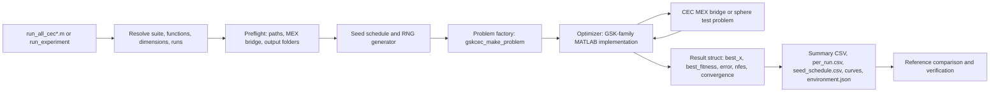

# Researcher handbook

> **What this is:** a single-document tour of the `gsk_family` project as a
> research package -- the optimization problem, how each of the seven GSK-family
> optimizers works, how experiments are made reproducible, and where the system
> can be safely extended. **For:** a new graduate student meeting GSK, a
> practitioner running CEC experiments reproducibly, and a developer extending
> the MATLAB or C++ implementation without breaking benchmark compatibility.
> **Prerequisites:** basic bounded-minimization background; no prior GSK
> knowledge assumed. **After reading:** you will understand the runner/optimizer/
> problem-factory split, the unified and reference seed policies, each
> optimizer's distinctive mechanism, and the safe vs. unsafe places to modify.

This handbook explains the current `gsk_family` project as a research package:
what problem it solves, how each algorithm works, how experiments are made
reproducible, and where a researcher can safely modify the system.

For exact command sequences, see [Command Reference](../getting-started/command_reference.md). For the MATLAB
function contract, see [matlab_interface.md](../reference/matlab_interface.md). For the seed
rules, see [seed_policy.md](../reference/seed_policy.md).

## 1. Optimization problem and notation

All optimizers in this project solve a bounded minimization problem:

```text
minimize    f(x)
subject to  lb_j <= x_j <= ub_j,  j = 1..D
```

Definitions:

| Symbol | Meaning |
|---|---|
| `x` | One candidate solution, stored as a row vector of length `D`. |
| `D` | Problem dimension, the number of decision variables. |
| `NP` | Population size, the number of candidate rows evolved together. |
| `P` | Population matrix, size `NP x D`; row `i` is candidate `x_i`. |
| `f(x_i)` | Objective value of candidate `i`; lower is better. |
| `nfes` | Number of function evaluations consumed. |
| `max_nfes` | Evaluation budget. A run may not perform more search updates than this budget allows, though some reference algorithms evaluate a full final generation before clipping accounting. |
| `lb`, `ub` | Lower and upper bounds, each `1 x D`. |
| `optimum` | Known benchmark optimum. If unknown, it is `NaN` and reported errors are also `NaN`. |

CEC suites are expensive enough that the project treats every objective call as
a first-class resource. This is why result files record `nfes`, why stopping
criteria are documented per algorithm, and why the C++ MEX bridge is required
before CEC runs start.

## 2. System workflow

The normal path from command to result is:



Why this separation exists:

- **Runners** own reproducibility, file layout, seed schedules, resume behavior,
  and result schemas. This keeps algorithm code focused on search logic.
- **Optimizers** own population updates, parameter adaptation, local search, and
  termination semantics. They do not decide where results are written.
- **Problem factories** own benchmark integration. Optimizers call
  `problem.evaluate(pop)` and do not need to know whether the backend is CEC2017,
  CEC2011, CEC2020, or the pure MATLAB sphere smoke problem.
- **C++ CEC tools** own suite ports, reference-table loading, CLI validation,
  and the MEX bridge used by MATLAB.

## 3. Reproducibility model

The project supports reference-compatible runs and new fair-comparison runs.
The default root `run_all_cec*.m` launchers use the unified policy for fair
cross-family experiments.

Unified seed formula:

```text
seed = mod(base_seed + 1000003*dim + 1000033*func + 1000037*run, 2147483646) + 1
```

Default:

```text
base_seed = 20240620
```

Important design rule: the seed depends only on `(base_seed, dim, func, run)`.
It does not include the algorithm name, algorithm index, population size, or
budget. Therefore every optimizer receives the same seed for the same CEC cell.

Worked seed example:

```text
base_seed = 20240620
dim       = 30
func      = 7
run       = 12

raw = 20240620 + 1000003*30 + 1000033*7 + 1000037*12
    = 69241385

seed = mod(raw, 2147483646) + 1
     = 69241386
```

In unified mode the runner also draws the initial population once and passes it
to every optimizer:

```matlab
seed = get_cec_seed(base_seed, dim, func, run);
rng(seed, generator);
X0 = initialization(NP, dim, lb, ub);
rng_state_after_initialization = rng;

for alg = 1:num_algorithms
    rng(rng_state_after_initialization);
    result = run_algorithm(alg, problem, X0, seed);
end
```

This is stricter than simply giving every algorithm the same seed, because two
algorithms may consume different numbers of random values during initialization.
By externalizing `X0`, the first population and the next random-number position
are both controlled.

**DT-GSK exception (unified-only).** DT-GSK's reference campaigns were produced
on this unified schedule, so `run_experiment` gives DT-GSK
`get_cec_seed(base_seed, dim, func, run)` and `threefry` under **every**
`seed_policy` (`is_unified_only` in `run_experiment.m`, mirroring the reference
implementation's `UNIFIED_ONLY_OPTIMIZERS`). It does not take the shared `X0`: it
derives named Threefry substreams from the run seed, samples its own
`NP = 5*D` initial population, and ignores a supplied
`options.initial_population`; the runner draws no `X0` for it and records
`initial_population_policy = optimizer self-initializes NP = 5*D ...`. In a
unified campaign DT-GSK therefore shares the seeds of the other six but not
their initial population.

## 4. Initialization example

Uniform initialization maps a random matrix `U` in `[0,1]` into the bounds:

```text
X0 = lb + U .* (ub - lb)
```

Example with `NP = 3`, `D = 2`, `lb = [-5, -5]`, `ub = [5, 5]`:

| Candidate | `U` row | Calculation | `X0` |
|---|---:|---|---:|
| 1 | `[0.10, 0.70]` | `[-5,-5] + [0.10,0.70]*10` | `[-4, 2]` |
| 2 | `[0.40, 0.20]` | `[-5,-5] + [0.40,0.20]*10` | `[-1, -3]` |
| 3 | `[0.90, 0.55]` | `[-5,-5] + [0.90,0.55]*10` | `[4, 0.5]` |

Why it matters: a population-based optimizer is highly sensitive to its first
population. For fair comparisons, all algorithms should be judged from the same
starting points, not from independently sampled populations.

## 5. Core GSK mechanism

GSK uses two update ideas:

- **Junior learning:** an individual learns from neighbors in the sorted fitness
  ranking. This emphasizes local rank information and exploration.
- **Senior learning:** an individual learns from best, middle, and worst rank
  groups. This emphasizes global ranking structure and exploitation.

For an individual `x_i`, one junior branch is:

```text
x_junior = x_i + KF * (x_Rg1 - x_Rg2 + x_Rg3 - x_i)
```

Definitions:

| Variable | Meaning |
|---|---|
| `KF` | Knowledge factor, a step-size multiplier. |
| `Rg1`, `Rg2` | Neighbor-style junior donor indices. |
| `Rg3` | Additional junior donor index. |
| `x_junior` | Candidate vector proposed by the junior phase. |

Worked junior update:

```text
x_i   = [ 2, -1]
x_Rg1 = [ 1, -2]
x_Rg2 = [ 4,  0]
x_Rg3 = [ 0,  3]
KF    = 0.5

direction = x_Rg1 - x_Rg2 + x_Rg3 - x_i
          = [1-4+0-2, -2-0+3-(-1)]
          = [-5, 2]

x_junior = [2, -1] + 0.5 * [-5, 2]
         = [-0.5, 0]
```

Interpretation: the candidate moves away from weaker or less useful directions
and toward donor information. `KF` controls how bold the move is. Large `KF`
improves exploration but may violate bounds or overshoot; small `KF` is safer
but can stagnate.

## 6. Boundary handling example

All GSK-family variants use midpoint-style repair for violated coordinates:

```text
if trial_j < lb_j: trial_j = (parent_j + lb_j) / 2
if trial_j > ub_j: trial_j = (parent_j + ub_j) / 2
```

Example:

```text
parent_j = 2
trial_j  = 8
ub_j     = 5

repaired = (2 + 5) / 2 = 3.5
```

Why midpoint repair is used: it preserves a relationship to the parent rather
than clipping every violation to the exact boundary. This can reduce boundary
crowding and preserve some directionality from the proposed move.

Limitation: midpoint repair is not neutral. If many trials violate a bound, the
population can be pulled toward boundary-adjacent midpoints. This is reference
behavior and must not be changed when reproducing published results.

## 7. Algorithm comparison at a glance

| Optimizer | Main idea | What adapts | Local search | Notes |
|---|---|---|---|---|
| GSK | Baseline gaining-sharing knowledge | Nothing; fixed `KF`, `KR`, `K`, `P` | No | Best for studying the core mechanism. |
| AGSK | Adaptive GSK | Parameter pool probabilities and population size | No | Uses reward from recent improvements. |
| APGSK | Adaptive-parameter GSK | AGSK machinery plus negative `KF` pool and stochastic junior schedule | No | Can take contracting moves late in the run. |
| ATMALS-GSK | Adaptive memory and local search | `KF`, `KR`, `K`, `P`, `PLS` probability pools | Yes, perturb around best | Uses growing reward memory and roulette selection. |
| eGSK | Enhanced GSK | Late-stage `KF1`, `KF2` fuzzy factors | Yes, `fmincon` SQP IP stage | Requires Optimization Toolbox for reference mode. |
| FDB-AGSK | AGSK with fitness-distance balance | AGSK pool probabilities and population size | No | Injects diversity-aware FDB donors. |
| DT-GSK | Dimension-tiered GSK (`pub` profile) | `(KF, KR, Kexp)` pool probabilities (ACE), population size (NLPSR from `5*D`), learned linkage for `D >= 50` | Yes, coordinate search on elites; compass polish for `D >= 50` | Mechanisms switched on by tier (`D < 20`, `20 <= D < 50`, `D >= 50`, `D >= 100`); escapes and restarts. |

## 8. AGSK reward computation example

AGSK has four parameter slots:

```text
KF_pool = [0.1, 1.0, 0.5, 1.0]
KR_pool = [0.2, 0.1, 0.9, 0.9]
```

Each individual chooses one slot. After offspring evaluation, the algorithm
credits slots that produced strict improvements. Suppose six individuals used
the following slots:

| Individual | Slot | Parent fitness | Child fitness | Improvement |
|---:|---:|---:|---:|---:|
| 1 | 1 | 40 | 35 | 5 |
| 2 | 1 | 20 | 18 | 2 |
| 3 | 2 | 50 | 51 | 0 |
| 4 | 3 | 25 | 20 | 5 |
| 5 | 3 | 10 | 10 | 0 |
| 6 | 4 | 30 | 27 | 3 |

Raw credit per slot:

```text
slot 1 = 5 + 2 = 7
slot 2 = 0
slot 3 = 5
slot 4 = 3
sum    = 15
```

Normalized:

```text
All_Imp = [7/15, 0, 5/15, 3/15]
        = [0.4667, 0, 0.3333, 0.2000]
```

The reference rule floors every slot but the largest at `0.05`; the largest slot
then takes the remaining probability so the vector still sums to 1. Here only
slot 2 (`0`) is below the floor, so it rises to `0.05` while slots 3 and 4 are
already above it; the largest (slot 1) absorbs the change:

```text
All_Imp = [0.4167, 0.0500, 0.3333, 0.2000]
```

The next adaptive probability is:

```text
KW_ind_next = 0.95 * KW_ind_old + 0.05 * All_Imp
```

Interpretation: a single successful generation nudges the slot probabilities,
but the update is conservative. This stabilizes adaptation and prevents the
algorithm from overreacting to one lucky generation.

## 9. APGSK negative-KF example

APGSK can use a negative secondary `KF` pool late in the run:

```text
kf_pool_negative = [-0.15, -0.05, -0.05, -0.15]
```

If the ordinary direction is:

```text
direction = [4, -2]
KF        = -0.15
x_i       = [1, 1]
```

then:

```text
x_trial = x_i + KF * direction
        = [1, 1] + (-0.15) * [4, -2]
        = [0.4, 1.3]
```

The negative sign reverses the proposed direction. This can be useful when
ordinary positive steps keep pushing candidates into an already exploited region.
It can also slow progress if used too early or too often, which is why the
reference only allows the positive/negative choice in the adaptive stage and
after budget progress conditions are met.

## 10. ATMALS-GSK probability-memory example

ATMALS-GSK stores a history matrix for each parameter pool. Each generation, the
selected value receives a Gaussian membership reward or penalty. The implemented
Gaussian membership is:

```text
mu(x; sigma, c) = exp(-(x - c)^2 / (2*sigma^2))
```

where:

| Symbol | Meaning |
|---|---|
| `x` | A candidate pool value. |
| `sigma` | Width of the Gaussian bump. |
| `c` | Center used by the reference code; in this port it remains the pool index, not the value. |

If `Mean_Fit_New < Mean_Fit`, the chosen region is rewarded:

```text
new_history_row = mu * exp(-(Mean_Fit_New - Mean_Fit) / abs(Mean_Fit))
```

Example:

```text
Mean_Fit     = 100
Mean_Fit_New = 90
relative gain factor = exp(-(-10)/100) = exp(0.1) = 1.1052
```

A value near the selected Gaussian center receives approximately `1.1052`, while
far values receive less according to `mu`. If the new mean is worse, the reference
penalty uses `(1 - mu) * 0.1 * exp(...)`.

Why it matters: ATMALS does not simply remember the last best parameter. It keeps
a weighted history, then roulette-selects future parameter values from the
probability vector. This is slower than fixed parameters but can adapt to
different phases of the search.

## 11. eGSK late-stage refinement example

eGSK has two factors:

```text
KF1 = junior knowledge factor
KF2 = senior knowledge factor
```

Early:

```text
KF1 = KF2 = 0.5
KR  = 1
```

Late in the run (`g >= 0.75*G_Max`), fuzzy membership updates the factors. A
triangular intuition is useful even though the implementation follows the
reference exactly:

```text
fitness anchors: a = 10, b = 20, c = 40
candidate fitness value = 25
```

The point lies between `b` and `c`, so the membership descends from its peak at
`b`. A high membership makes a larger factor more likely; a low or invalid
membership is clamped to zero by the reference rule.

Then the IP stage may call `fmincon` around the current best if the best error is
still above the target and the escape criterion is satisfied. This stage can
improve final accuracy, but it makes strict reproducibility depend on MATLAB and
Optimization Toolbox version.

## 12. FDB-AGSK diversity example

Fitness-Distance Balance combines quality and diversity. For three candidates:

| Candidate | Fitness | Manhattan distance to best | Normalized fitness | Normalized distance | FDB score |
|---:|---:|---:|---:|---:|---:|
| A | 10 | 0 | 1.00 | 0.00 | 1.00 |
| B | 14 | 5 | 0.50 | 1.00 | 1.50 |
| C | 18 | 2 | 0.00 | 0.40 | 0.40 |

Although A is the best by fitness, B receives the highest FDB score because it is
reasonably fit and far from the current best. Injecting B as a donor can help the
population avoid premature convergence.

Limitation: distance is not always useful in high-dimensional spaces; many
points can become similarly far apart. This is why FDB is a donor-selection
mechanism, not a guarantee of global exploration.

## 13. Evaluation budgets and termination

Budget rules are part of the algorithm definition:

| Optimizer | Early target stop? | Budget-crossing behavior |
|---|---|---|
| GSK | No | Evaluates full child generation and clips accounting. |
| AGSK | Yes, after generation/reduction checks | Evaluates full generation; accounting follows reference semantics. |
| APGSK | Yes | Same family as AGSK. |
| ATMALS-GSK | No | Runs to budget; local search is internal perturbation, not a separate solver. |
| eGSK | No | `fmincon` IP calls may push `nfes` slightly beyond `max_nfes`, matching reference behavior. |
| FDB-AGSK | No in current interface | Full-generation behavior follows the reference case files. |
| DT-GSK | No | Evaluates only the rows that still fit in the budget, so `nfes` ends exactly at `max_nfes`. |

Why this matters: changing a termination rule can change both result quality and
the random stream. A faster run is not necessarily a faithful run.

## 14. Archive and restart behavior

The six MATLAB-origin optimizers keep no evolutionary external archive like the
archive used in SHADE-family or CMA-ES restart methods. Diversity is handled by
rank partitions, adaptive parameter choices, FDB donor injection, and local
search, depending on the optimizer. DT-GSK is the exception: it keeps an elite
archive (members at a minimum normalized distance from each other) that seeds
part of its escape restarts, and adds a deep-stall full restart and, for
`D >= 100`, basin-novelty restarts (see `src/optimizers/dt-gsk/README.md`).

The project does have **experiment-level archival and resume**:

- Existing result folders are preserved.
- A run resumes by reusing completed per-run rows whose stored seed, budget
  (`max_nfes`) and generator match the active run.
- Fixed-name summaries and metadata are archived before refresh.
- Stale rows (another seed, budget or generator) are ignored rather than
  deleted; those run ids are re-run and appended.
- An `output_dir` inside `benchmarks/cec_reference_results` is refused on every
  run (`run_experiment:outputUnsafe`).
- If `overwrite=true`, the previous active output tree is moved under
  `_overwrite_archive/` first, then the replacement run starts from empty
  `summary/`, `curves/`, and `gen_logs/` folders.

This design protects long CEC campaigns. It also means that changing the seed
policy, base seed, budget, or generator intentionally starts a new logical
schedule inside the same output tree unless the user selects a new output
directory or enables `overwrite`.

## 15. File and module map

| Path | Purpose |
|---|---|
| `run_all_cec2011.m`, `run_all_cec2017.m`, `run_all_cec2013.m`, `run_all_cec2013lsgo.m`, `run_all_cec2020.m` | Human-friendly MATLAB launchers for suite-level experiment campaigns. |
| `gsk_family/src/runners/run_experiment.m` | Main MATLAB experiment engine: seeds, resume, execution, summary tables, curves, comparison output. |
| `gsk_family/src/runners/get_cec_seed.m` | Unified deterministic seed formula. |
| `gsk_family/src/runners/verify_unified_seed_schedule.m` | Post-run audit that optimizers share the same seed on every `(D,F,run)` key present in two or more schedules; missing keys are warnings. |
| `gsk_family/src/runners/gskcec_make_problem.m` | Creates the MATLAB `problem` struct around the C++ MEX benchmark handle. |
| `gsk_family/src/common/*.m` | Shared GSK helpers: initialization, bound repair, donor selection, RNG setup, population reduction. |
| `gsk_family/src/optimizers/*/*_optimize.m` | Algorithm implementations. Each accepts `(problem, options)` and returns `result`. |
| `gsk_family/benchmarks/cec_suite_cpp/cec_tools/` | C++ benchmark framework, CLIs, MEX source, reference comparison code, and C++ tests. |
| `gsk_family/benchmarks/cec_reference_results/` | Imported reference evidence: published aggregate tables plus curated benchmark-side `curves/`, `curves/graphs/`, and `gen_logs/` convergence assets. These are read-only evidence, not live run output. |
| `gsk_family/configs/*.yml` | C++ CLI batch configurations. MATLAB root launchers use direct arguments instead. |
| `gsk_family/scripts/build_mex_bridge.ps1` | Builds the MATLAB MEX bridge. |
| `gsk_family/scripts/build_docs.ps1` | Generates the HTML site under `docs/html`. |
| `gsk_family/scripts/analyze_results.m` | Toolbox-free statistical analysis and figures over generated results. |
| `gsk_family/scripts/compare_reference_runs.m` | Per-`(dimension, function)` comparison of two `per_run.csv` sets (Wilcoxon rank-sum, Holm-adjusted; Statistics and Machine Learning Toolbox), e.g. a DT-GSK campaign against the imported CEC2017 evidence. |

## 16. Extension guidance

Safe extension points:

- Add a new optimizer under `src/optimizers/<slug>/`.
- Implement `result = <name>_optimize(problem, options)`.
- Reuse `gsk_set_rng`, `gsk_initial_population_from_options`,
  `gsk_bound_repair`, and `gsk_reduction_survivors` when the behavior matches.
- Add an algorithm page under `docs/algorithms/`.
- Add smoke tests under `src/tests/`.
- Update `run_experiment.m` only when the runner needs to know the new optimizer
  name, options metadata, or reference table mapping.
- For a reference that is not a MATLAB release, follow the DT-GSK pattern:
  verify the port against the unmodified reference code on identical random
  numbers before trusting campaign statistics (see the
  [Extension Guide](../development/extension_guide.md#port-from-a-non-matlab-reference)).

Unsafe changes without a reference audit:

- changing donor draw order;
- changing `rand` call counts;
- replacing midpoint repair with clipping;
- changing target-error zeroing from strict `<` to `<=`;
- changing evaluation budget crossing behavior;
- changing CEC2017 F2 exclusion in default publication comparisons;
- deleting or overwriting existing `results/` trees.

## 17. Common pitfalls

| Symptom | Likely cause | What to check |
|---|---|---|
| Results differ from a published table | Seed policy, RNG generator, population size, missing eGSK `fmincon`, or suite protocol mismatch | `environment.json`, `seed_schedule.csv`, algorithm page, [Benchmark Protocol](../reference/benchmark_protocol.md) |
| `run_all_cec2017` prints many `RESUME` lines | Cells are already complete and current-seed rows are being reused | This is expected; use a new output directory for a fresh campaign. |
| CEC run fails before starting | MEX bridge missing or locked during rebuild | Run `build.txt` commands and close MATLAB before rebuilding the MEX. |
| eGSK fails with `fminconUnavailable` | Optimization Toolbox unavailable | Install/enable toolbox or run explicit non-reference diagnostics with `use_fmincon=false`. |
| FDB-AGSK case 2 errors on flat fitness | Reference degenerate behavior for empty FDB ranking | Use non-degenerate problems or another case for diagnostics. |
| DT-GSK seeds ignore `seed_policy`; its first population differs from the shared `X0` | Expected: DT-GSK is unified-only and self-initializes (section 3) | `initial_population_policy` in `run_config.json`; nothing to fix. |
| A DT-GSK campaign is not bit-identical to the reference implementation's runs | MATLAB's Threefry doubles differ from the reference implementation's by at most `2^-53` per uniform draw, so trajectories separate after a last-bit difference flips a discrete decision | Compare statistically with `scripts/compare_reference_runs.m`. |
| Tiny `Delta(New-Old)` signs appear confusing | Absolute differences below `1e-8` are considered zero in the MATLAB comparison table | See `src/runners/README.md`. |

## 18. Research usage checklist

Before reporting results:

1. Record commit hash or file snapshot.
2. Record MATLAB version and installed toolboxes.
3. Record compiler, CMake version, and MEX build command.
4. Record suite, function list, dimensions, runs, population settings, and
   budget.
5. Record `seed_policy`, `base_seed`, and `rand_generator`.
6. Preserve `environment.json`, `seed_schedule.csv`, `per_run.csv`, and summary
   CSVs.
7. Run smoke tests and C++ tests after source changes.
8. Verify unified seed schedules when comparing multiple optimizers, and state
   that DT-GSK shares the seeds but not the runner's initial population.
9. State whether CEC2017 F2 was excluded.
10. State whether eGSK used `fmincon` and which Optimization Toolbox version was
    installed.
11. Report every setting that differs from an optimizer's published one
    (population sizes, parameters, `algorithms.ini` aliases): the
    `settings_<suite>.tex` table of `compare_algorithms` lists them, and each
    tree's `environment.json` records `base_optimizer` and `alias_settings`.
12. Report the statistics a reviewer expects for a multi-algorithm claim:
    Friedman (with Iman-Davenport), the post-hoc test against the proposed
    algorithm with a multiple-test correction (Holm or Finner,
    `posthoc_<suite>.csv`), the CD diagram, and effect sizes next to the
    per-function signs. Say whether the signs use raw or Holm-adjusted
    p-values, and include the CEC complexity table (`cec_complexity`) for
    CEC2017.

## 19. Literature and provenance

The implementations are tied to the reference releases named in each optimizer
header and algorithm page: historical MATLAB releases for six optimizers, and
the DT-GSK reference implementation v2.46 (MIT license,
<https://github.com/MostafaMassoud/DT-GSK>) for DT-GSK. The project uses those
files as the primary provenance source because exact reproduction often depends
on small code details that are not fully specified in papers.

Research lineage:

- GSK: baseline Gaining-Sharing Knowledge optimizer and its junior/senior
  learning phases.
- AGSK/APGSK: adaptive parameter-control variants using success-based parameter
  pools and population reduction.
- ATMALS-GSK: memory-based adaptive parameter selection with local search.
- eGSK: enhanced GSK with late-stage fuzzy factor adaptation and SQP refinement;
  see the DOI linked in [egsk.md](../algorithms/egsk.md).
- FDB-AGSK: AGSK combined with Fitness-Distance Balance donor selection.
- DT-GSK: Masoud, M. E. A.; Roshdy, H. S. M.; Mohamed, A. W. "DT-GSK:
  Dimension-Tiered Adaptive Configuration Selection and Deterministic
  Refinement for Gaining-Sharing Knowledge-Based Optimization Algorithm."
  *Algorithms* (MDPI), 2026 (accepted, in production; DOI pending). A
  line-by-line MATLAB port was verified against the unmodified reference implementation on
  identical random numbers in all four dimension tiers and reproduces the
  reference's golden values to `1e-13`; the compact three-file version shipped
  here reproduces that port bit for bit. The full record, including the CEC2017
  campaign against the imported reference results, is kept in
  [src/optimizers/dt-gsk/README.md](../../src/optimizers/dt-gsk/README.md).
- CEC benchmark suites: CEC2011 real-world problems, CEC2013, CEC2013 large-scale
  global optimization, CEC2017, and CEC2020.

When paper text and executable reference code disagree, this project preserves
the executable reference behavior unless the discrepancy is explicitly marked as
a framework-level extension or a verified bug fix.
